### squat__r00 학습·평가 완료
e000~e002로 학습하고 e003은 미학습 형상으로 평가했습니다.

| 형상 | 생존 | 관절 RMS (°) | 발 오차 (cm) | 자세 오차 (°) | 종료 위치 오차 (cm) | 접지 일치 | 종합 |
| --- | --- | ---: | ---: | ---: | ---: | ---: | --- |
| e000 | 예 | 2.01 | 1.14 | 1.24 | 3.82 | 99.6% | 통과 |
| e001 | 예 | 1.87 | 1.29 | 1.74 | 0.94 | 99.8% | 통과 |
| e002 | 예 | 2.48 | 2.07 | 3.13 | 4.81 | 97.9% | 통과 |
| e003 | 예 | 14.73 | 6.00 | 3.86 | 5.91 | 98.1% | 불합격 |

오차는 낮을수록, 접지 일치는 높을수록 좋습니다. e003은 학습에 사용하지 않은 형상입니다.

#### 형상별 평가 오차 (x축: 형상, y축: 오차)

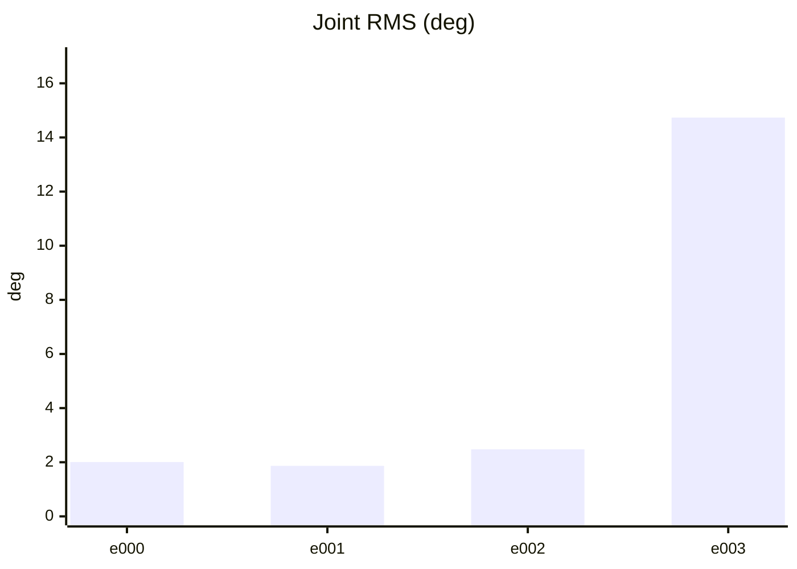

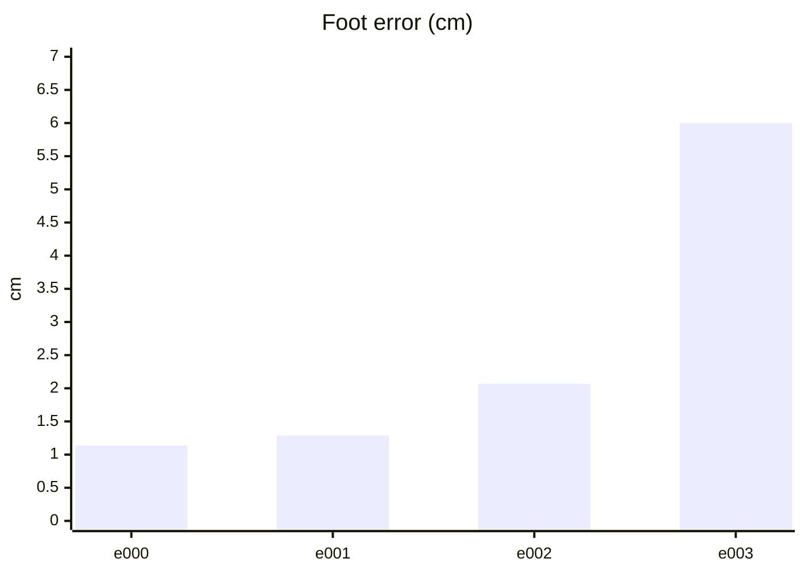

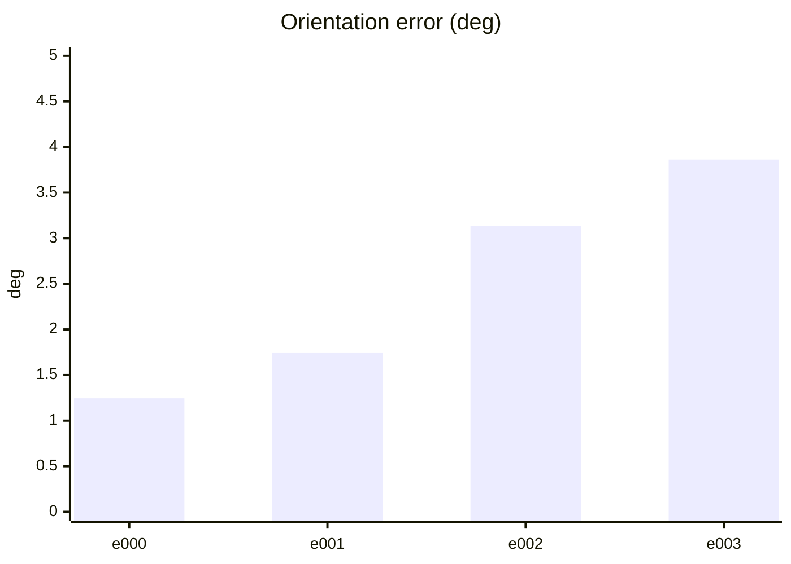

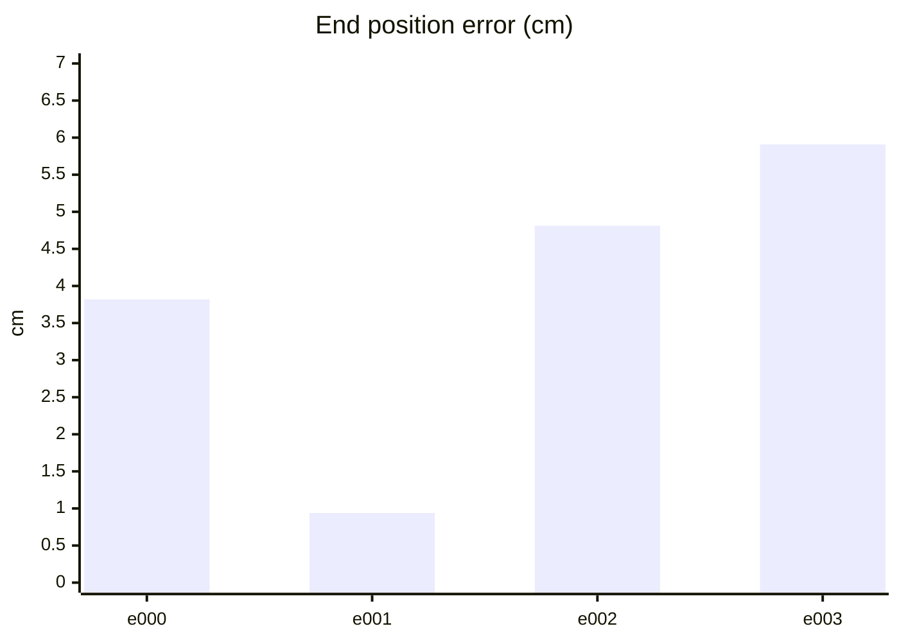

#### PPO 학습 지표 (첫 기록 → 마지막 기록)
| 지표 | 변화 | 간단한 해석 |
| --- | ---: | --- |
| Policy Loss | -0.0126 → -0.0236 | 단독으로 좋고 나쁨을 판정하지 않습니다. NaN·급변 여부를 봅니다. |
| Value Loss | 0.0267 → 0.0805 | 지속적으로 폭증하지 않고 안정적이면 좋습니다. |
| Approximate KL | 0.185 → 24.7 | 급증하면 정책 변화가 과격할 수 있습니다. 1 이상이면 점검이 필요합니다. |
| Clip Fraction | 미기록 | 과도한 clipping 여부를 볼 지표지만 현재 코드가 기록하지 않습니다. |
| Entropy 관련 손실 | -0.163 → -0.1 | 원래 Entropy는 미기록입니다. 손실값만으로 성능을 판정하지 않습니다. |
| Gradient Norm | 미기록 | 실제 기울기 크기는 미기록입니다. |
| Explained Variance | 미기록 | 1에 가까울수록 예측력이 좋지만 현재 미기록입니다. |
| Episode Length | 252 → 205 | 길이만으로는 부족합니다. 클립 완료율과 함께 봅니다. |
| 조기 종료율 (낙상) | 0% → 0% | 낮을수록 좋습니다. 전체 조기 종료율은 미기록입니다. |
| 클립 완료율 | 100% → 100% | 높을수록 좋습니다. |

학습 손실보다 아래 평가 CSV의 생존·오차·`pass_all`과 영상을 우선 확인하세요.

#### PPO 지표 추이 (x축: 학습 스텝, y축: 지표 값)

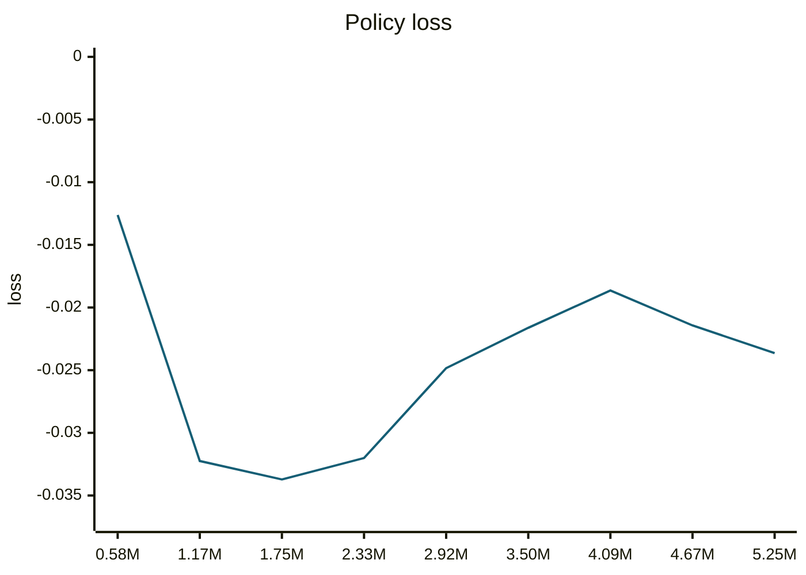

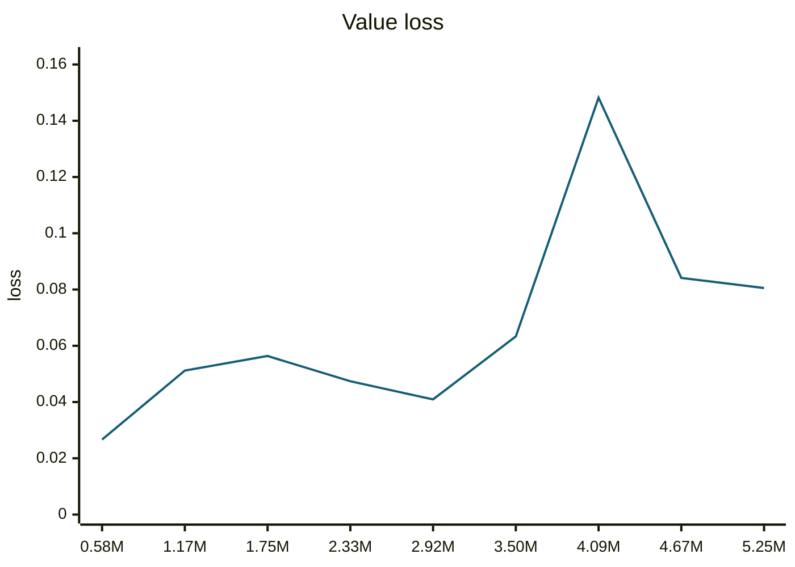

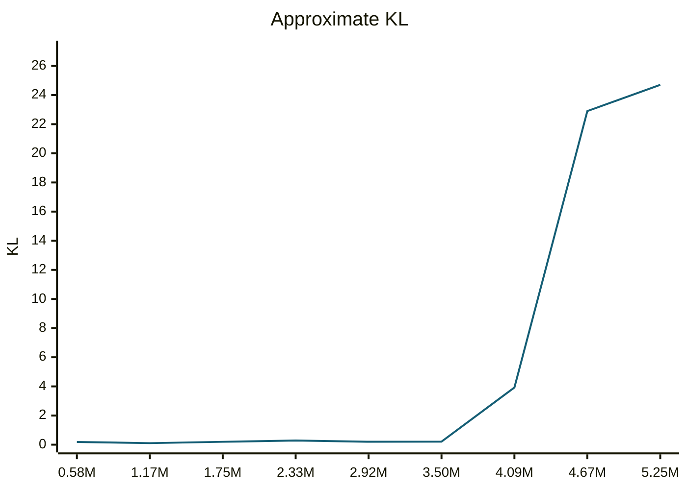

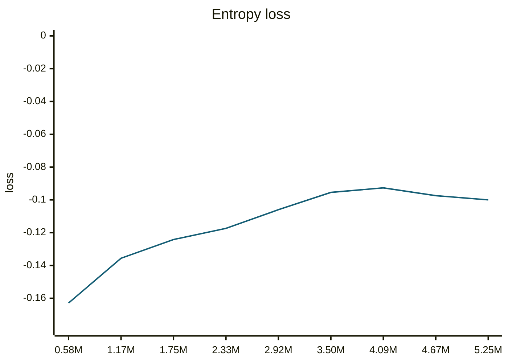

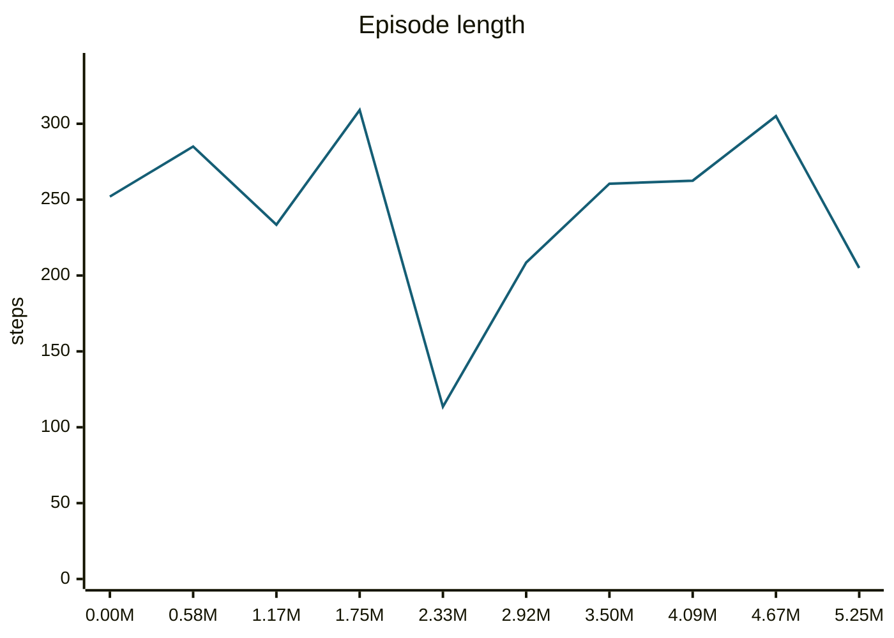

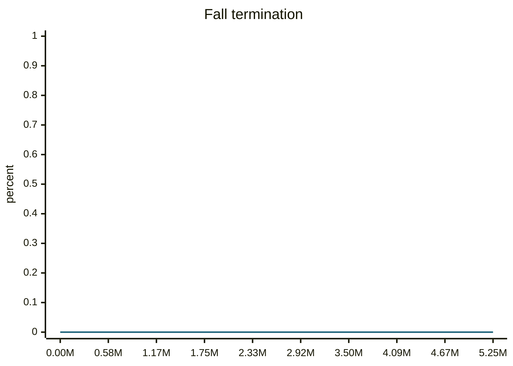

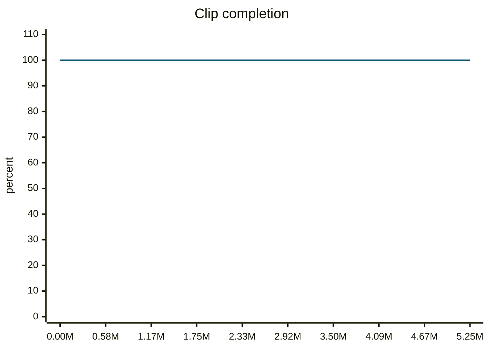

#### motion_eval/summary.csv — `runs/pipeline_v1/experts/squat__r00/wandb/offline-run-20261015_161005-x8gaqt5h/motion_eval/summary.csv`
```csv
design,motion,frames,evaluated_frames,survived,joint_rms_deg,foot_err_cm,orn_err_deg,end_pos_err_cm,end_pos_tol_cm,travel_m,contact_agree,ref_infeasible,pass_joint,pass_foot,pass_orn,pass_end_pos,pass_contact,pass_all
e000,squat__r00,253,252,1,2.0060267448425293,1.1373043060302734,1.2447157049700381,3.8184035569429398,5.0,0.011531967669725418,0.996031746031746,0.0,1,1,1,1,1,1
e001,squat__r00,253,252,1,1.8663753271102905,1.2867968082427979,1.7410844696477108,0.9387025609612465,5.0,0.013571538962423801,0.998015873015873,0.0,1,1,1,1,1,1
e002,squat__r00,253,252,1,2.4790761470794678,2.069161891937256,3.1327909548580877,4.812973365187645,5.0,0.01390678621828556,0.9791666666666666,0.0,1,1,1,1,1,1
e003,squat__r00,253,252,1,14.73387336730957,6.000029563903809,3.863014254039216,5.908549204468727,5.0,0.009109597653150558,0.9811507936507936,0.0,0,0,1,0,1,0
```
