### tiltRoll__r00 학습·평가 완료
e000~e002로 학습하고 e003은 미학습 형상으로 평가했습니다.

| 형상 | 생존 | 관절 RMS (°) | 발 오차 (cm) | 자세 오차 (°) | 종료 위치 오차 (cm) | 접지 일치 | 종합 |
| --- | --- | ---: | ---: | ---: | ---: | ---: | --- |
| e000 | 예 | 3.97 | 2.40 | 4.49 | 1.99 | 91.3% | 통과 |
| e001 | 예 | 2.87 | 2.26 | 3.72 | 2.99 | 99.7% | 통과 |
| e002 | 예 | 4.59 | 3.41 | 4.86 | 3.46 | 90.1% | 불합격 |
| e003 | 예 | 15.23 | 7.16 | 7.20 | 10.43 | 81.3% | 불합격 |

오차는 낮을수록, 접지 일치는 높을수록 좋습니다. e003은 학습에 사용하지 않은 형상입니다.

#### 형상별 평가 오차 (x축: 형상, y축: 오차)

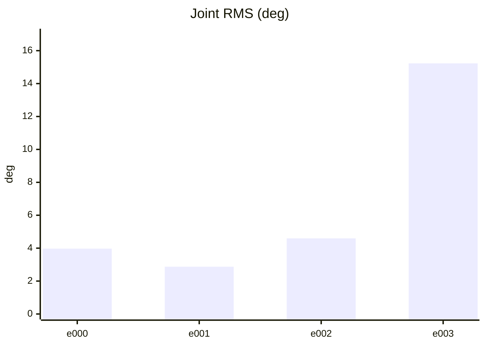

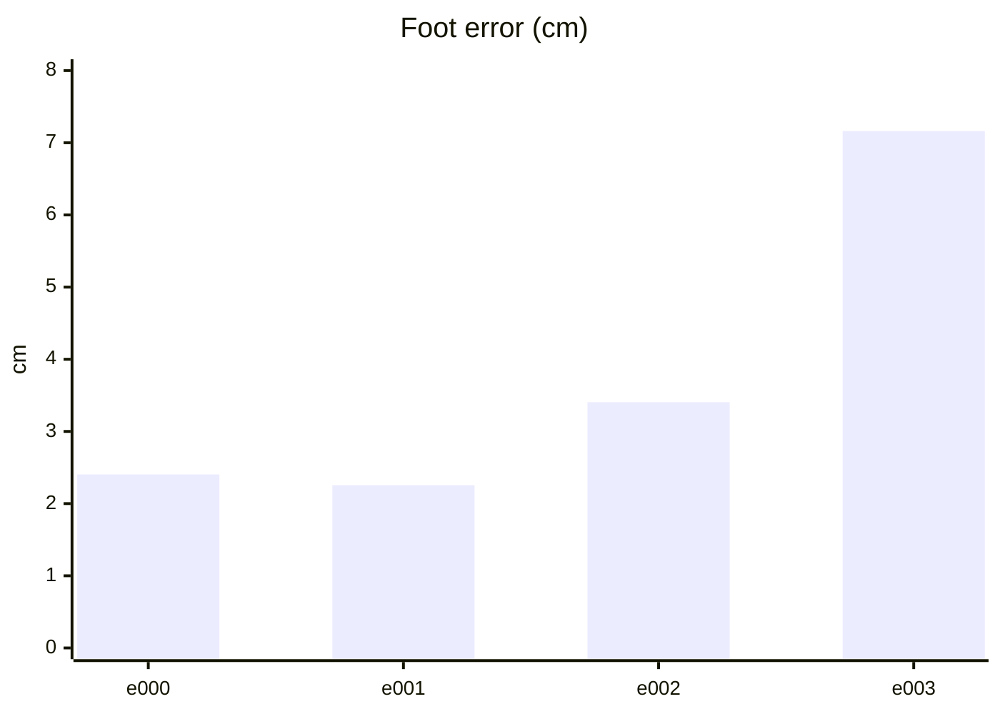

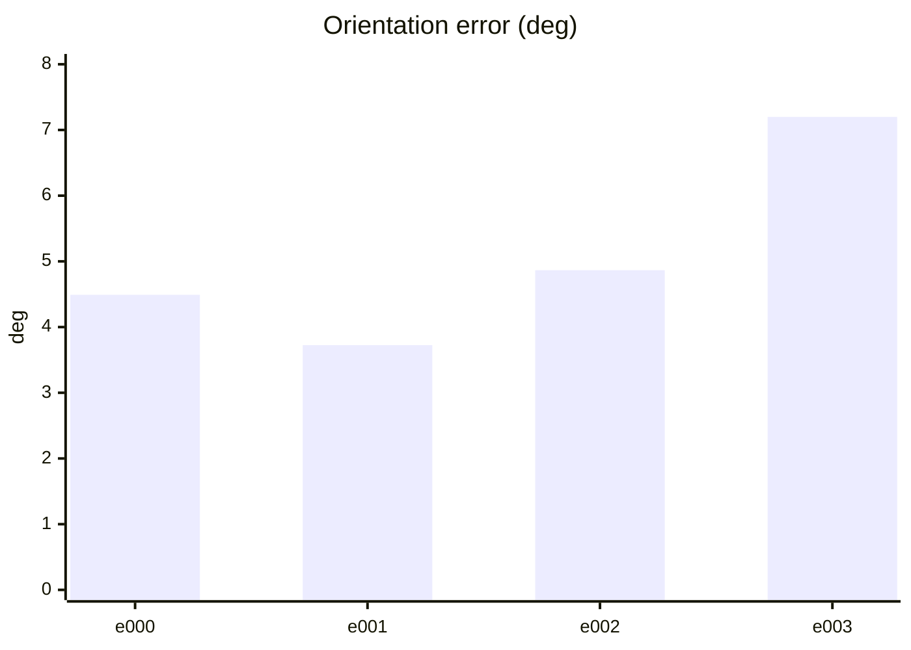

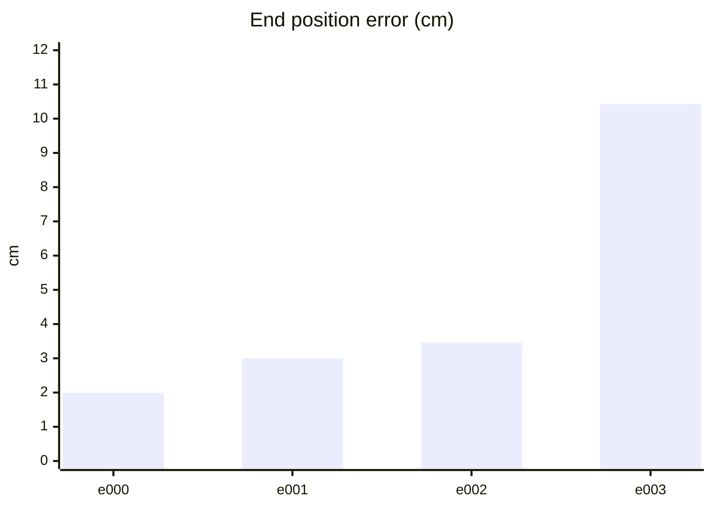

#### PPO 학습 지표 (첫 기록 → 마지막 기록)
| 지표 | 변화 | 간단한 해석 |
| --- | ---: | --- |
| Policy Loss | -0.0162 → -0.0325 | 단독으로 좋고 나쁨을 판정하지 않습니다. NaN·급변 여부를 봅니다. |
| Value Loss | 0.0289 → 0.0746 | 지속적으로 폭증하지 않고 안정적이면 좋습니다. |
| Approximate KL | 0.233 → 0.15 | 급증하면 정책 변화가 과격할 수 있습니다. 1 이상이면 점검이 필요합니다. |
| Clip Fraction | 미기록 | 과도한 clipping 여부를 볼 지표지만 현재 코드가 기록하지 않습니다. |
| Entropy 관련 손실 | -0.174 → -0.136 | 원래 Entropy는 미기록입니다. 손실값만으로 성능을 판정하지 않습니다. |
| Gradient Norm | 미기록 | 실제 기울기 크기는 미기록입니다. |
| Explained Variance | 미기록 | 1에 가까울수록 예측력이 좋지만 현재 미기록입니다. |
| Episode Length | 270 → 246 | 길이만으로는 부족합니다. 클립 완료율과 함께 봅니다. |
| 조기 종료율 (낙상) | 0% → 0% | 낮을수록 좋습니다. 전체 조기 종료율은 미기록입니다. |
| 클립 완료율 | 100% → 100% | 높을수록 좋습니다. |

학습 손실보다 아래 평가 CSV의 생존·오차·`pass_all`과 영상을 우선 확인하세요.

#### PPO 지표 추이 (x축: 학습 스텝, y축: 지표 값)

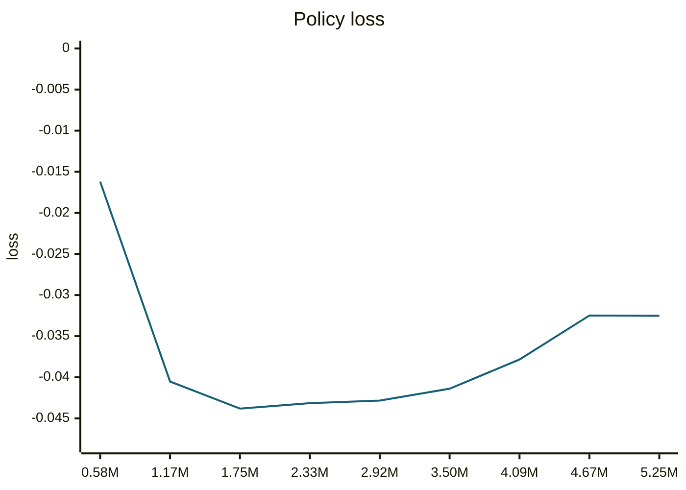

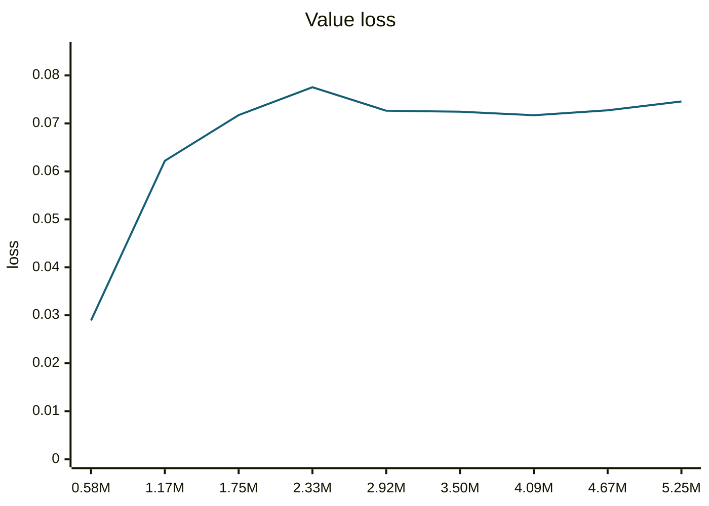

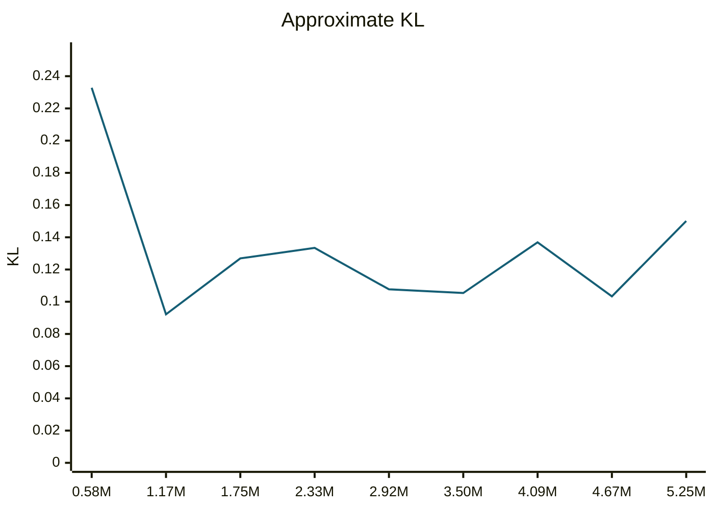

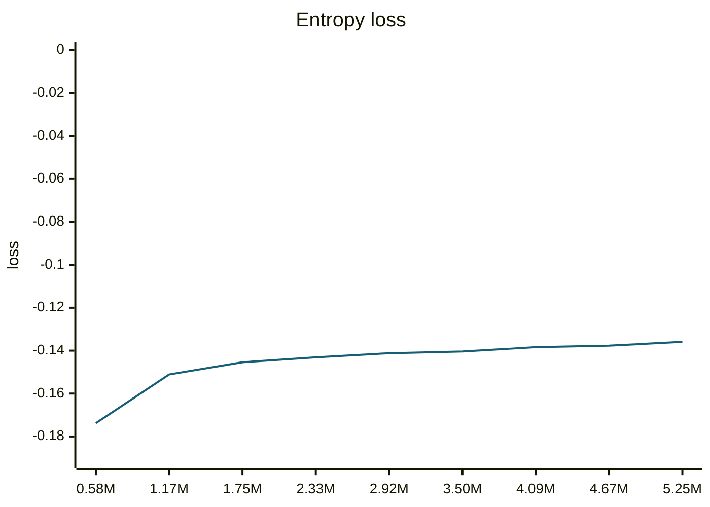

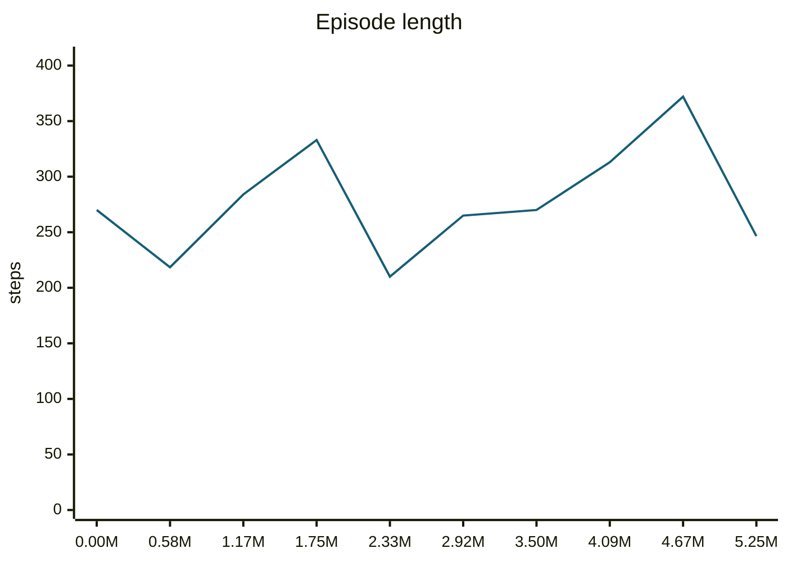

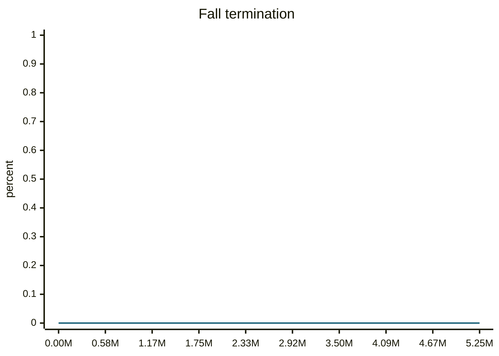

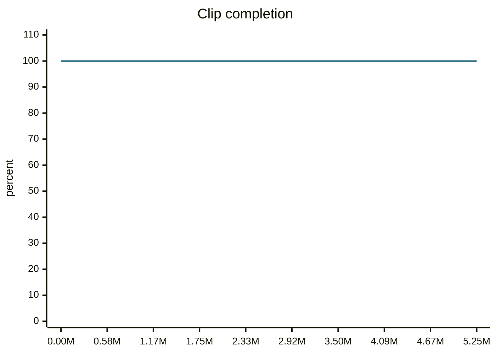

#### motion_eval/summary.csv — `runs/pipeline_v1/experts/tiltRoll__r00/wandb/offline-run-20261015_164720-jaikjuaw/motion_eval/summary.csv`
```csv
design,motion,frames,evaluated_frames,survived,joint_rms_deg,foot_err_cm,orn_err_deg,end_pos_err_cm,end_pos_tol_cm,travel_m,contact_agree,ref_infeasible,pass_joint,pass_foot,pass_orn,pass_end_pos,pass_contact,pass_all
e000,tiltRoll__r00,231,230,1,3.969769239425659,2.404224157333374,4.491015459833925,1.9917644560337067,5.0,0.011052844114601612,0.9130434782608695,0.0,1,1,1,1,1,1
e001,tiltRoll__r00,231,230,1,2.8741164207458496,2.2558085918426514,3.7246682361185126,2.9937690123915672,5.0,0.013334929011762142,0.9967391304347826,0.0,1,1,1,1,1,1
e002,tiltRoll__r00,231,230,1,4.592766284942627,3.4054815769195557,4.86479704085054,3.4578830003738403,5.0,0.013631261885166168,0.9010869565217391,0.0,1,0,1,1,1,0
e003,tiltRoll__r00,231,230,1,15.228323936462402,7.162679195404053,7.198536698694443,10.428165644407272,5.0,0.008931084536015987,0.8130434782608695,0.0,0,0,0,0,0,0
```
