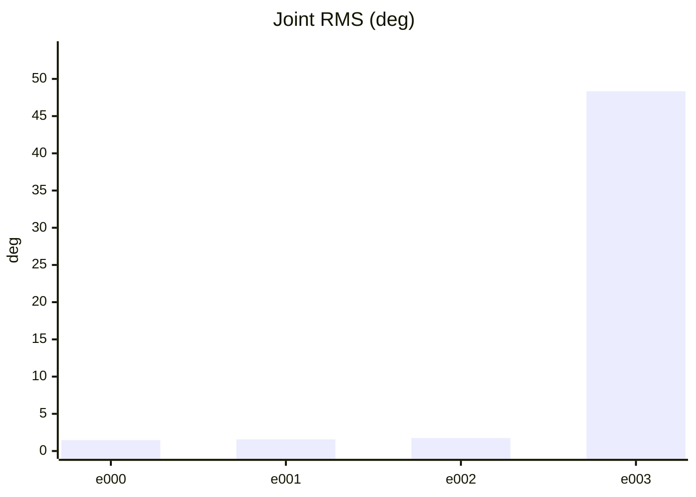
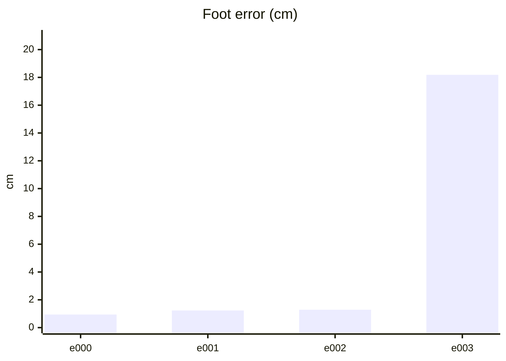
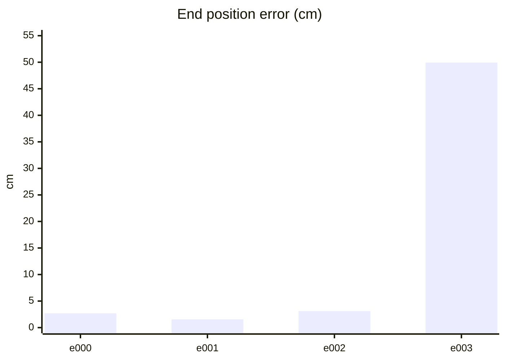
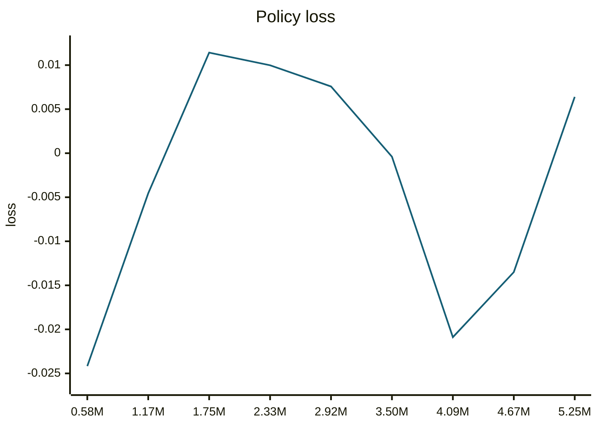
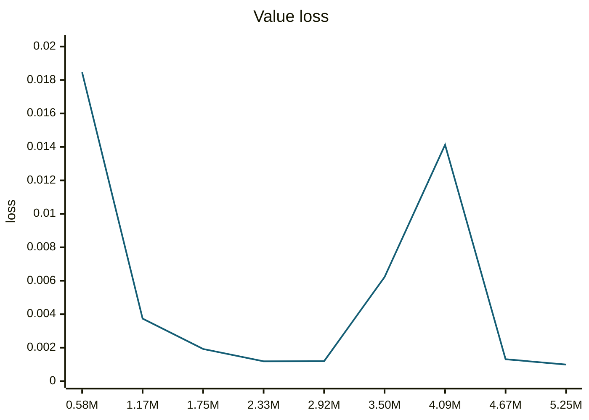
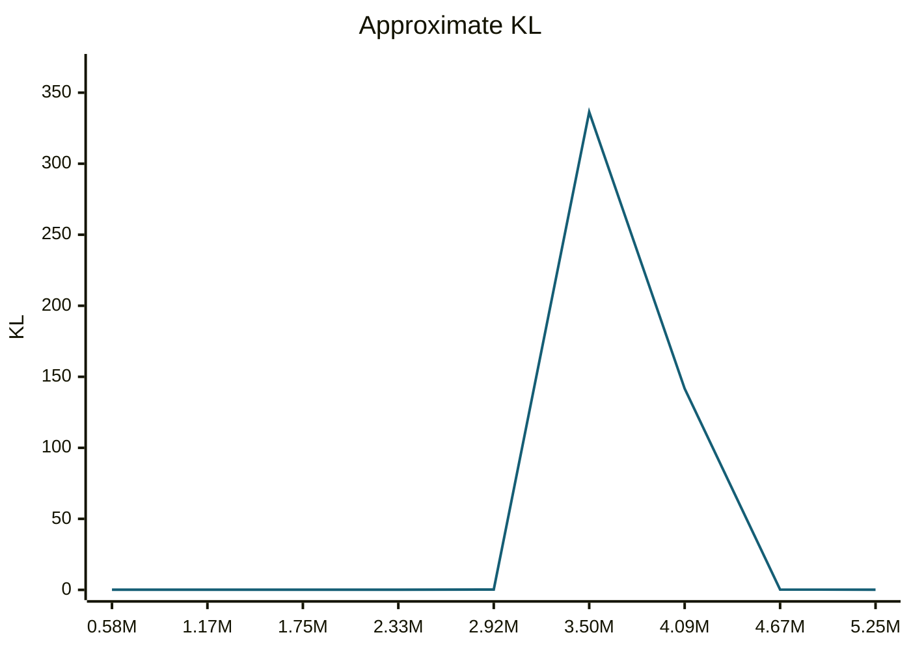
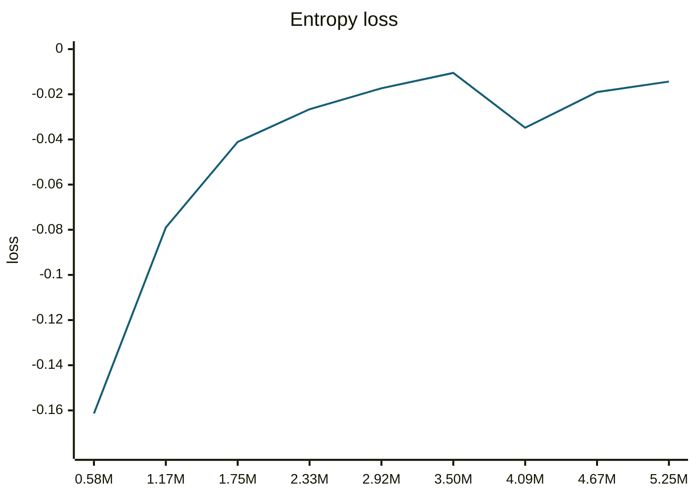
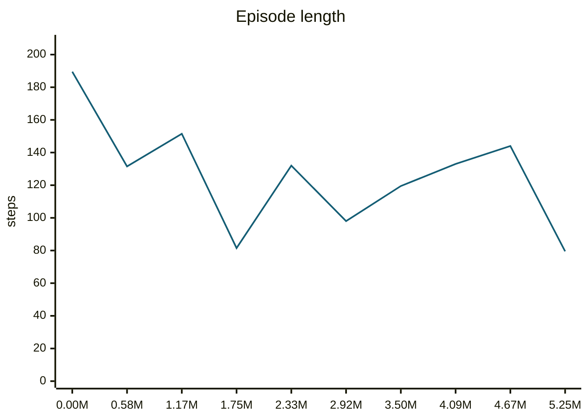
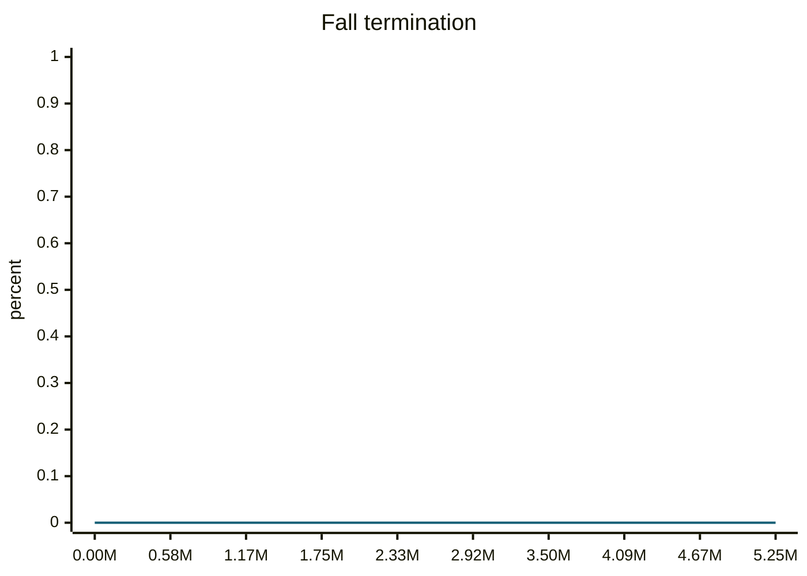
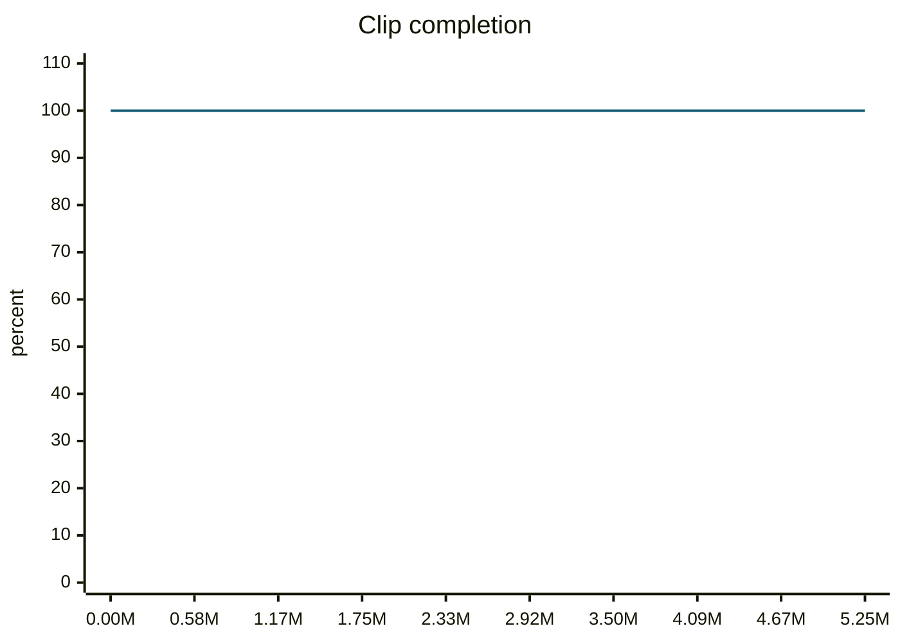

### trotBackwardFast__r00 학습·평가 완료
e000~e002로 학습하고 e003은 미학습 형상으로 평가했습니다.

| 형상 | 생존 | 관절 RMS (°) | 발 오차 (cm) | 자세 오차 (°) | 종료 위치 오차 (cm) | 접지 일치 | 종합 |
| --- | --- | ---: | ---: | ---: | ---: | ---: | --- |
| e000 | 예 | 1.47 | 0.94 | 0.92 | 2.69 | 99.3% | 통과 |
| e001 | 예 | 1.57 | 1.23 | 1.34 | 1.56 | 99.0% | 통과 |
| e002 | 예 | 1.75 | 1.28 | 1.16 | 3.12 | 99.3% | 통과 |
| e003 | 예 | 48.35 | 18.19 | 28.88 | 49.93 | 68.4% | 불합격 |

오차는 낮을수록, 접지 일치는 높을수록 좋습니다. e003은 학습에 사용하지 않은 형상입니다.

#### 형상별 평가 오차 (x축: 형상, y축: 오차)








#### PPO 학습 지표 (첫 기록 → 마지막 기록)
| 지표 | 변화 | 간단한 해석 |
| --- | ---: | --- |
| Policy Loss | -0.0242 → 0.0064 | 단독으로 좋고 나쁨을 판정하지 않습니다. NaN·급변 여부를 봅니다. |
| Value Loss | 0.0185 → 0.000993 | 지속적으로 폭증하지 않고 안정적이면 좋습니다. |
| Approximate KL | 0.149 → 0.145 | 급증하면 정책 변화가 과격할 수 있습니다. 1 이상이면 점검이 필요합니다. |
| Clip Fraction | 미기록 | 과도한 clipping 여부를 볼 지표지만 현재 코드가 기록하지 않습니다. |
| Entropy 관련 손실 | -0.161 → -0.0144 | 원래 Entropy는 미기록입니다. 손실값만으로 성능을 판정하지 않습니다. |
| Gradient Norm | 미기록 | 실제 기울기 크기는 미기록입니다. |
| Explained Variance | 미기록 | 1에 가까울수록 예측력이 좋지만 현재 미기록입니다. |
| Episode Length | 190 → 79.5 | 길이만으로는 부족합니다. 클립 완료율과 함께 봅니다. |
| 조기 종료율 (낙상) | 0% → 0% | 낮을수록 좋습니다. 전체 조기 종료율은 미기록입니다. |
| 클립 완료율 | 100% → 100% | 높을수록 좋습니다. |

학습 손실보다 아래 평가 CSV의 생존·오차·`pass_all`과 영상을 우선 확인하세요.

#### PPO 지표 추이 (x축: 학습 스텝, y축: 지표 값)















#### motion_eval/summary.csv — `runs/pipeline_v1/experts/trotBackwardFast__r00/wandb/offline-run-20261015_170610-6o4rz41f/motion_eval/summary.csv`
```csv
design,motion,frames,evaluated_frames,survived,joint_rms_deg,foot_err_cm,orn_err_deg,end_pos_err_cm,end_pos_tol_cm,travel_m,contact_agree,ref_infeasible,pass_joint,pass_foot,pass_orn,pass_end_pos,pass_contact,pass_all
e000,trotBackwardFast__r00,104,103,1,1.4666321277618408,0.9387090802192688,0.9242759333344548,2.694031596183777,13.569132089614868,1.3569132089614868,0.9927184466019418,0.028846153846153848,1,1,1,1,1,1
e001,trotBackwardFast__r00,104,103,1,1.5698001384735107,1.2300177812576294,1.3431512693915428,1.5591331757605076,16.232206821441654,1.623220682144165,0.9902912621359223,0.07692307692307693,1,1,1,1,1,1
e002,trotBackwardFast__r00,104,103,1,1.7477385997772217,1.2845937013626099,1.1573240734216348,3.1202200800180435,16.59777283668518,1.659777283668518,0.9927184466019418,0.08653846153846154,1,1,1,1,1,1
e003,trotBackwardFast__r00,104,103,1,48.3540153503418,18.185386657714844,28.883239018780458,49.92764592170715,10.95555067062378,1.095555067062378,0.6844660194174758,0.019230769230769232,0,0,0,0,0,0
```
