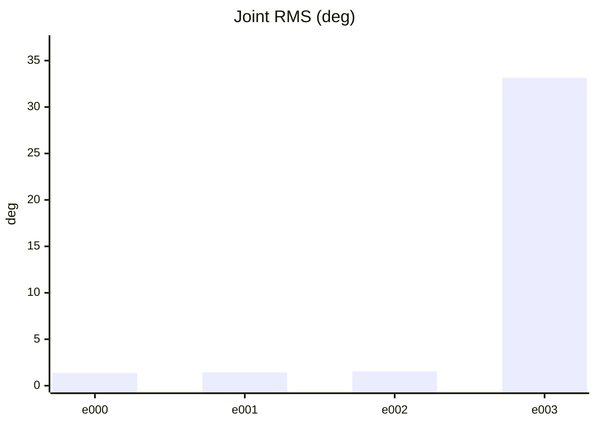
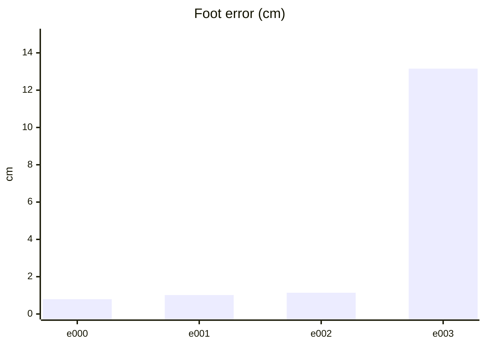
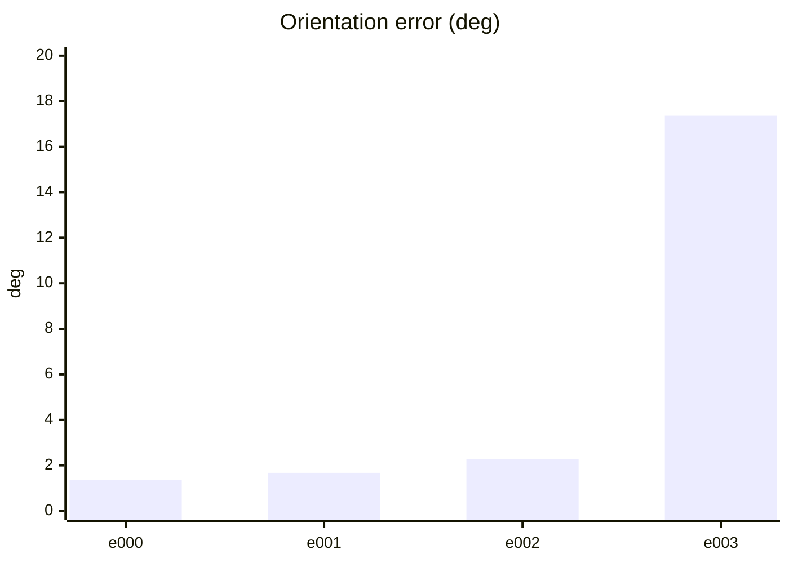
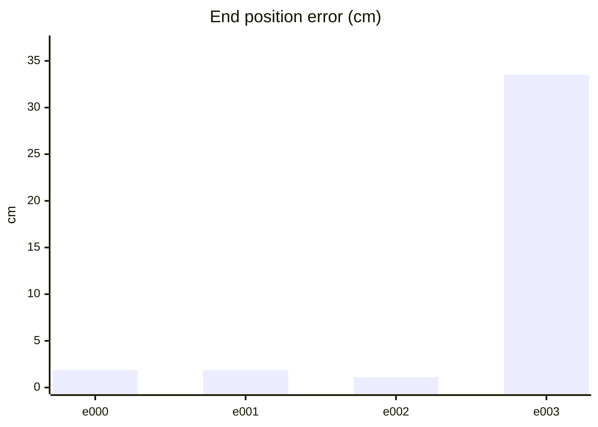
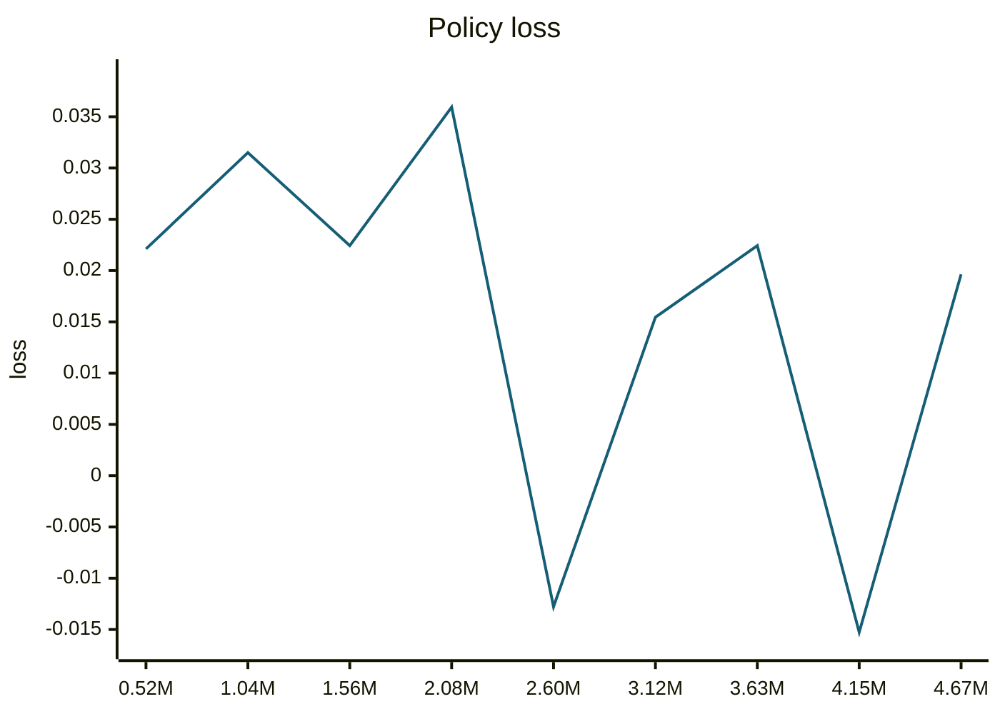
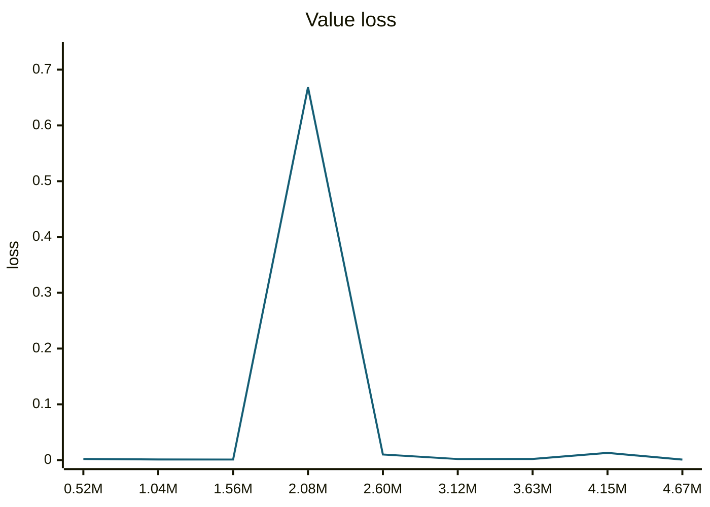
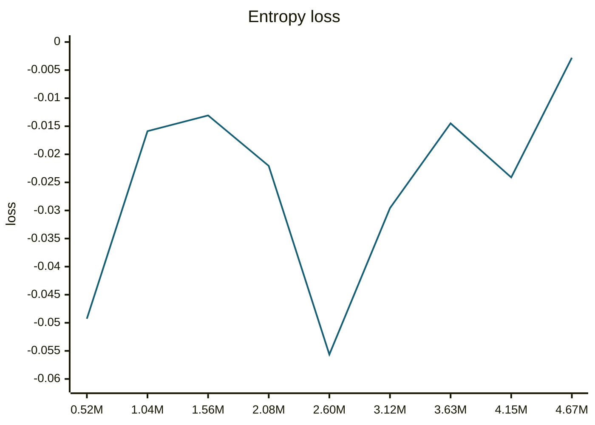
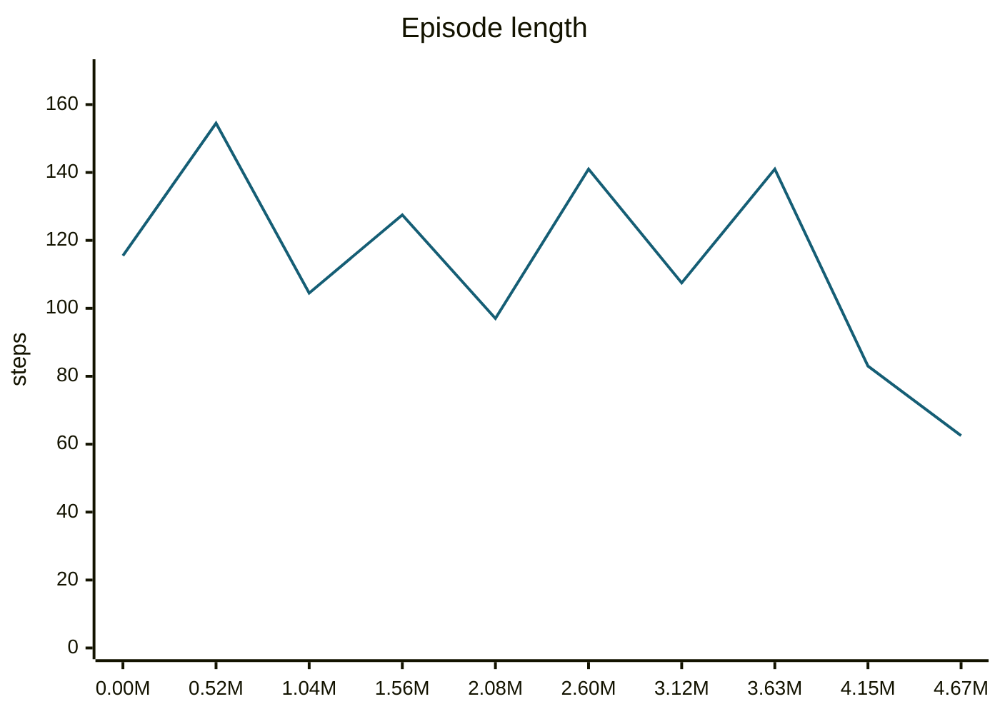
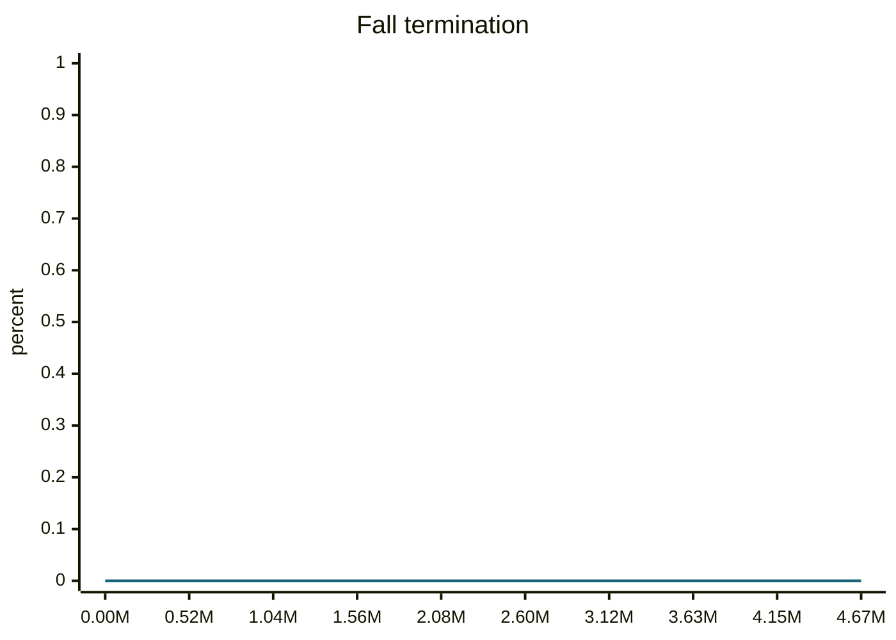
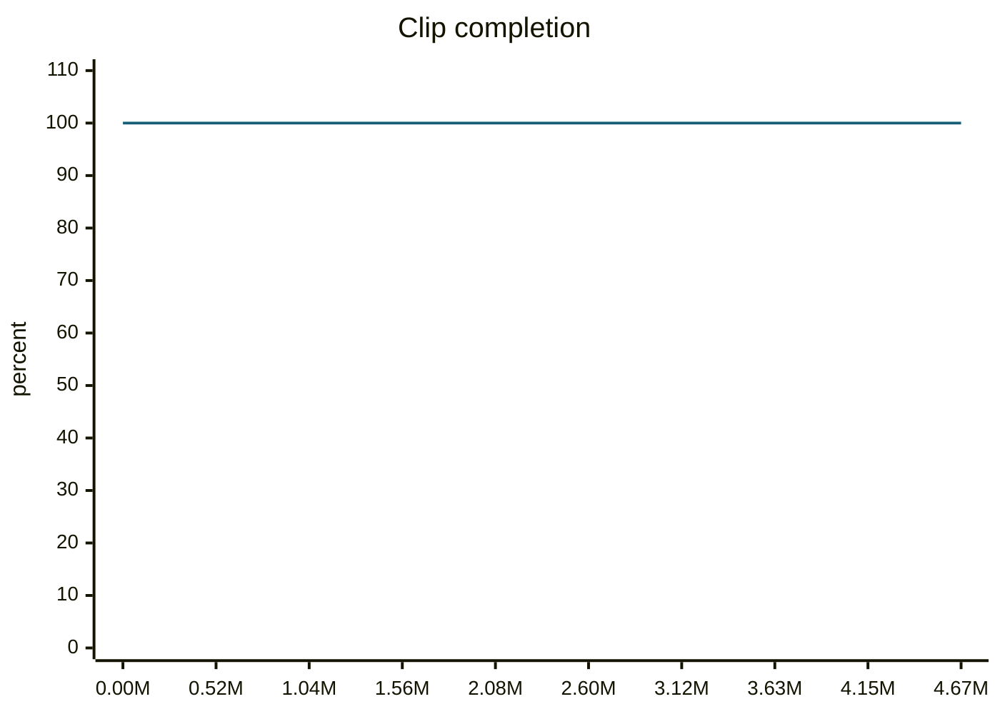

### trotBackwardSlow__r00 학습·평가 완료
e000~e002로 학습하고 e003은 미학습 형상으로 평가했습니다.

| 형상 | 생존 | 관절 RMS (°) | 발 오차 (cm) | 자세 오차 (°) | 종료 위치 오차 (cm) | 접지 일치 | 종합 |
| --- | --- | ---: | ---: | ---: | ---: | ---: | --- |
| e000 | 예 | 1.37 | 0.79 | 1.36 | 1.88 | 96.8% | 통과 |
| e001 | 예 | 1.43 | 1.01 | 1.67 | 1.87 | 96.8% | 통과 |
| e002 | 예 | 1.55 | 1.14 | 2.29 | 1.09 | 97.0% | 통과 |
| e003 | 예 | 33.14 | 13.15 | 17.36 | 33.53 | 73.1% | 불합격 |

오차는 낮을수록, 접지 일치는 높을수록 좋습니다. e003은 학습에 사용하지 않은 형상입니다.

#### 형상별 평가 오차 (x축: 형상, y축: 오차)









#### PPO 학습 지표 (첫 기록 → 마지막 기록)
| 지표 | 변화 | 간단한 해석 |
| --- | ---: | --- |
| Policy Loss | 0.0221 → 0.0196 | 단독으로 좋고 나쁨을 판정하지 않습니다. NaN·급변 여부를 봅니다. |
| Value Loss | 0.002 → 0.000852 | 지속적으로 폭증하지 않고 안정적이면 좋습니다. |
| Approximate KL | 0.103 → 0.13 | 급증하면 정책 변화가 과격할 수 있습니다. 1 이상이면 점검이 필요합니다. |
| Clip Fraction | 미기록 | 과도한 clipping 여부를 볼 지표지만 현재 코드가 기록하지 않습니다. |
| Entropy 관련 손실 | -0.0493 → -0.00281 | 원래 Entropy는 미기록입니다. 손실값만으로 성능을 판정하지 않습니다. |
| Gradient Norm | 미기록 | 실제 기울기 크기는 미기록입니다. |
| Explained Variance | 미기록 | 1에 가까울수록 예측력이 좋지만 현재 미기록입니다. |
| Episode Length | 116 → 62.5 | 길이만으로는 부족합니다. 클립 완료율과 함께 봅니다. |
| 조기 종료율 (낙상) | 0% → 0% | 낮을수록 좋습니다. 전체 조기 종료율은 미기록입니다. |
| 클립 완료율 | 100% → 100% | 높을수록 좋습니다. |

학습 손실보다 아래 평가 CSV의 생존·오차·`pass_all`과 영상을 우선 확인하세요.
체크포인트에서 재개한 모션은 재개 이후 로그의 값과 추가 학습 스텝만 표시합니다.

#### PPO 지표 추이 (x축: 학습 스텝, y축: 지표 값)





```mermaid
---
config:
  theme: base
  themeVariables:
    xyChart:
      plotColorPalette: '#155e75'
  themeCSS: '.line-plot-0 path { stroke-width: 3.5px !important; }'
---
xychart-beta
    title "Approximate KL"
    x-axis ["0.52M", "1.04M", "1.56M", "2.08M", "2.60M", "3.12M", "3.63M", "4.15M", "4.67M"]
    y-axis "KL" 0 --> 2.17e+03
    line [0.1032, 0.1185, 0.1099, 1970, 0.9509, 0.09716, 7.368, 119.8, 0.1302]
```









#### motion_eval/summary.csv — `runs/pipeline_v1/experts/trotBackwardSlow__r00/wandb/offline-run-20261015_173257-hqysd0ij/motion_eval/summary.csv`
```csv
design,motion,frames,evaluated_frames,survived,joint_rms_deg,foot_err_cm,orn_err_deg,end_pos_err_cm,end_pos_tol_cm,travel_m,contact_agree,ref_infeasible,pass_joint,pass_foot,pass_orn,pass_end_pos,pass_contact,pass_all
e000,trotBackwardSlow__r00,94,93,1,1.3659183979034424,0.7938432693481445,1.3633197150664391,1.8786774948239326,5.765130519866943,0.5765130519866943,0.967741935483871,0.10638297872340426,1,1,1,1,1,1
e001,trotBackwardSlow__r00,94,93,1,1.4346271753311157,1.0147395133972168,1.6715097642319243,1.865978166460991,6.8975913524627686,0.6897591352462769,0.967741935483871,0.10638297872340426,1,1,1,1,1,1
e002,trotBackwardSlow__r00,94,93,1,1.5455783605575562,1.1412761211395264,2.2883881837892943,1.085183396935463,7.0513975620269775,0.7051397562026978,0.9704301075268817,0.10638297872340426,1,1,1,1,1,1
e003,trotBackwardSlow__r00,94,93,1,33.143760681152344,13.154120445251465,17.3607016752636,33.5333377122879,5.0,0.465524286031723,0.7311827956989247,0.10638297872340426,0,0,0,0,0,0
```
