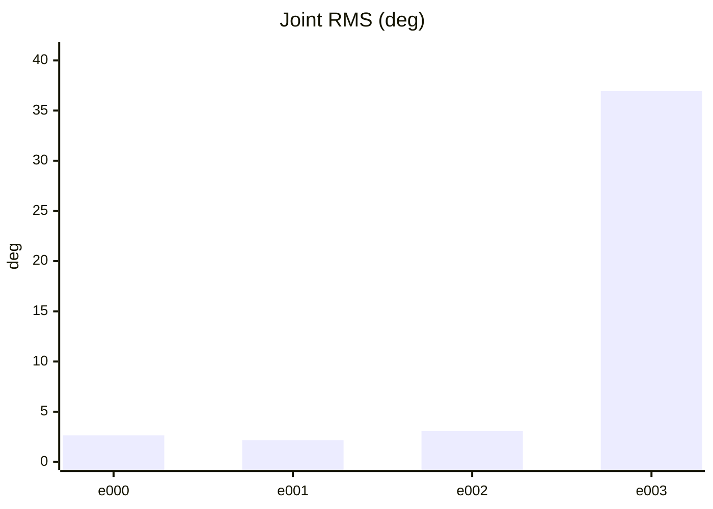
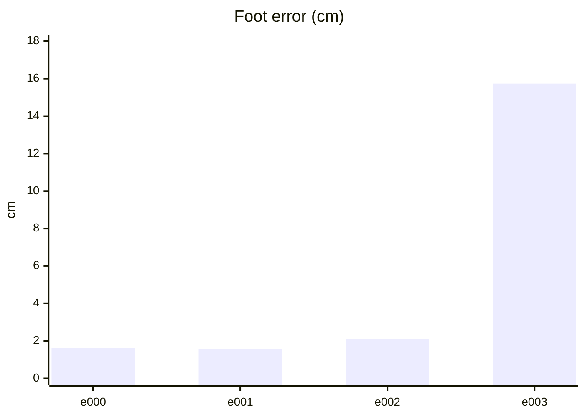
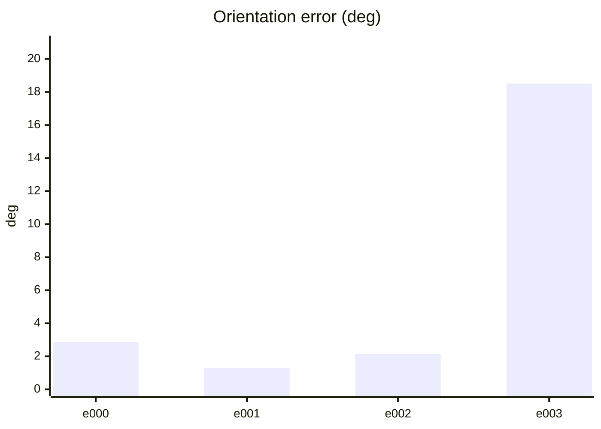
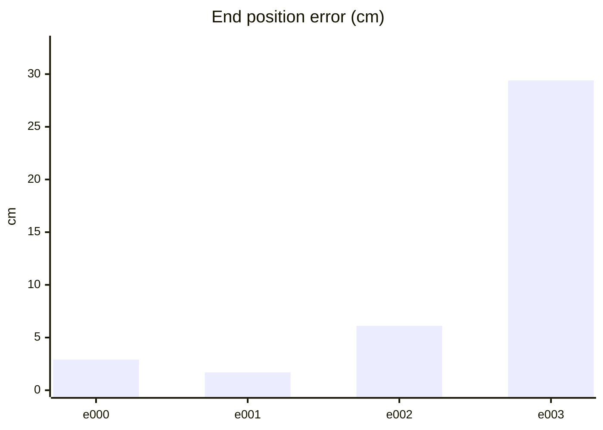
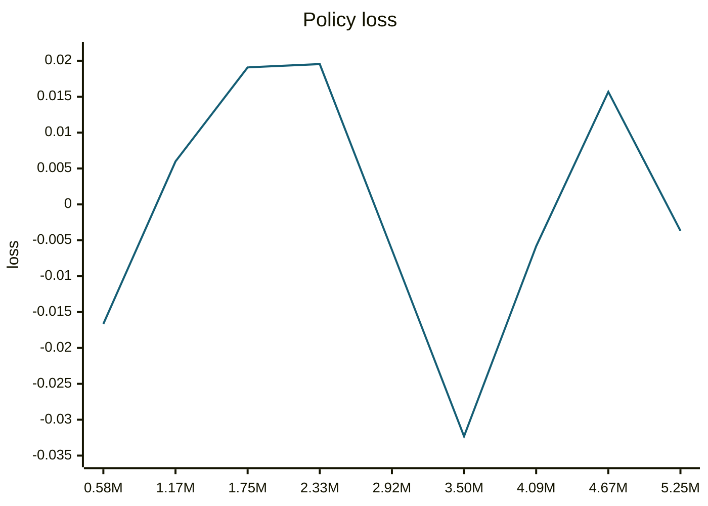
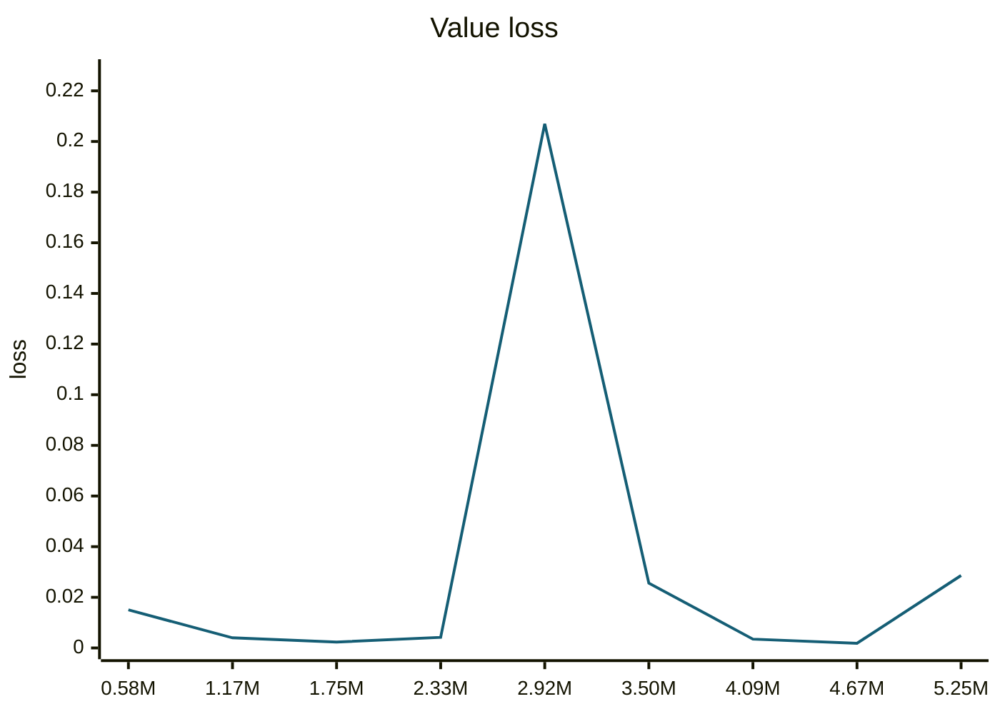
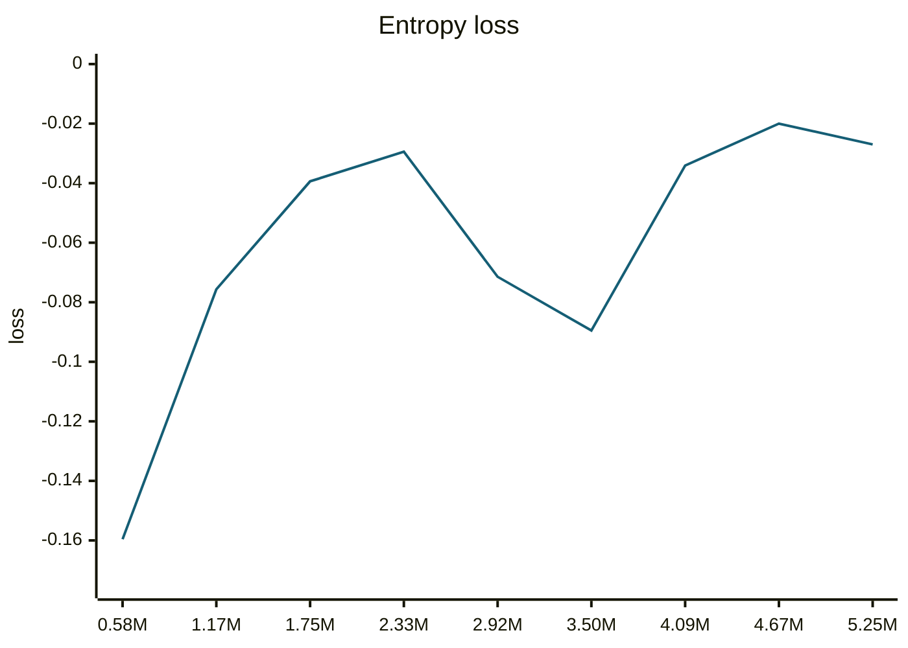
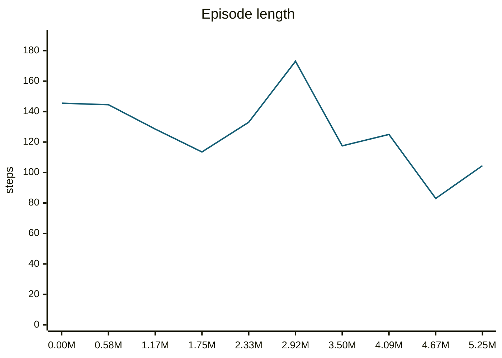
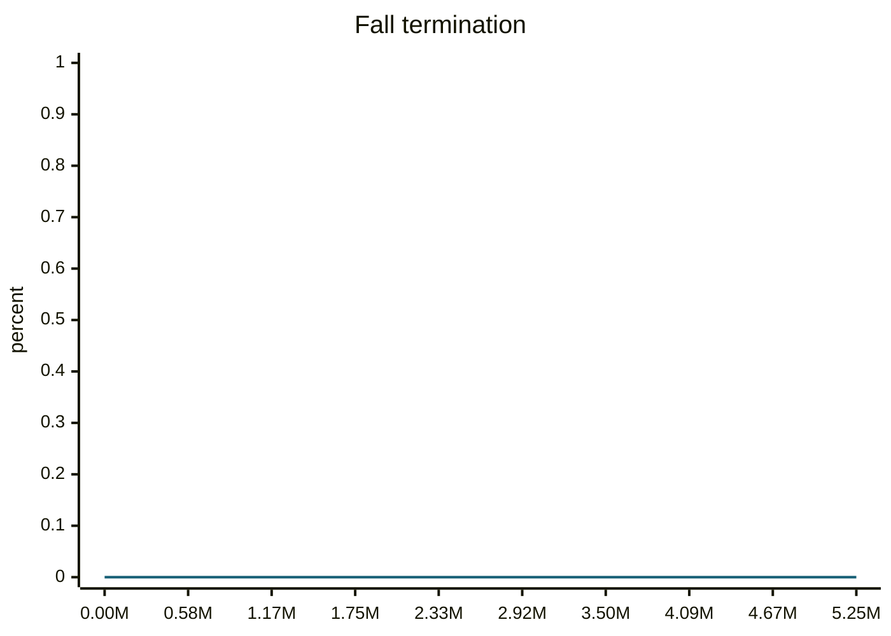
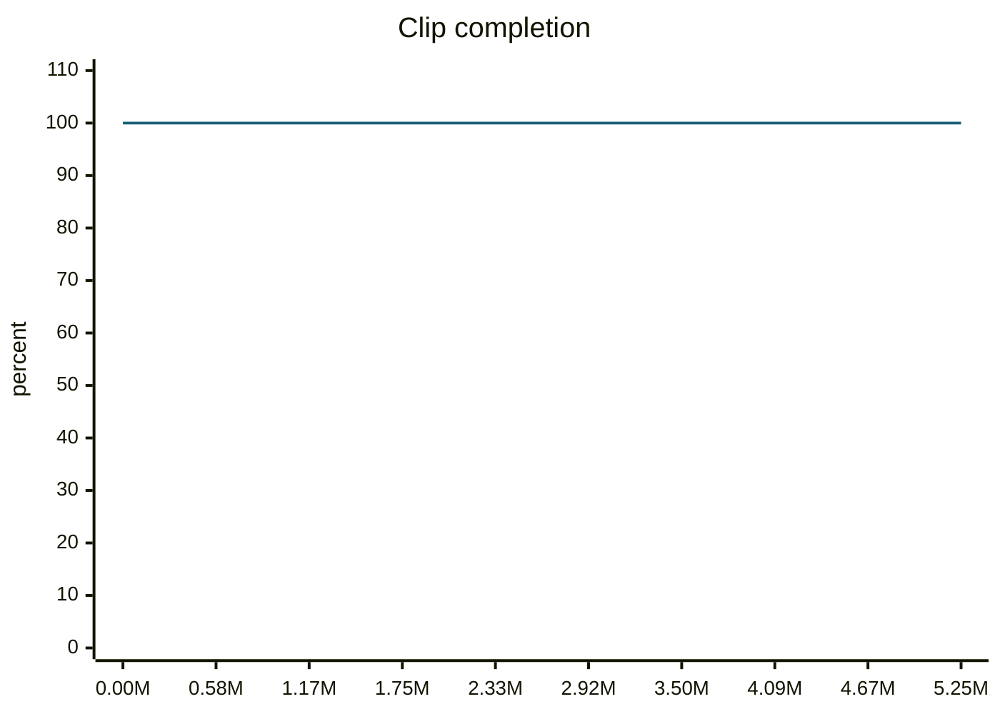

### trotCCWSlow__r00 학습·평가 완료
e000~e002로 학습하고 e003은 미학습 형상으로 평가했습니다.

| 형상 | 생존 | 관절 RMS (°) | 발 오차 (cm) | 자세 오차 (°) | 종료 위치 오차 (cm) | 접지 일치 | 종합 |
| --- | --- | ---: | ---: | ---: | ---: | ---: | --- |
| e000 | 예 | 2.65 | 1.63 | 2.86 | 2.90 | 96.6% | 통과 |
| e001 | 예 | 2.15 | 1.59 | 1.30 | 1.69 | 98.4% | 통과 |
| e002 | 예 | 3.07 | 2.11 | 2.14 | 6.11 | 93.8% | 불합격 |
| e003 | 아니요 | 36.94 | 15.73 | 18.51 | 29.40 | 71.9% | 불합격 |

오차는 낮을수록, 접지 일치는 높을수록 좋습니다. e003은 학습에 사용하지 않은 형상입니다.

#### 형상별 평가 오차 (x축: 형상, y축: 오차)









#### PPO 학습 지표 (첫 기록 → 마지막 기록)
| 지표 | 변화 | 간단한 해석 |
| --- | ---: | --- |
| Policy Loss | -0.0166 → -0.00368 | 단독으로 좋고 나쁨을 판정하지 않습니다. NaN·급변 여부를 봅니다. |
| Value Loss | 0.015 → 0.0286 | 지속적으로 폭증하지 않고 안정적이면 좋습니다. |
| Approximate KL | 0.137 → 1.19e+04 | 급증하면 정책 변화가 과격할 수 있습니다. 1 이상이면 점검이 필요합니다. |
| Clip Fraction | 미기록 | 과도한 clipping 여부를 볼 지표지만 현재 코드가 기록하지 않습니다. |
| Entropy 관련 손실 | -0.16 → -0.027 | 원래 Entropy는 미기록입니다. 손실값만으로 성능을 판정하지 않습니다. |
| Gradient Norm | 미기록 | 실제 기울기 크기는 미기록입니다. |
| Explained Variance | 미기록 | 1에 가까울수록 예측력이 좋지만 현재 미기록입니다. |
| Episode Length | 146 → 104 | 길이만으로는 부족합니다. 클립 완료율과 함께 봅니다. |
| 조기 종료율 (낙상) | 0% → 0% | 낮을수록 좋습니다. 전체 조기 종료율은 미기록입니다. |
| 클립 완료율 | 100% → 100% | 높을수록 좋습니다. |

학습 손실보다 아래 평가 CSV의 생존·오차·`pass_all`과 영상을 우선 확인하세요.

#### PPO 지표 추이 (x축: 학습 스텝, y축: 지표 값)





```mermaid
---
config:
  theme: base
  themeVariables:
    xyChart:
      plotColorPalette: '#155e75'
  themeCSS: '.line-plot-0 path { stroke-width: 3.5px !important; }'
---
xychart-beta
    title "Approximate KL"
    x-axis ["0.58M", "1.17M", "1.75M", "2.33M", "2.92M", "3.50M", "4.09M", "4.67M", "5.25M"]
    y-axis "KL" 0 --> 1.31e+04
    line [0.1368, 0.08322, 0.09288, 0.232, 3861, 2533, 158.2, 460.2, 1.193e+04]
```









#### motion_eval/summary.csv — `runs/pipeline_v1/experts/trotCCWSlow__r00/wandb/offline-run-20261015_174913-rcro537k/motion_eval/summary.csv`
```csv
design,motion,frames,evaluated_frames,survived,joint_rms_deg,foot_err_cm,orn_err_deg,end_pos_err_cm,end_pos_tol_cm,travel_m,contact_agree,ref_infeasible,pass_joint,pass_foot,pass_orn,pass_end_pos,pass_contact,pass_all
e000,trotCCWSlow__r00,110,109,1,2.6461987495422363,1.6320496797561646,2.862619920233853,2.9041605070233345,5.0,0.21876387298107147,0.9655963302752294,0.09090909090909091,1,1,1,1,1,1
e001,trotCCWSlow__r00,110,109,1,2.151167631149292,1.5896930694580078,1.3039975745221795,1.6890205442905426,5.0,0.261282742023468,0.9839449541284404,0.1,1,1,1,1,1,1
e002,trotCCWSlow__r00,110,109,1,3.0676498413085938,2.110959053039551,2.1428887853986702,6.111282110214233,5.0,0.2673775255680084,0.9380733944954128,0.1,1,1,1,0,1,0
e003,trotCCWSlow__r00,110,48,0,36.94478988647461,15.734333038330078,18.510960011346675,29.403620958328247,5.0,0.17740657925605774,0.71875,0.09090909090909091,0,0,0,0,0,0
```
