### trotCWSlow__r00 학습·평가 완료
e000~e002로 학습하고 e003은 미학습 형상으로 평가했습니다.

| 형상 | 생존 | 관절 RMS (°) | 발 오차 (cm) | 자세 오차 (°) | 종료 위치 오차 (cm) | 접지 일치 | 종합 |
| --- | --- | ---: | ---: | ---: | ---: | ---: | --- |
| e000 | 예 | 1.59 | 0.98 | 0.90 | 1.16 | 99.2% | 통과 |
| e001 | 예 | 1.73 | 1.33 | 1.04 | 1.33 | 99.2% | 통과 |
| e002 | 예 | 1.62 | 1.11 | 1.19 | 0.71 | 99.5% | 통과 |
| e003 | 예 | 13.85 | 5.64 | 5.89 | 10.52 | 95.5% | 불합격 |

오차는 낮을수록, 접지 일치는 높을수록 좋습니다. e003은 학습에 사용하지 않은 형상입니다.

#### 형상별 평가 오차 (x축: 형상, y축: 오차)

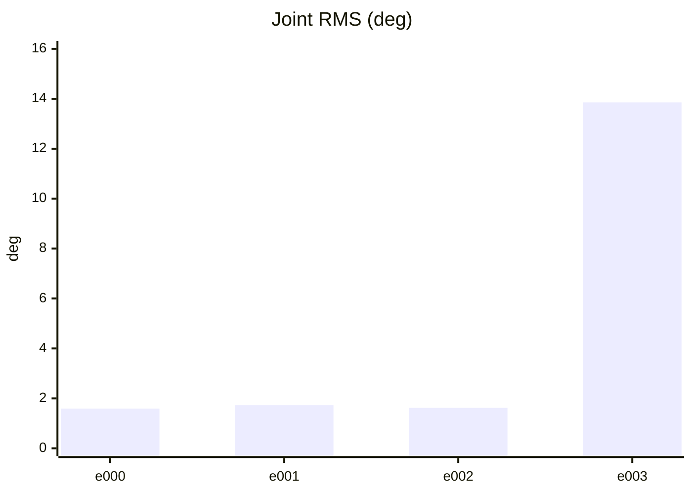

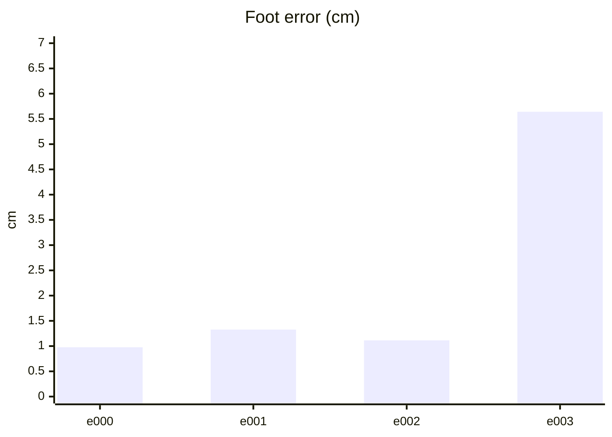

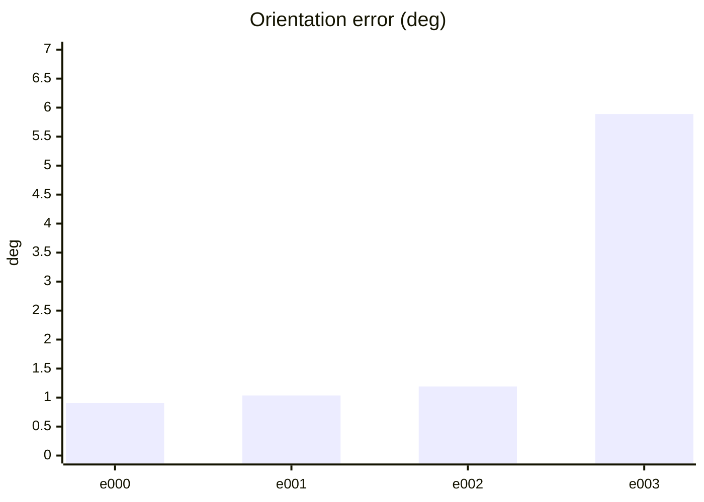

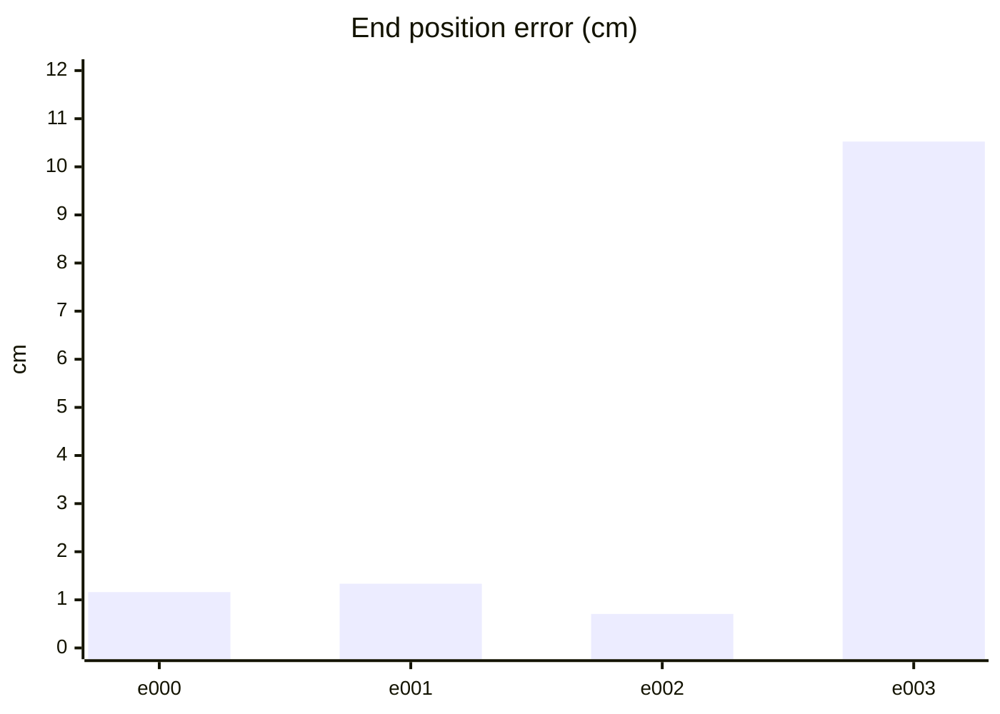

#### PPO 학습 지표 (첫 기록 → 마지막 기록)
| 지표 | 변화 | 간단한 해석 |
| --- | ---: | --- |
| Policy Loss | -0.00436 → -0.0155 | 단독으로 좋고 나쁨을 판정하지 않습니다. NaN·급변 여부를 봅니다. |
| Value Loss | 0.016 → 0.00711 | 지속적으로 폭증하지 않고 안정적이면 좋습니다. |
| Approximate KL | 0.184 → 4.3 | 급증하면 정책 변화가 과격할 수 있습니다. 1 이상이면 점검이 필요합니다. |
| Clip Fraction | 미기록 | 과도한 clipping 여부를 볼 지표지만 현재 코드가 기록하지 않습니다. |
| Entropy 관련 손실 | -0.152 → -0.0237 | 원래 Entropy는 미기록입니다. 손실값만으로 성능을 판정하지 않습니다. |
| Gradient Norm | 미기록 | 실제 기울기 크기는 미기록입니다. |
| Explained Variance | 미기록 | 1에 가까울수록 예측력이 좋지만 현재 미기록입니다. |
| Episode Length | 130 → 120 | 길이만으로는 부족합니다. 클립 완료율과 함께 봅니다. |
| 조기 종료율 (낙상) | 0% → 0% | 낮을수록 좋습니다. 전체 조기 종료율은 미기록입니다. |
| 클립 완료율 | 100% → 100% | 높을수록 좋습니다. |

학습 손실보다 아래 평가 CSV의 생존·오차·`pass_all`과 영상을 우선 확인하세요.

#### PPO 지표 추이 (x축: 학습 스텝, y축: 지표 값)

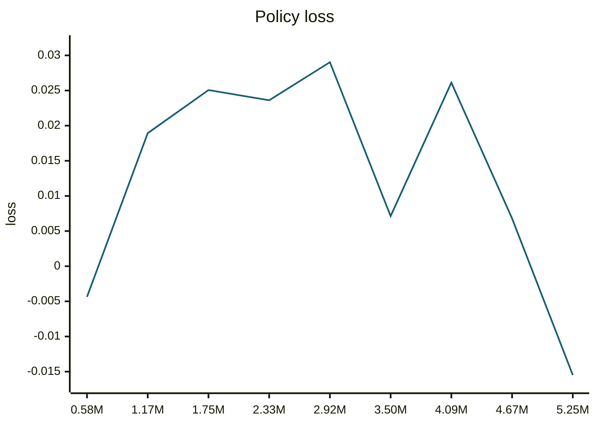

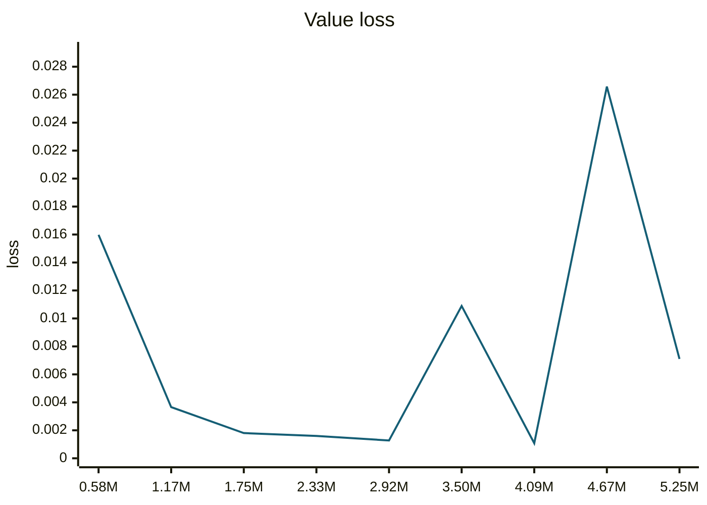

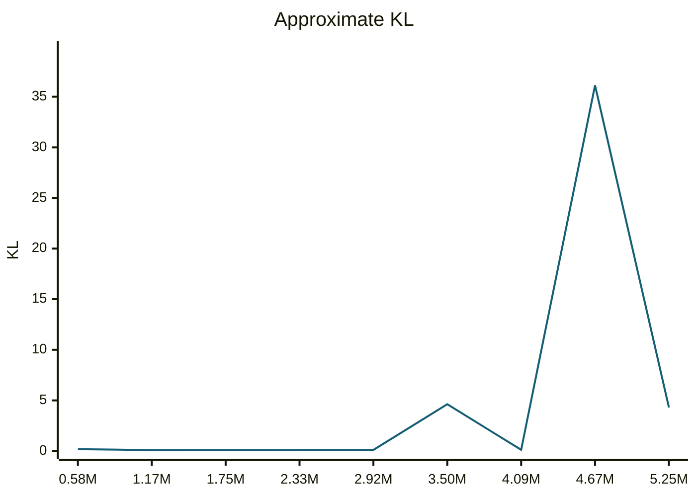

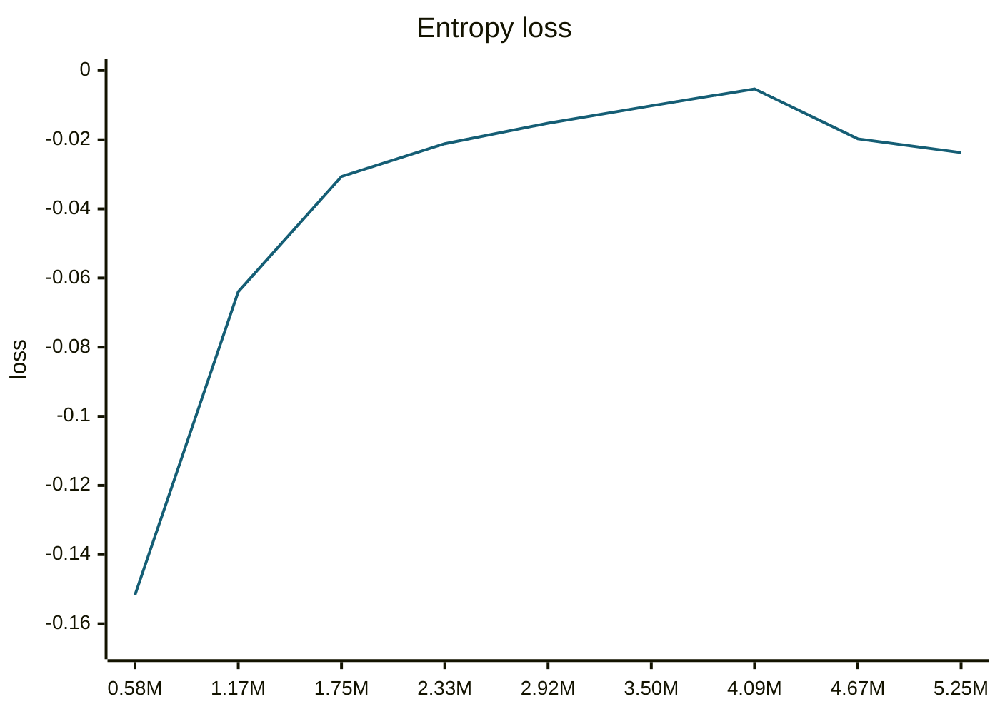

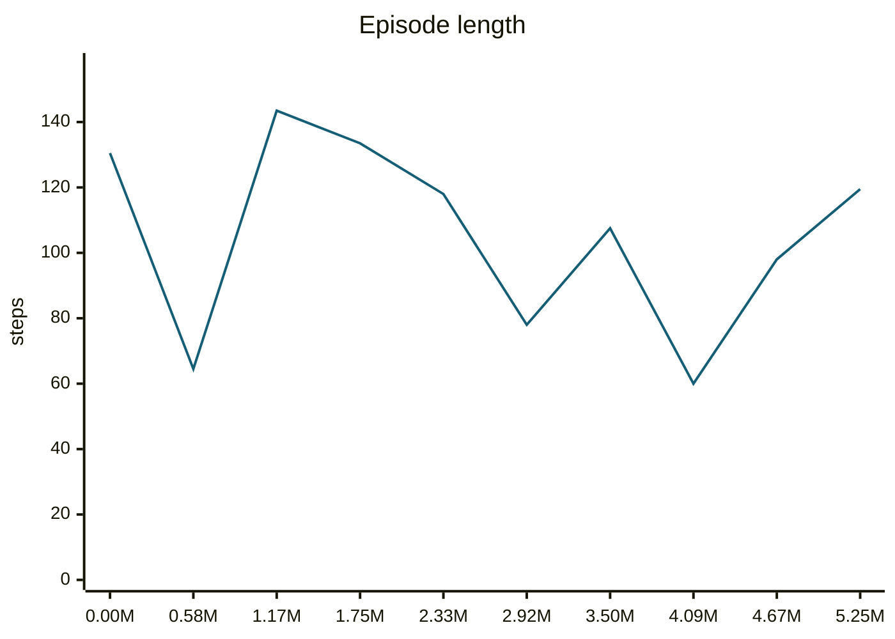

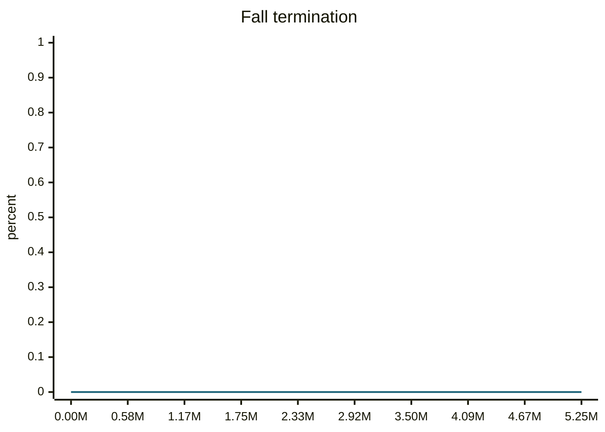

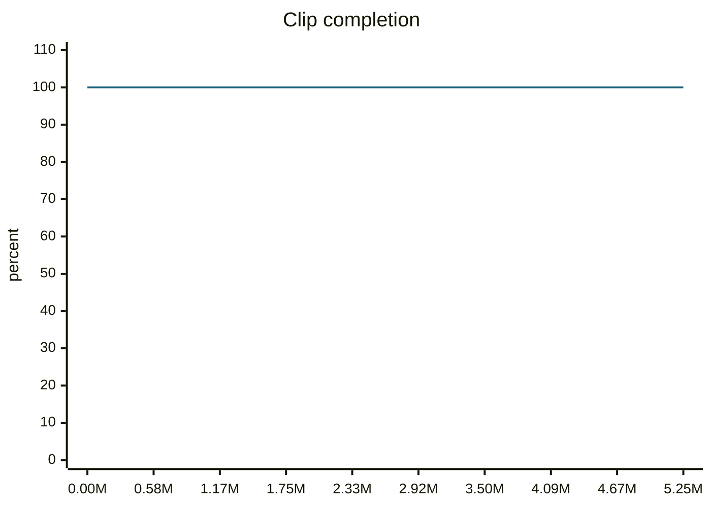

#### motion_eval/summary.csv — `runs/pipeline_v1/experts/trotCWSlow__r00/wandb/offline-run-20261015_180733-hg56hq38/motion_eval/summary.csv`
```csv
design,motion,frames,evaluated_frames,survived,joint_rms_deg,foot_err_cm,orn_err_deg,end_pos_err_cm,end_pos_tol_cm,travel_m,contact_agree,ref_infeasible,pass_joint,pass_foot,pass_orn,pass_end_pos,pass_contact,pass_all
e000,trotCWSlow__r00,100,99,1,1.5893690586090088,0.9784345626831055,0.9048051734049817,1.1605060659348965,5.0,0.08040935546159744,0.9924242424242424,0.03,1,1,1,1,1,1
e001,trotCWSlow__r00,100,99,1,1.7279025316238403,1.3272255659103394,1.037342620230124,1.334946695715189,5.0,0.09574875235557556,0.9924242424242424,0.18,1,1,1,1,1,1
e002,trotCWSlow__r00,100,99,1,1.619557499885559,1.114446997642517,1.1916447529402177,0.7065599784255028,5.0,0.09812386333942413,0.9949494949494949,0.13,1,1,1,1,1,1
e003,trotCWSlow__r00,100,99,1,13.854151725769043,5.641735553741455,5.8894081101278415,10.524559020996094,5.0,0.06590629369020462,0.9545454545454546,0.05,0,0,0,0,1,0
```
