### trotForwardFast__r00 학습·평가 완료
e000~e002로 학습하고 e003은 미학습 형상으로 평가했습니다.

| 형상 | 생존 | 관절 RMS (°) | 발 오차 (cm) | 자세 오차 (°) | 종료 위치 오차 (cm) | 접지 일치 | 종합 |
| --- | --- | ---: | ---: | ---: | ---: | ---: | --- |
| e000 | 예 | 2.31 | 1.49 | 1.60 | 2.70 | 90.7% | 통과 |
| e001 | 예 | 2.33 | 1.77 | 2.37 | 7.72 | 90.9% | 통과 |
| e002 | 예 | 2.96 | 1.97 | 2.24 | 2.60 | 91.2% | 통과 |
| e003 | 예 | 14.49 | 5.81 | 6.48 | 55.15 | 81.0% | 불합격 |

오차는 낮을수록, 접지 일치는 높을수록 좋습니다. e003은 학습에 사용하지 않은 형상입니다.

#### 형상별 평가 오차 (x축: 형상, y축: 오차)

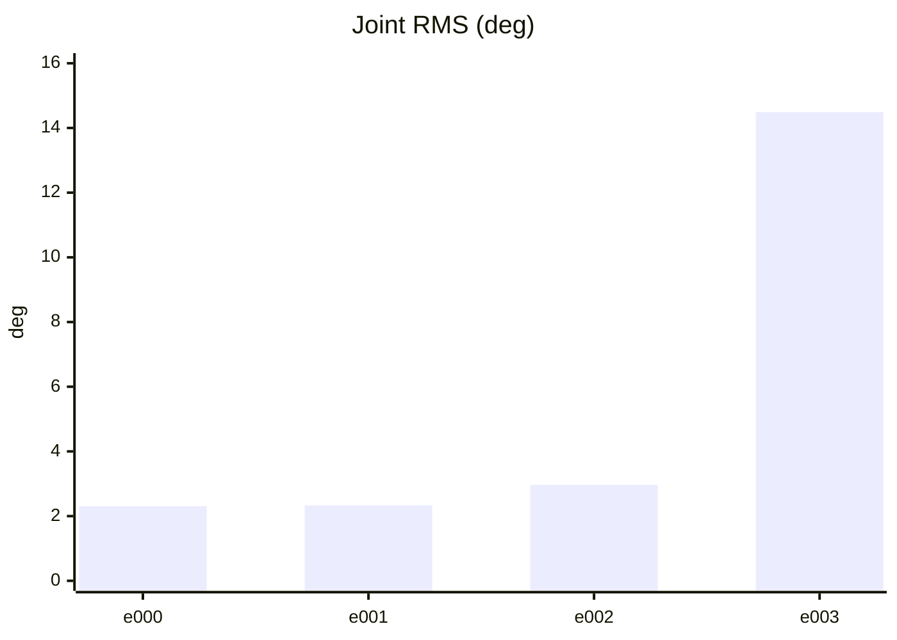

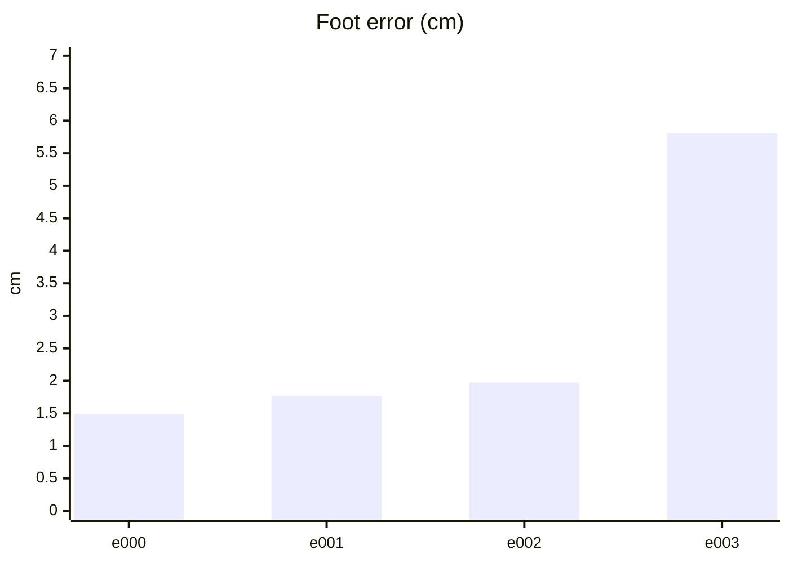

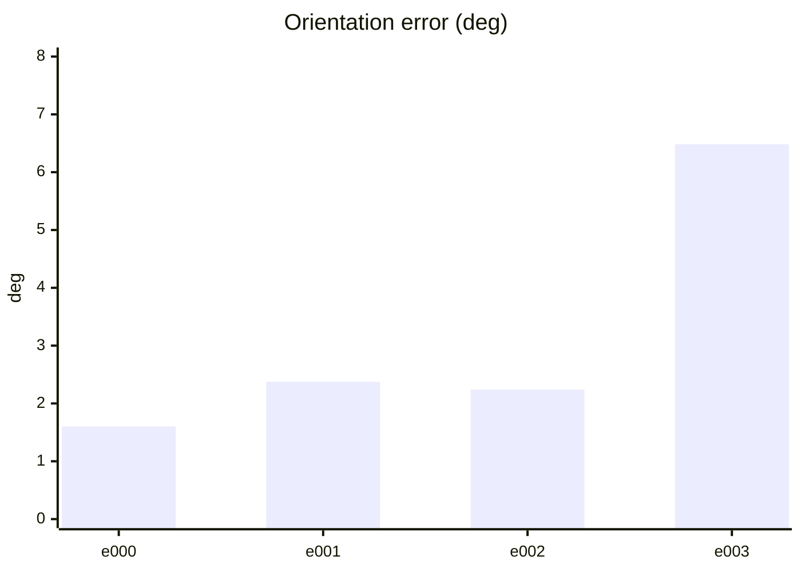

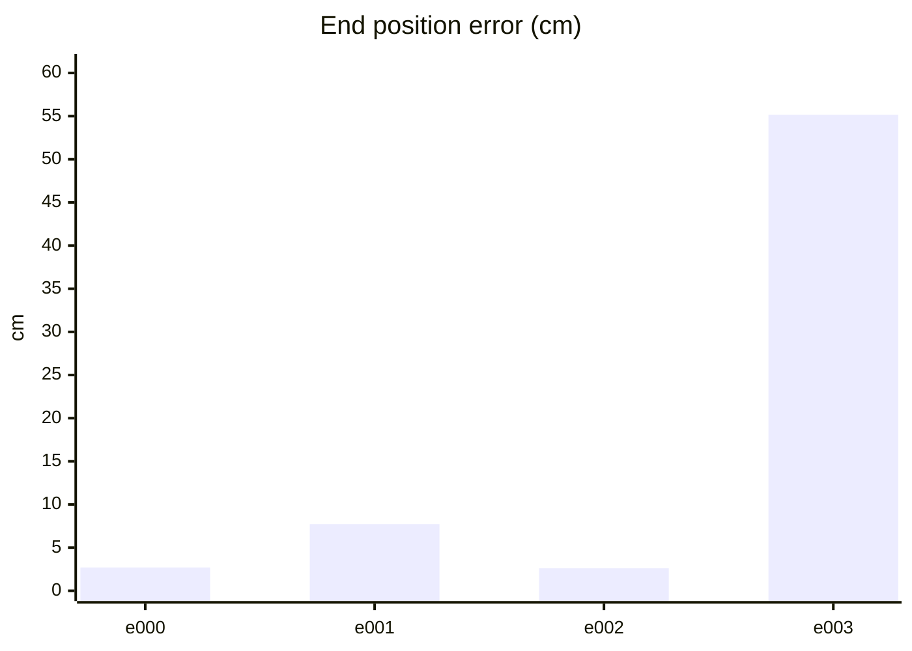

#### PPO 학습 지표 (첫 기록 → 마지막 기록)
| 지표 | 변화 | 간단한 해석 |
| --- | ---: | --- |
| Policy Loss | -0.0252 → -0.0228 | 단독으로 좋고 나쁨을 판정하지 않습니다. NaN·급변 여부를 봅니다. |
| Value Loss | 0.0166 → 0.00134 | 지속적으로 폭증하지 않고 안정적이면 좋습니다. |
| Approximate KL | 0.175 → 0.207 | 급증하면 정책 변화가 과격할 수 있습니다. 1 이상이면 점검이 필요합니다. |
| Clip Fraction | 미기록 | 과도한 clipping 여부를 볼 지표지만 현재 코드가 기록하지 않습니다. |
| Entropy 관련 손실 | -0.162 → -0.0358 | 원래 Entropy는 미기록입니다. 손실값만으로 성능을 판정하지 않습니다. |
| Gradient Norm | 미기록 | 실제 기울기 크기는 미기록입니다. |
| Explained Variance | 미기록 | 1에 가까울수록 예측력이 좋지만 현재 미기록입니다. |
| Episode Length | 108 → 126 | 길이만으로는 부족합니다. 클립 완료율과 함께 봅니다. |
| 조기 종료율 (낙상) | 0% → 0% | 낮을수록 좋습니다. 전체 조기 종료율은 미기록입니다. |
| 클립 완료율 | 100% → 100% | 높을수록 좋습니다. |

학습 손실보다 아래 평가 CSV의 생존·오차·`pass_all`과 영상을 우선 확인하세요.

#### PPO 지표 추이 (x축: 학습 스텝, y축: 지표 값)

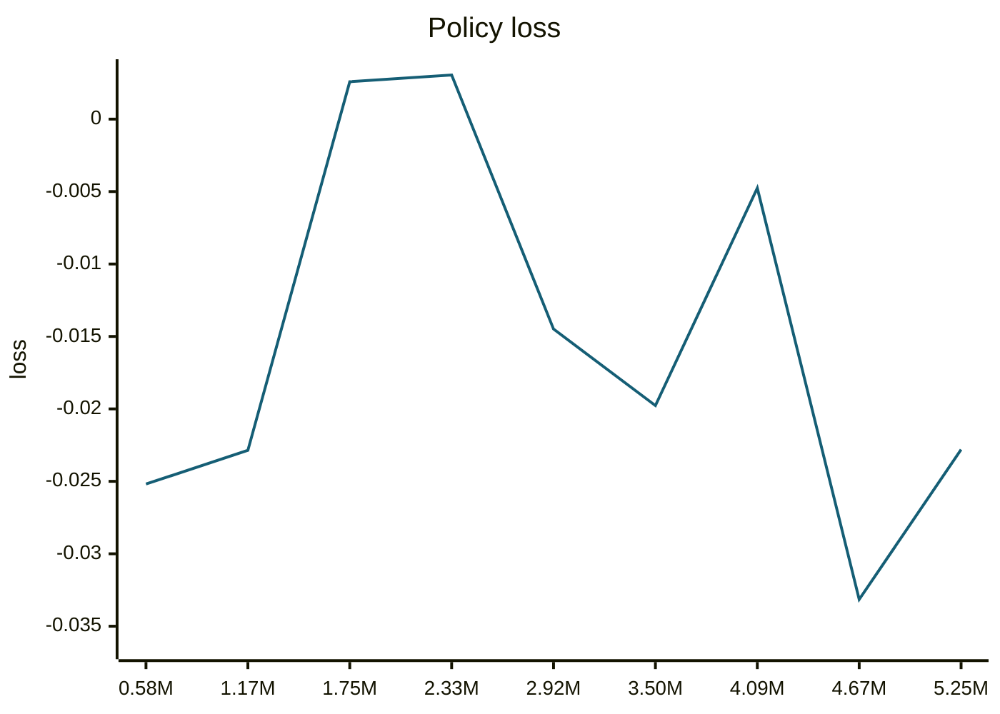

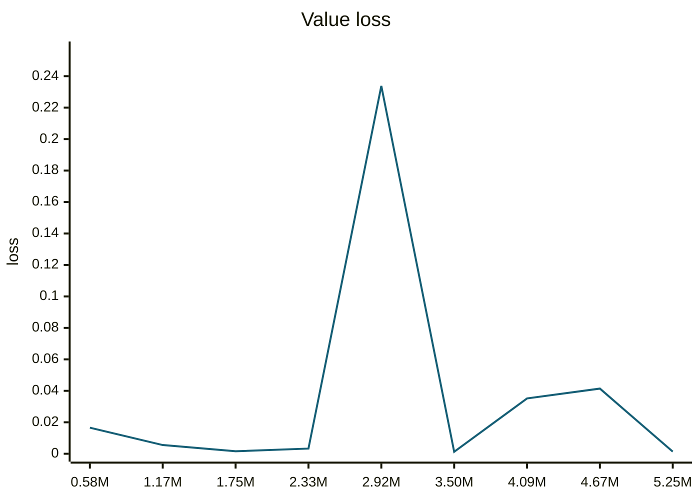

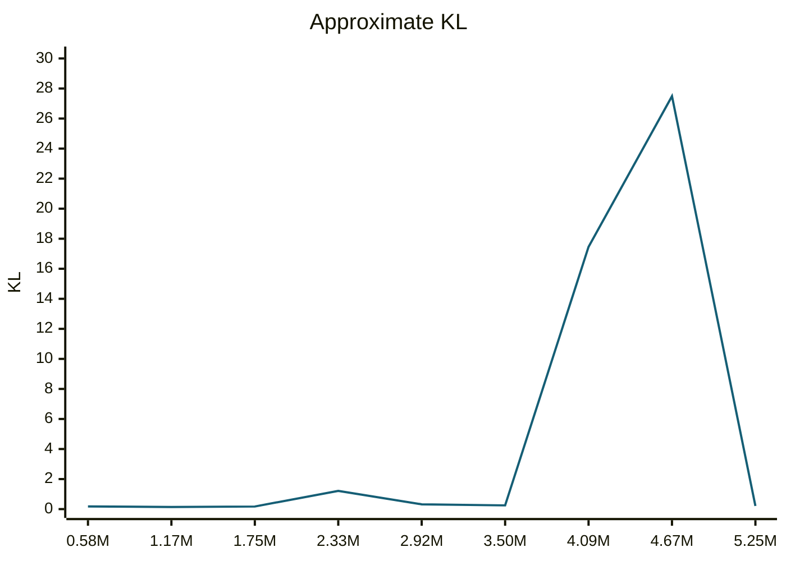

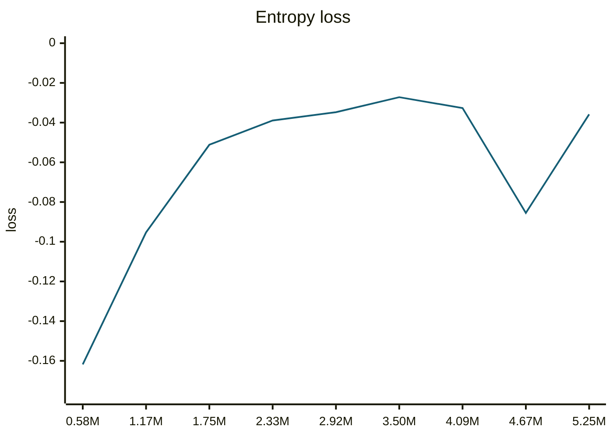

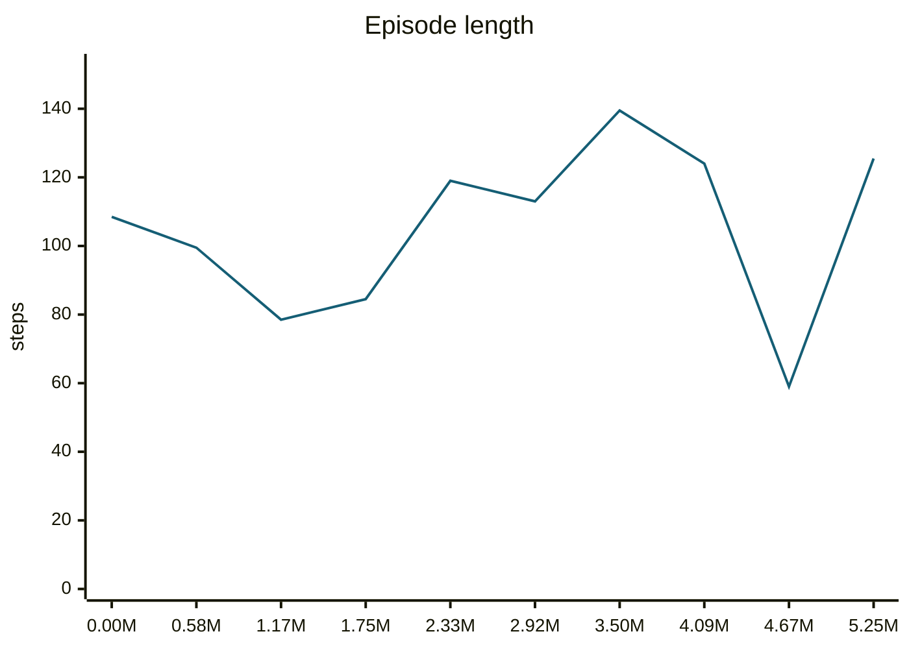

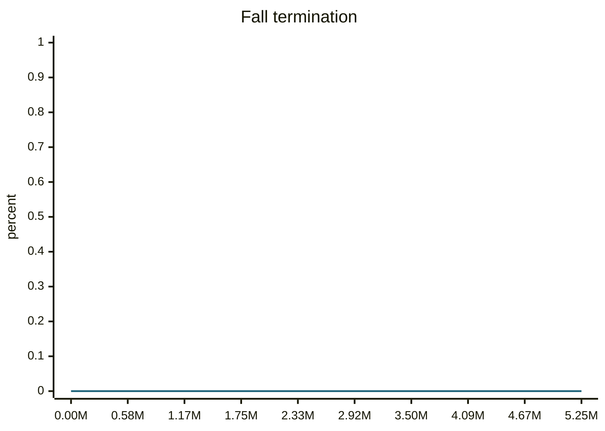

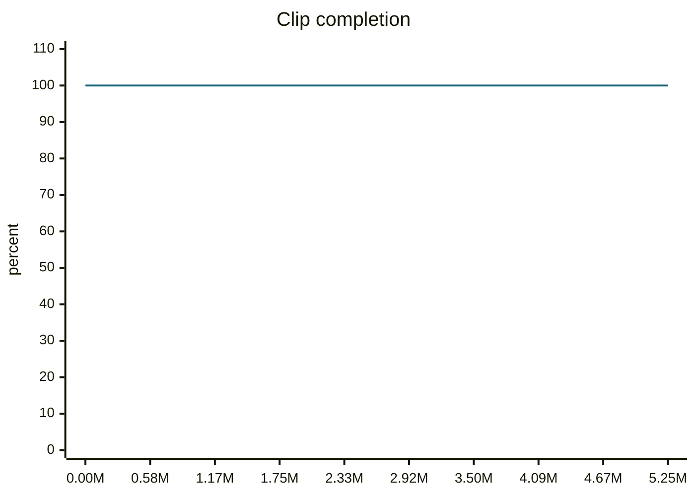

#### motion_eval/summary.csv — `runs/pipeline_v1/experts/trotForwardFast__r00/wandb/offline-run-20261015_182546-uf208lh7/motion_eval/summary.csv`
```csv
design,motion,frames,evaluated_frames,survived,joint_rms_deg,foot_err_cm,orn_err_deg,end_pos_err_cm,end_pos_tol_cm,travel_m,contact_agree,ref_infeasible,pass_joint,pass_foot,pass_orn,pass_end_pos,pass_contact,pass_all
e000,trotForwardFast__r00,92,91,1,2.308800458908081,1.4881519079208374,1.602176083060741,2.7036406099796295,16.012476682662964,1.6012476682662964,0.9065934065934066,0.5434782608695652,1,1,1,1,1,1
e001,trotForwardFast__r00,92,91,1,2.3308537006378174,1.7697079181671143,2.3746724393471226,7.718295603990555,19.15113925933838,1.915113925933838,0.9093406593406593,0.6304347826086957,1,1,1,1,1,1
e002,trotForwardFast__r00,92,91,1,2.9645769596099854,1.974225401878357,2.23865398169712,2.602541260421276,19.586257934570312,1.9586257934570312,0.9120879120879121,0.6086956521739131,1,1,1,1,1,1
e003,trotForwardFast__r00,92,91,1,14.48936939239502,5.808167934417725,6.481534683927917,55.15257120132446,12.933759689331056,1.2933759689331055,0.8104395604395604,0.40217391304347827,0,0,0,0,0,0
```
