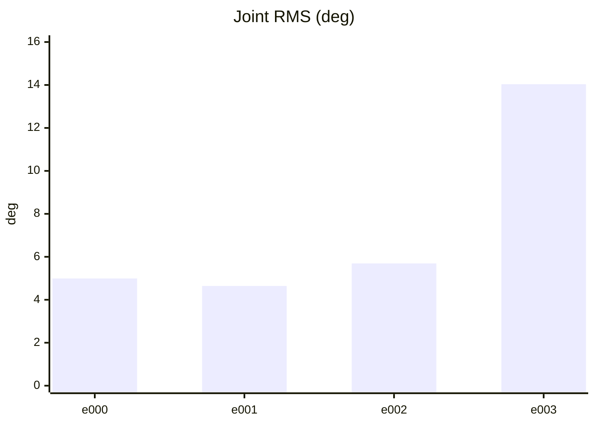
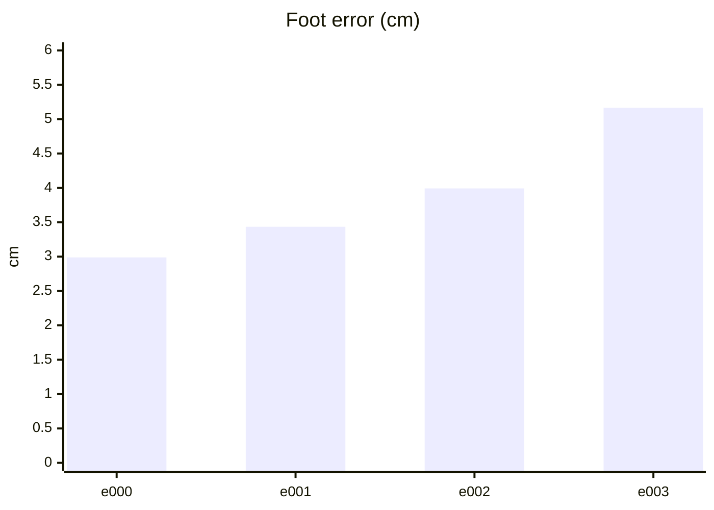
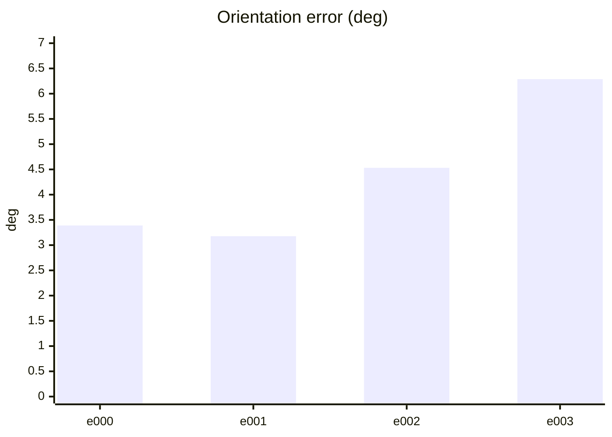
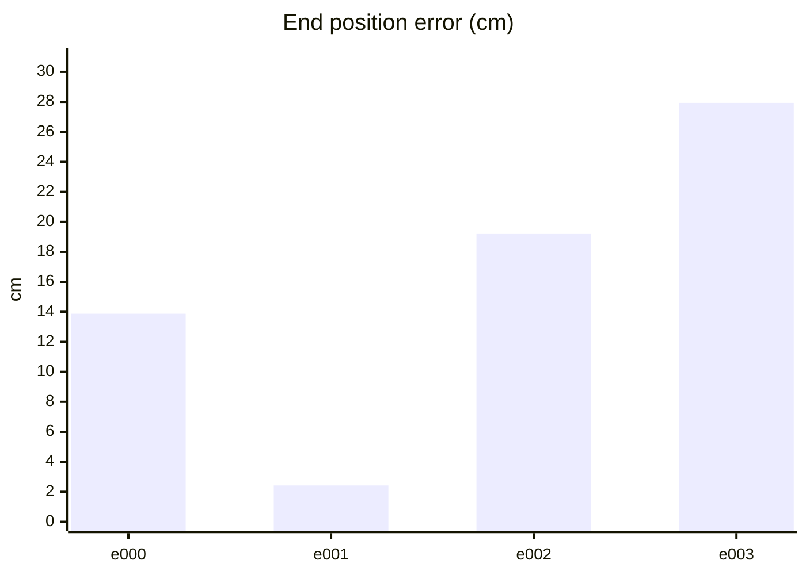
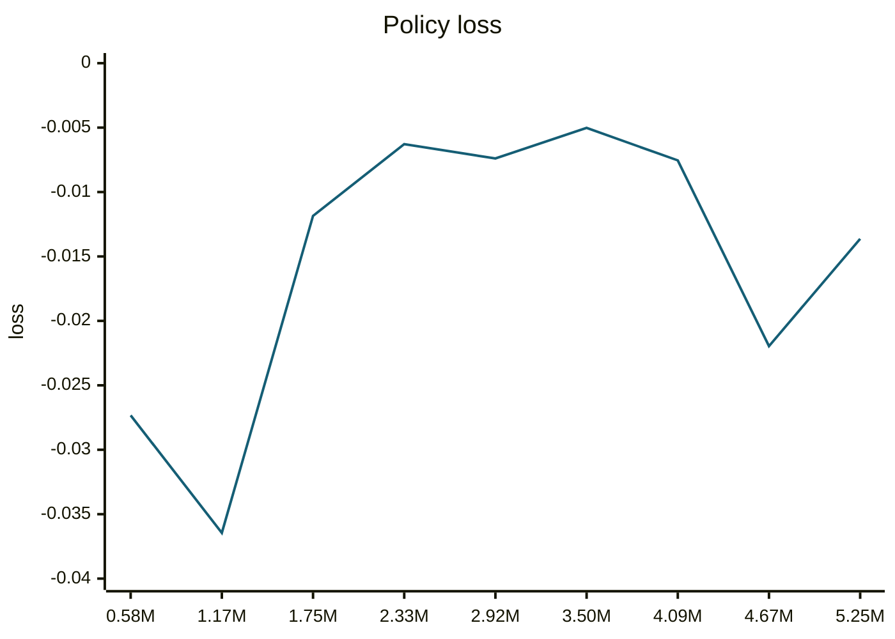
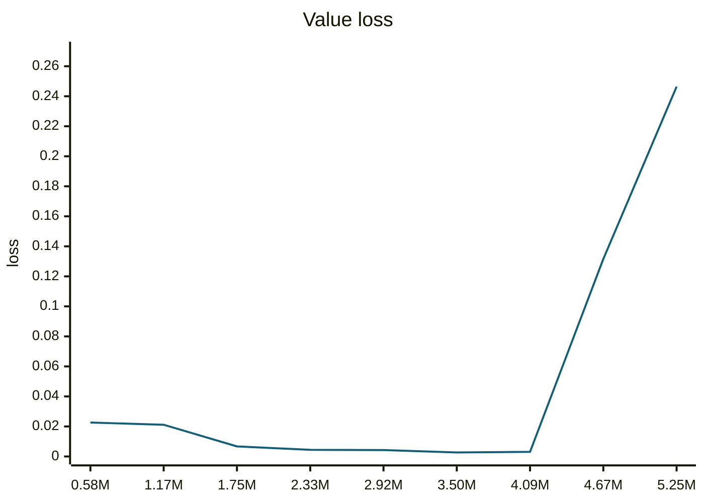
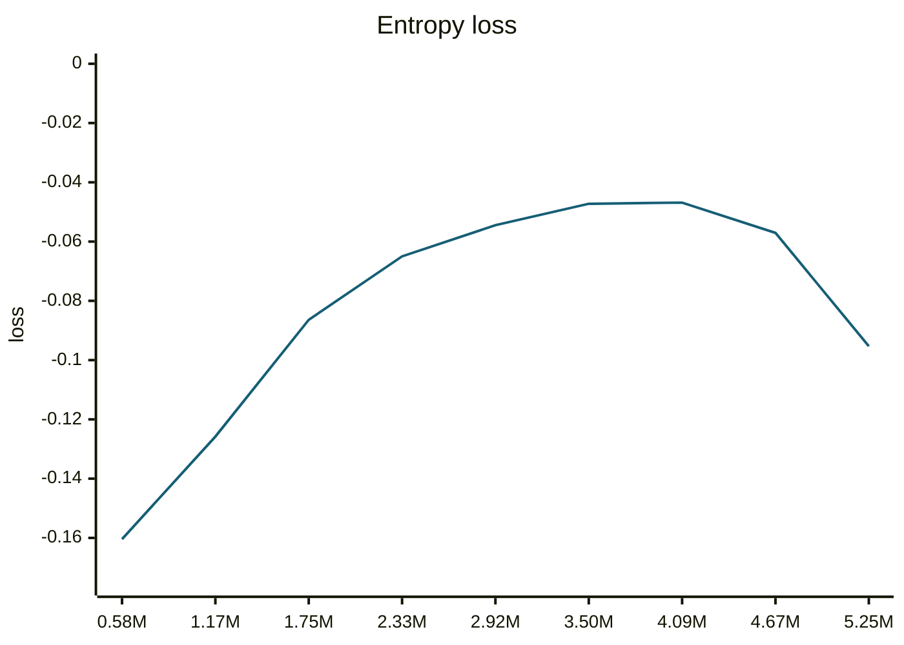
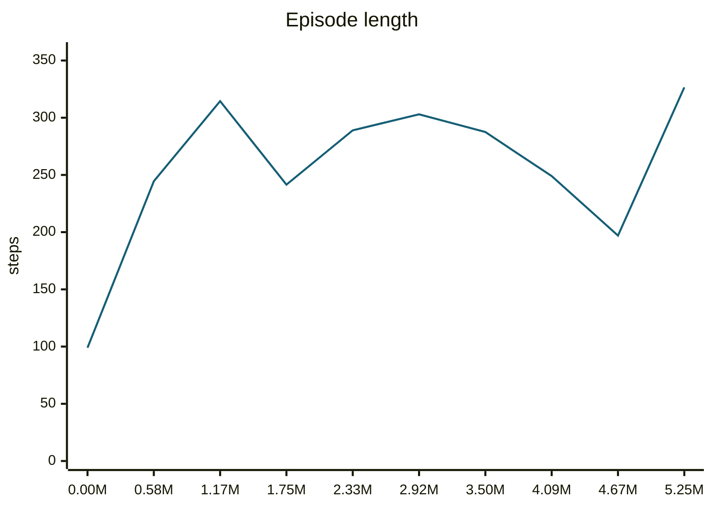
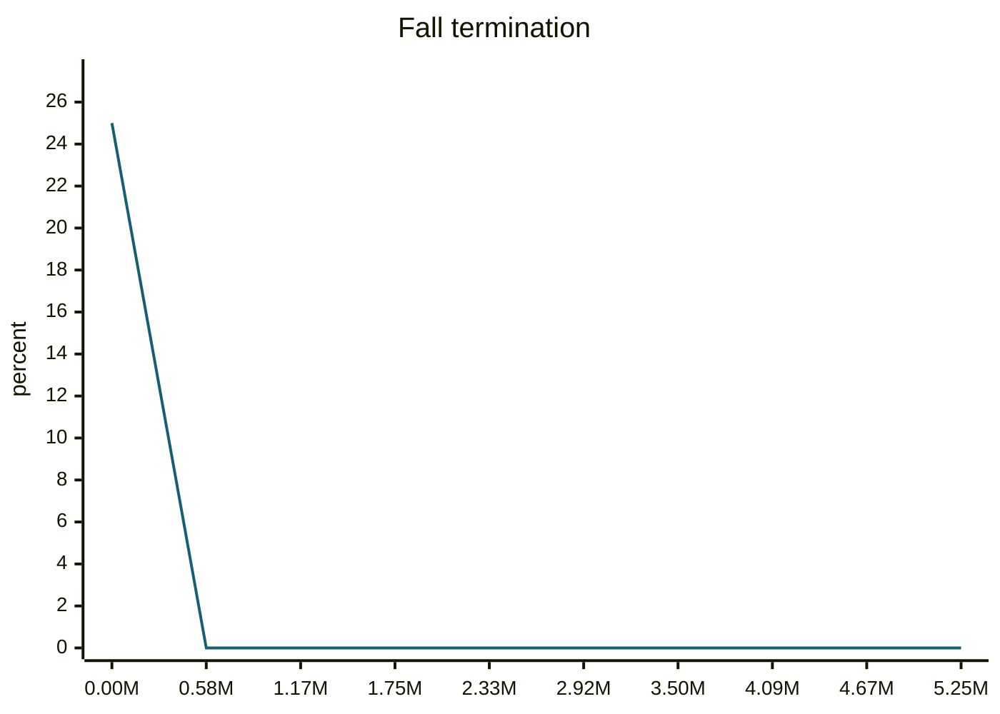
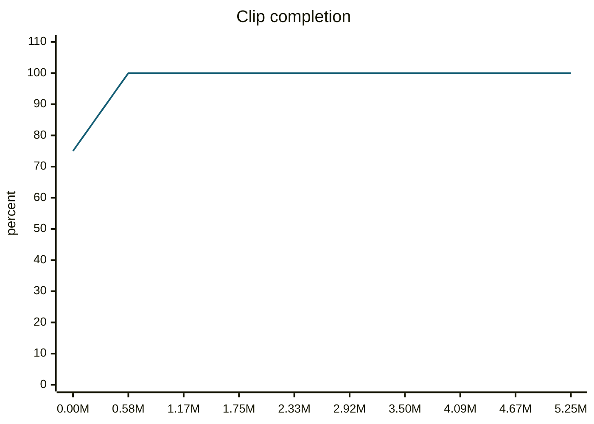

### trotForwardSlow__r00 학습·평가 완료
e000~e002로 학습하고 e003은 미학습 형상으로 평가했습니다.

| 형상 | 생존 | 관절 RMS (°) | 발 오차 (cm) | 자세 오차 (°) | 종료 위치 오차 (cm) | 접지 일치 | 종합 |
| --- | --- | ---: | ---: | ---: | ---: | ---: | --- |
| e000 | 예 | 4.99 | 2.99 | 3.39 | 13.88 | 98.2% | 통과 |
| e001 | 예 | 4.64 | 3.43 | 3.18 | 2.42 | 96.6% | 불합격 |
| e002 | 예 | 5.69 | 3.99 | 4.53 | 19.19 | 97.3% | 불합격 |
| e003 | 예 | 14.03 | 5.16 | 6.29 | 27.93 | 91.7% | 불합격 |

오차는 낮을수록, 접지 일치는 높을수록 좋습니다. e003은 학습에 사용하지 않은 형상입니다.

#### 형상별 평가 오차 (x축: 형상, y축: 오차)









#### PPO 학습 지표 (첫 기록 → 마지막 기록)
| 지표 | 변화 | 간단한 해석 |
| --- | ---: | --- |
| Policy Loss | -0.0273 → -0.0136 | 단독으로 좋고 나쁨을 판정하지 않습니다. NaN·급변 여부를 봅니다. |
| Value Loss | 0.0226 → 0.246 | 지속적으로 폭증하지 않고 안정적이면 좋습니다. |
| Approximate KL | 0.153 → 7.1e+03 | 급증하면 정책 변화가 과격할 수 있습니다. 1 이상이면 점검이 필요합니다. |
| Clip Fraction | 미기록 | 과도한 clipping 여부를 볼 지표지만 현재 코드가 기록하지 않습니다. |
| Entropy 관련 손실 | -0.16 → -0.0953 | 원래 Entropy는 미기록입니다. 손실값만으로 성능을 판정하지 않습니다. |
| Gradient Norm | 미기록 | 실제 기울기 크기는 미기록입니다. |
| Explained Variance | 미기록 | 1에 가까울수록 예측력이 좋지만 현재 미기록입니다. |
| Episode Length | 99 → 326 | 길이만으로는 부족합니다. 클립 완료율과 함께 봅니다. |
| 조기 종료율 (낙상) | 25% → 0% | 낮을수록 좋습니다. 전체 조기 종료율은 미기록입니다. |
| 클립 완료율 | 75% → 100% | 높을수록 좋습니다. |

학습 손실보다 아래 평가 CSV의 생존·오차·`pass_all`과 영상을 우선 확인하세요.

#### PPO 지표 추이 (x축: 학습 스텝, y축: 지표 값)





```mermaid
---
config:
  theme: base
  themeVariables:
    xyChart:
      plotColorPalette: '#155e75'
  themeCSS: '.line-plot-0 path { stroke-width: 3.5px !important; }'
---
xychart-beta
    title "Approximate KL"
    x-axis ["0.58M", "1.17M", "1.75M", "2.33M", "2.92M", "3.50M", "4.09M", "4.67M", "5.25M"]
    y-axis "KL" 0 --> 7.81e+03
    line [0.1525, 0.09065, 0.09658, 0.1163, 0.2592, 0.09944, 0.1012, 204.5, 7098]
```









#### motion_eval/summary.csv — `runs/pipeline_v1/experts/trotForwardSlow__r00/wandb/offline-run-20261015_184358-vrobrotx/motion_eval/summary.csv`
```csv
design,motion,frames,evaluated_frames,survived,joint_rms_deg,foot_err_cm,orn_err_deg,end_pos_err_cm,end_pos_tol_cm,travel_m,contact_agree,ref_infeasible,pass_joint,pass_foot,pass_orn,pass_end_pos,pass_contact,pass_all
e000,trotForwardSlow__r00,226,225,1,4.991060733795166,2.9893014430999756,3.388796326617823,13.875158131122589,18.303840160369873,1.8303840160369873,0.9822222222222222,0.061946902654867256,1,1,1,1,1,1
e001,trotForwardSlow__r00,226,225,1,4.641539096832275,3.433713436126709,3.177083250989002,2.4241000413894653,21.896522045135498,2.18965220451355,0.9655555555555555,0.2610619469026549,1,0,1,1,1,0
e002,trotForwardSlow__r00,226,225,1,5.69346284866333,3.9924402236938477,4.530703339568381,19.192153215408325,22.390522956848148,2.2390522956848145,0.9733333333333334,0.17256637168141592,0,0,1,1,1,0
e003,trotForwardSlow__r00,226,225,1,14.03466796875,5.164672374725342,6.2881620848035436,27.932271361351013,14.780300855636597,1.4780300855636597,0.9166666666666666,0.03982300884955752,0,0,0,0,1,0
```
