### trotLeftSlow__r00 학습·평가 완료
e000~e002로 학습하고 e003은 미학습 형상으로 평가했습니다.

| 형상 | 생존 | 관절 RMS (°) | 발 오차 (cm) | 자세 오차 (°) | 종료 위치 오차 (cm) | 접지 일치 | 종합 |
| --- | --- | ---: | ---: | ---: | ---: | ---: | --- |
| e000 | 예 | 2.27 | 1.27 | 1.60 | 1.78 | 96.9% | 통과 |
| e001 | 예 | 2.29 | 1.51 | 1.92 | 1.92 | 97.3% | 통과 |
| e002 | 예 | 2.23 | 1.33 | 2.58 | 2.97 | 97.8% | 통과 |
| e003 | 예 | 11.37 | 4.46 | 4.01 | 7.05 | 94.1% | 불합격 |

오차는 낮을수록, 접지 일치는 높을수록 좋습니다. e003은 학습에 사용하지 않은 형상입니다.

#### 형상별 평가 오차 (x축: 형상, y축: 오차)

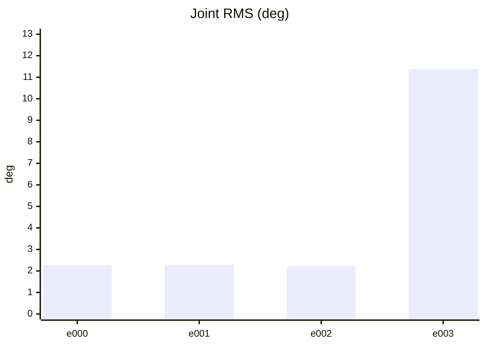

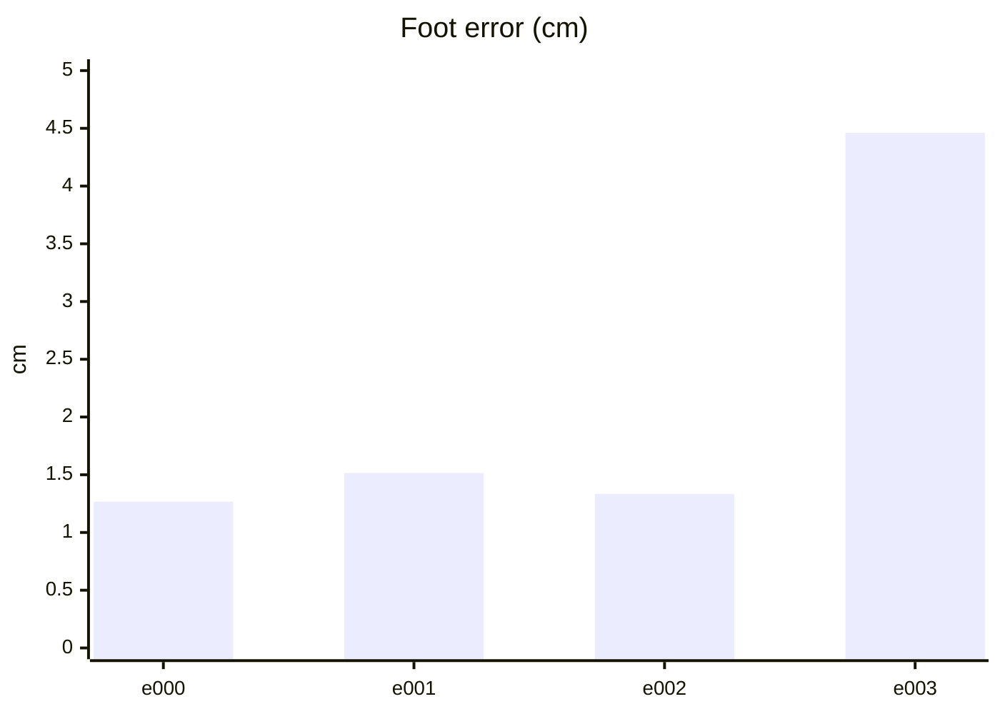

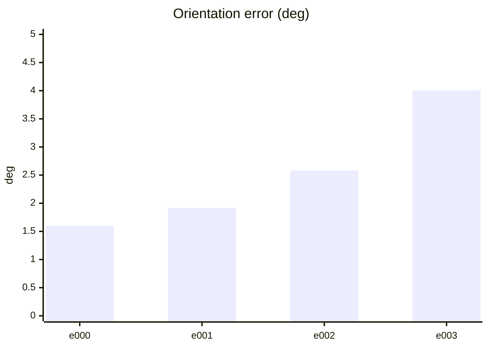

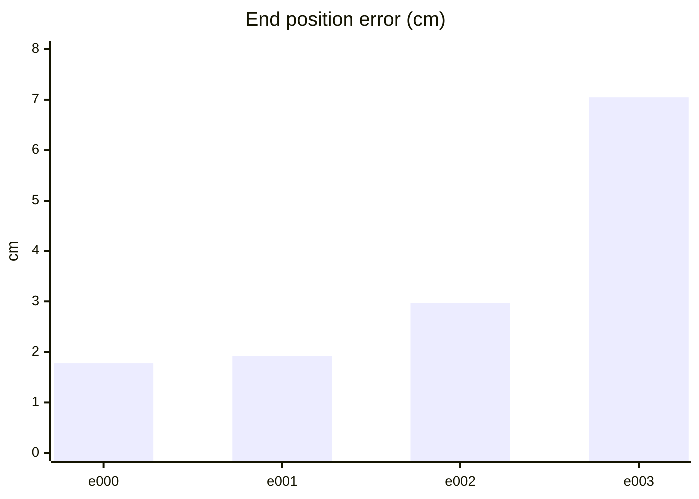

#### PPO 학습 지표 (첫 기록 → 마지막 기록)
| 지표 | 변화 | 간단한 해석 |
| --- | ---: | --- |
| Policy Loss | -0.0222 → -0.00425 | 단독으로 좋고 나쁨을 판정하지 않습니다. NaN·급변 여부를 봅니다. |
| Value Loss | 0.0399 → 0.00358 | 지속적으로 폭증하지 않고 안정적이면 좋습니다. |
| Approximate KL | 0.213 → 0.112 | 급증하면 정책 변화가 과격할 수 있습니다. 1 이상이면 점검이 필요합니다. |
| Clip Fraction | 미기록 | 과도한 clipping 여부를 볼 지표지만 현재 코드가 기록하지 않습니다. |
| Entropy 관련 손실 | -0.174 → -0.0459 | 원래 Entropy는 미기록입니다. 손실값만으로 성능을 판정하지 않습니다. |
| Gradient Norm | 미기록 | 실제 기울기 크기는 미기록입니다. |
| Explained Variance | 미기록 | 1에 가까울수록 예측력이 좋지만 현재 미기록입니다. |
| Episode Length | 178 → 283 | 길이만으로는 부족합니다. 클립 완료율과 함께 봅니다. |
| 조기 종료율 (낙상) | 0% → 0% | 낮을수록 좋습니다. 전체 조기 종료율은 미기록입니다. |
| 클립 완료율 | 100% → 100% | 높을수록 좋습니다. |

학습 손실보다 아래 평가 CSV의 생존·오차·`pass_all`과 영상을 우선 확인하세요.

#### PPO 지표 추이 (x축: 학습 스텝, y축: 지표 값)

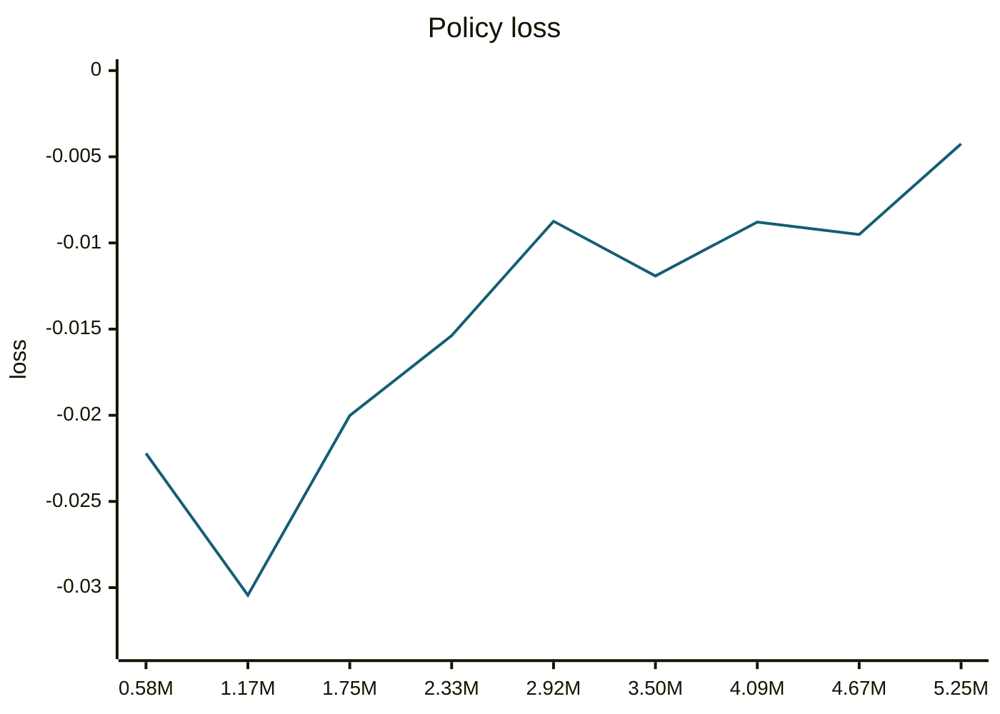

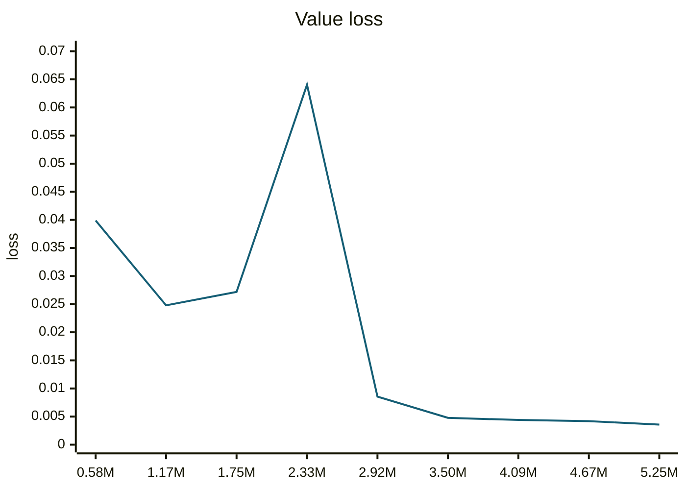

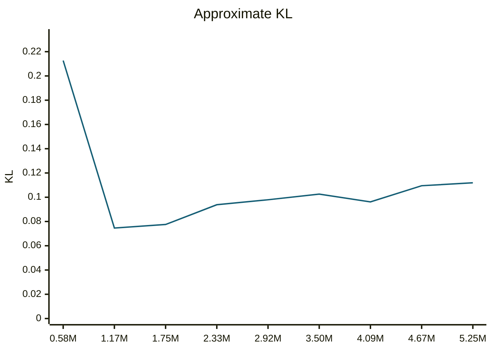

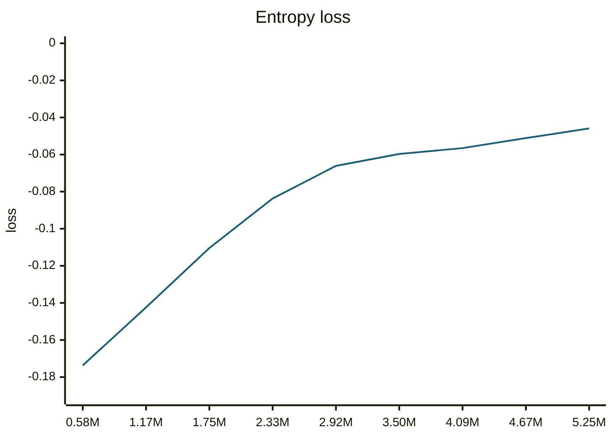

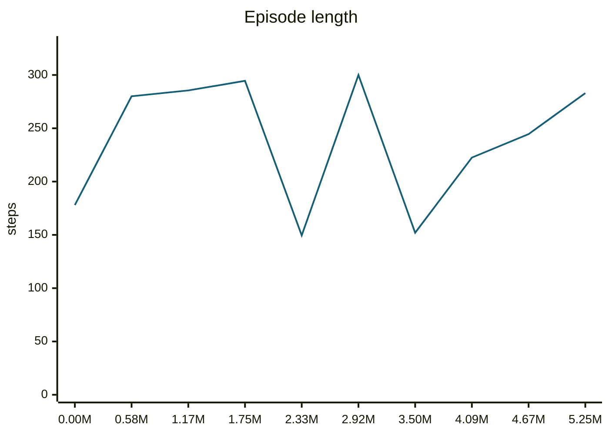

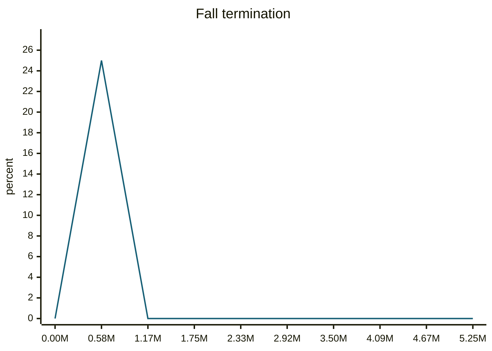

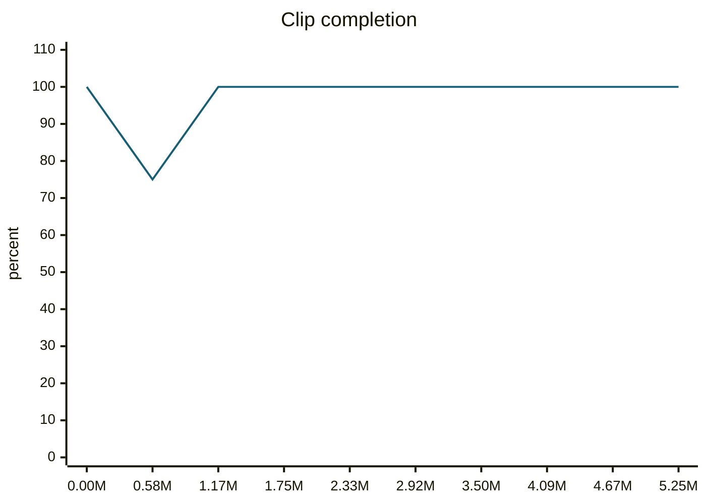

#### motion_eval/summary.csv — `runs/pipeline_v1/experts/trotLeftSlow__r00/wandb/offline-run-20261015_190227-b1tfbr0o/motion_eval/summary.csv`
```csv
design,motion,frames,evaluated_frames,survived,joint_rms_deg,foot_err_cm,orn_err_deg,end_pos_err_cm,end_pos_tol_cm,travel_m,contact_agree,ref_infeasible,pass_joint,pass_foot,pass_orn,pass_end_pos,pass_contact,pass_all
e000,trotLeftSlow__r00,261,260,1,2.2732794284820557,1.267300009727478,1.600633214587429,1.7752991989254951,10.461113452911377,1.0461113452911377,0.9692307692307692,0.09578544061302682,1,1,1,1,1,1
e001,trotLeftSlow__r00,261,260,1,2.2868149280548096,1.5146781206130981,1.9189595084752575,1.9192932173609734,12.514433860778809,1.2514433860778809,0.9730769230769231,0.10727969348659004,1,1,1,1,1,1
e002,trotLeftSlow__r00,261,260,1,2.225466728210449,1.3349182605743408,2.5800413611505566,2.9656490311026573,12.796941995620728,1.2796941995620728,0.9778846153846154,0.12260536398467432,1,1,1,1,1,1
e003,trotLeftSlow__r00,261,260,1,11.371606826782227,4.461315631866455,4.005163274940456,7.047320902347565,8.446853756904602,0.8446853756904602,0.9413461538461538,0.09578544061302682,0,0,1,1,1,0
```
