### trotRightFast__r00 학습·평가 완료
e000~e002로 학습하고 e003은 미학습 형상으로 평가했습니다.

| 형상 | 생존 | 관절 RMS (°) | 발 오차 (cm) | 자세 오차 (°) | 종료 위치 오차 (cm) | 접지 일치 | 종합 |
| --- | --- | ---: | ---: | ---: | ---: | ---: | --- |
| e000 | 예 | 1.38 | 0.87 | 1.27 | 1.84 | 99.0% | 통과 |
| e001 | 예 | 1.67 | 1.25 | 1.32 | 1.58 | 99.0% | 통과 |
| e002 | 예 | 1.61 | 1.19 | 1.14 | 0.79 | 99.2% | 통과 |
| e003 | 예 | 72.79 | 21.68 | 23.14 | 61.82 | 69.4% | 불합격 |

오차는 낮을수록, 접지 일치는 높을수록 좋습니다. e003은 학습에 사용하지 않은 형상입니다.

#### 형상별 평가 오차 (x축: 형상, y축: 오차)

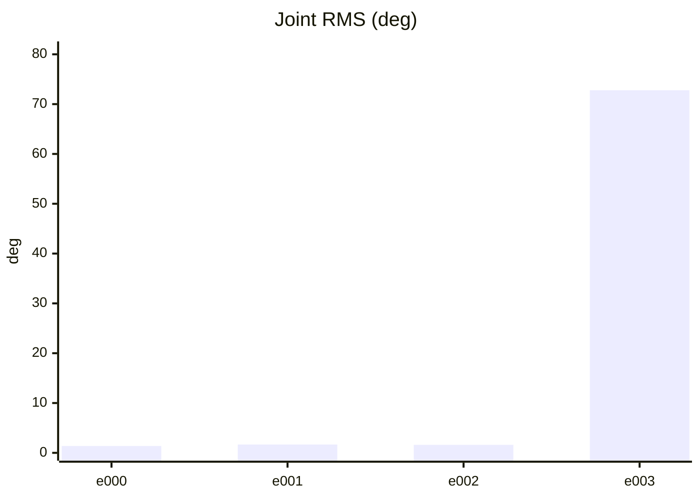

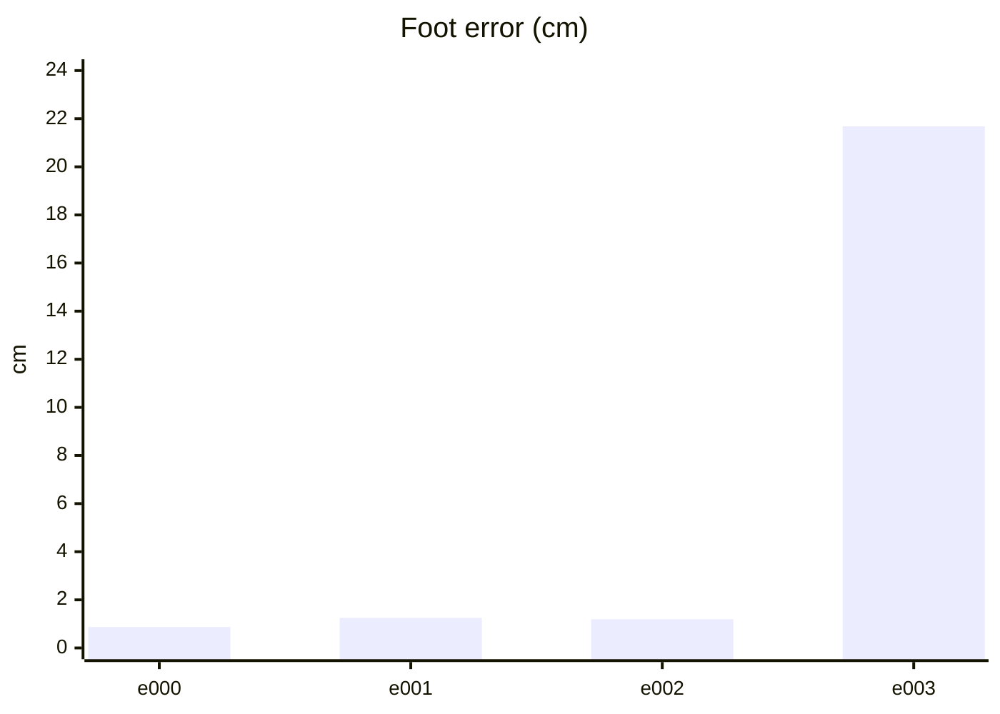

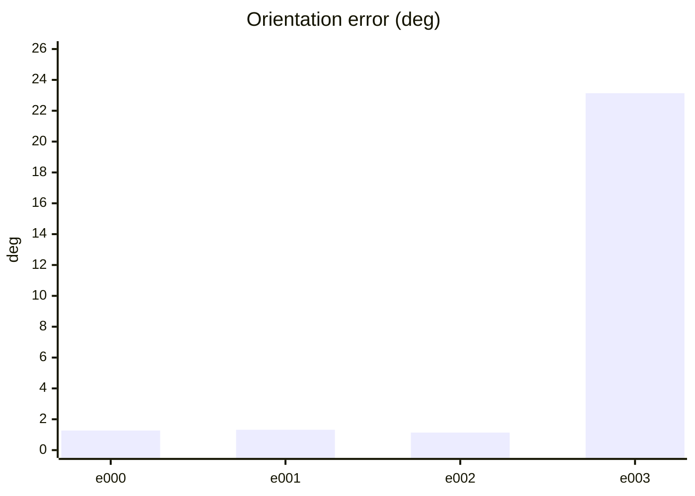

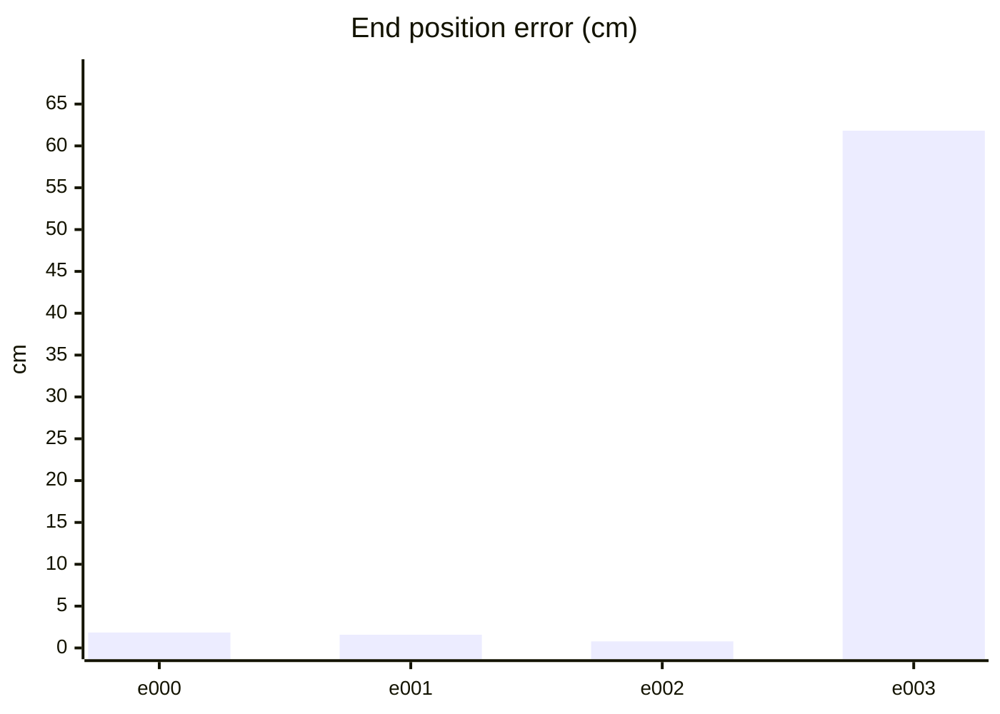

#### PPO 학습 지표 (첫 기록 → 마지막 기록)
| 지표 | 변화 | 간단한 해석 |
| --- | ---: | --- |
| Policy Loss | -0.0232 → 0.0247 | 단독으로 좋고 나쁨을 판정하지 않습니다. NaN·급변 여부를 봅니다. |
| Value Loss | 0.0205 → 0.000746 | 지속적으로 폭증하지 않고 안정적이면 좋습니다. |
| Approximate KL | 0.152 → 0.161 | 급증하면 정책 변화가 과격할 수 있습니다. 1 이상이면 점검이 필요합니다. |
| Clip Fraction | 미기록 | 과도한 clipping 여부를 볼 지표지만 현재 코드가 기록하지 않습니다. |
| Entropy 관련 손실 | -0.164 → -0.00545 | 원래 Entropy는 미기록입니다. 손실값만으로 성능을 판정하지 않습니다. |
| Gradient Norm | 미기록 | 실제 기울기 크기는 미기록입니다. |
| Explained Variance | 미기록 | 1에 가까울수록 예측력이 좋지만 현재 미기록입니다. |
| Episode Length | 112 → 95 | 길이만으로는 부족합니다. 클립 완료율과 함께 봅니다. |
| 조기 종료율 (낙상) | 0% → 0% | 낮을수록 좋습니다. 전체 조기 종료율은 미기록입니다. |
| 클립 완료율 | 100% → 100% | 높을수록 좋습니다. |

학습 손실보다 아래 평가 CSV의 생존·오차·`pass_all`과 영상을 우선 확인하세요.

#### PPO 지표 추이 (x축: 학습 스텝, y축: 지표 값)

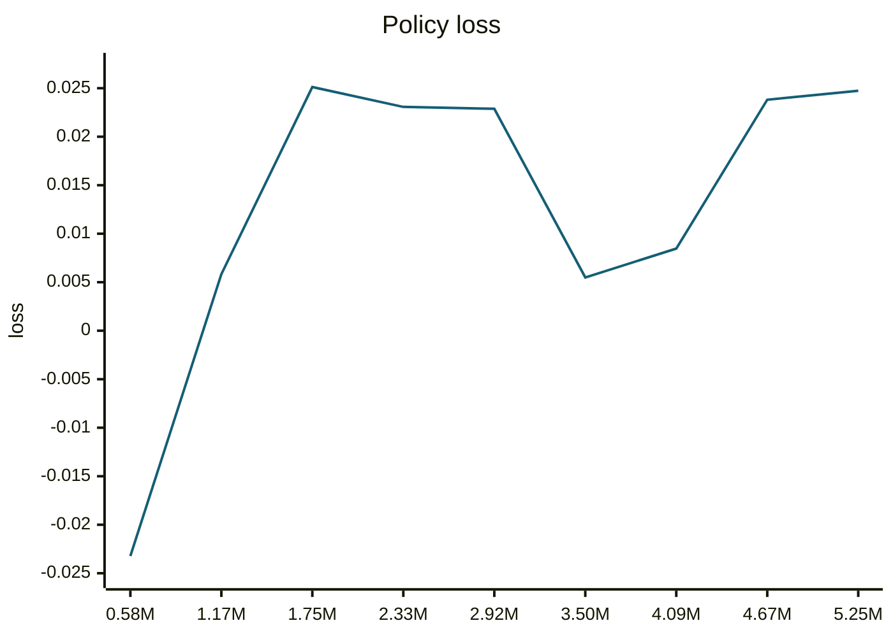

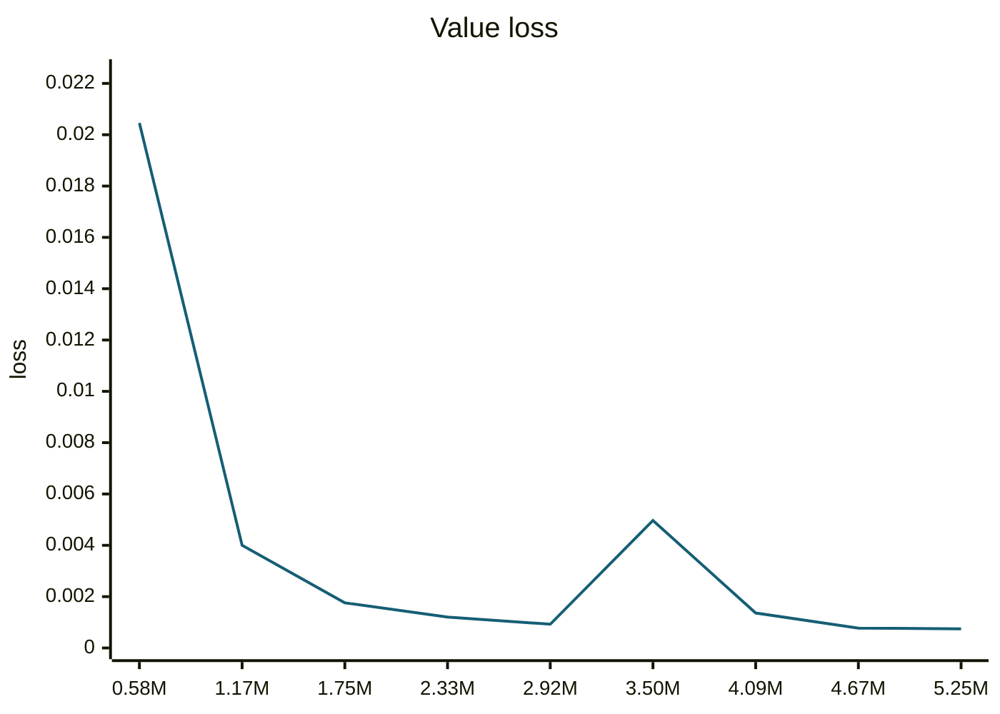

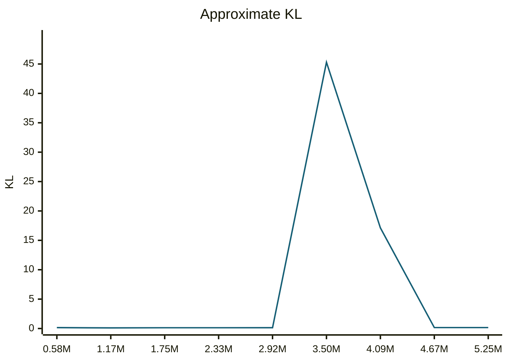

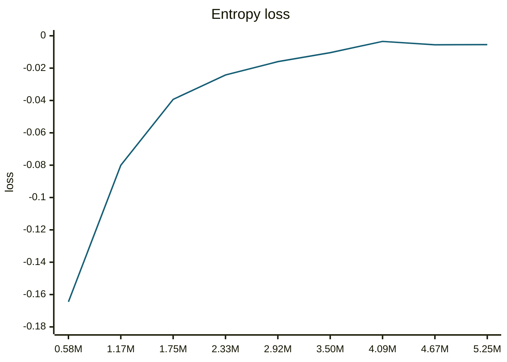

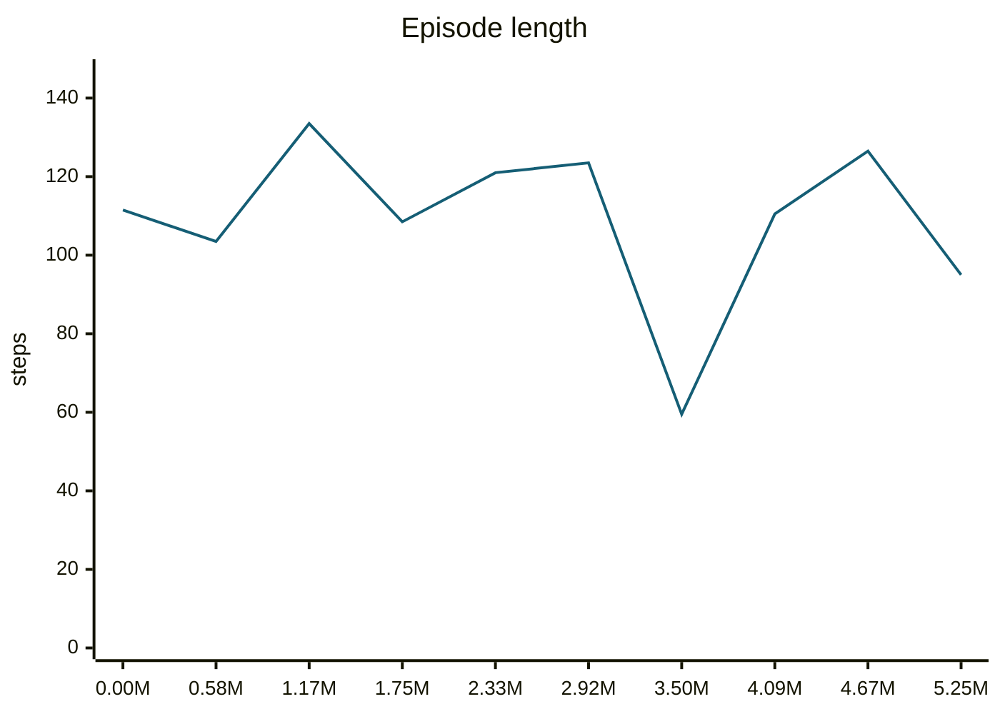

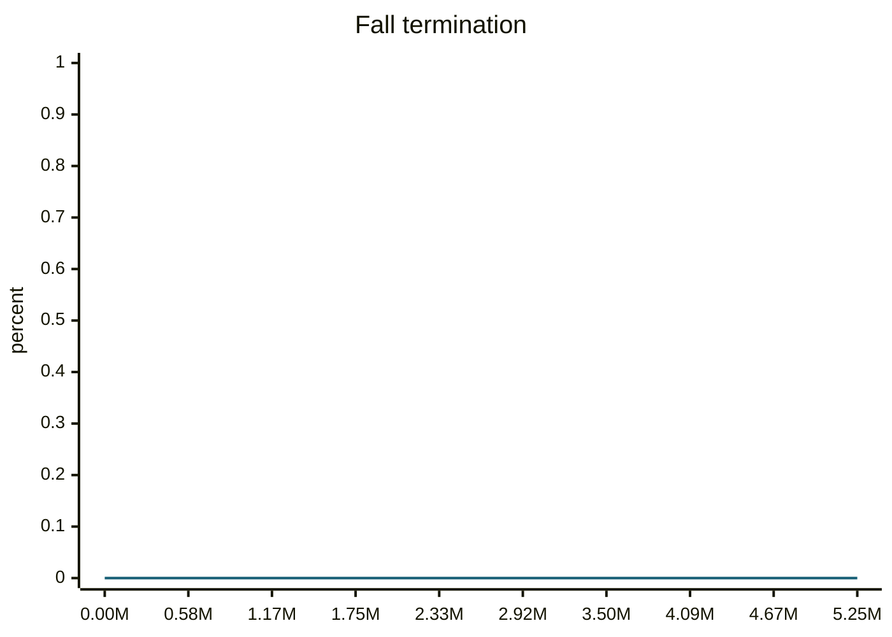

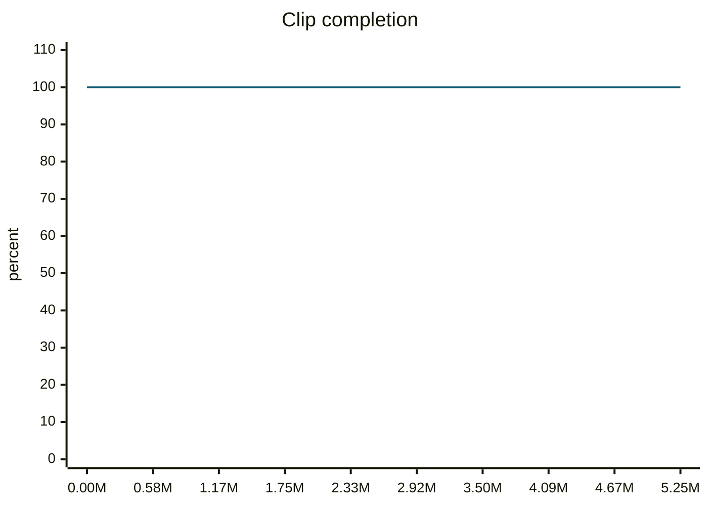

#### motion_eval/summary.csv — `runs/pipeline_v1/experts/trotRightFast__r00/wandb/offline-run-20261015_192058-uqvfcwgf/motion_eval/summary.csv`
```csv
design,motion,frames,evaluated_frames,survived,joint_rms_deg,foot_err_cm,orn_err_deg,end_pos_err_cm,end_pos_tol_cm,travel_m,contact_agree,ref_infeasible,pass_joint,pass_foot,pass_orn,pass_end_pos,pass_contact,pass_all
e000,trotRightFast__r00,99,98,1,1.3802319765090942,0.8720535635948181,1.268718512781639,1.8435560166835785,9.584627151489258,0.9584627151489258,0.9897959183673469,0.16161616161616163,1,1,1,1,1,1
e001,trotRightFast__r00,99,98,1,1.6721967458724976,1.2503564357757568,1.3177245945673668,1.5756167471408844,11.465554237365723,1.1465554237365723,0.9897959183673469,0.2828282828282828,1,1,1,1,1,1
e002,trotRightFast__r00,99,98,1,1.6118580102920532,1.1940903663635254,1.1368660366228673,0.7854723371565342,11.724029779434204,1.1724029779434204,0.9923469387755102,0.26262626262626265,1,1,1,1,1,1
e003,trotRightFast__r00,99,98,1,72.79305267333984,21.683055877685547,23.136980882934836,61.818867921829224,7.739165425300598,0.7739165425300598,0.6938775510204082,0.06060606060606061,0,0,0,0,0,0
```
