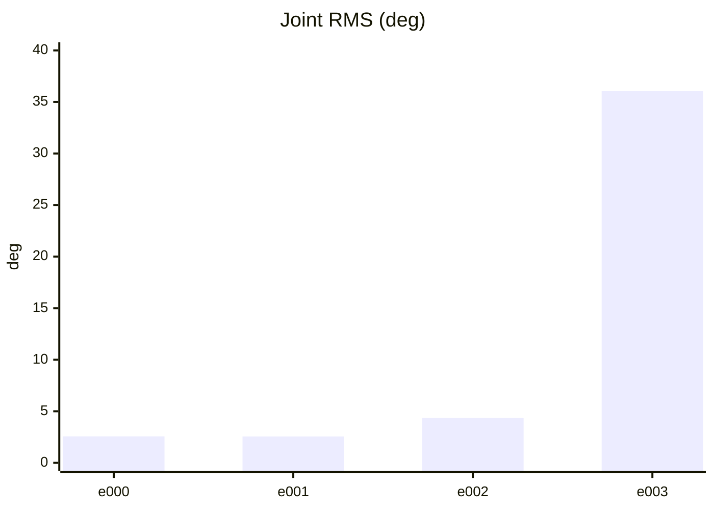
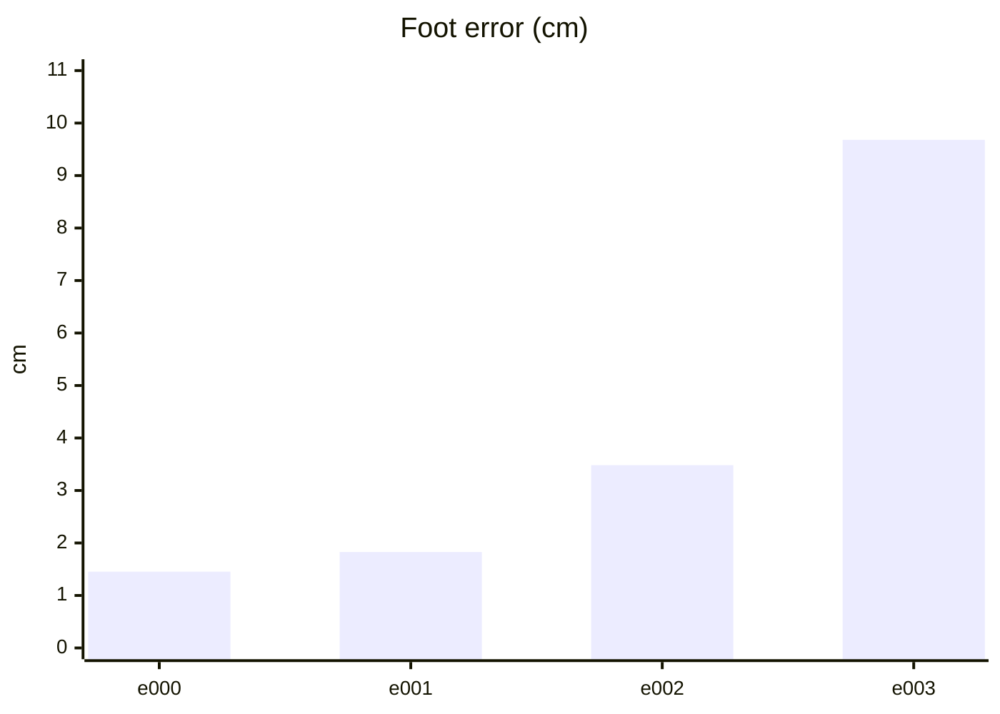
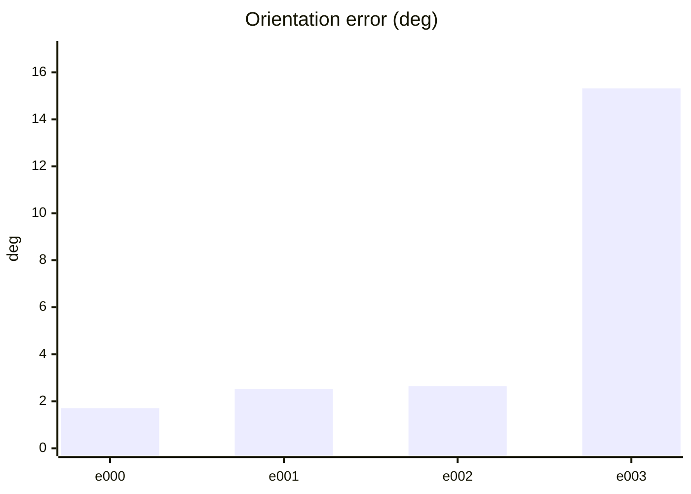
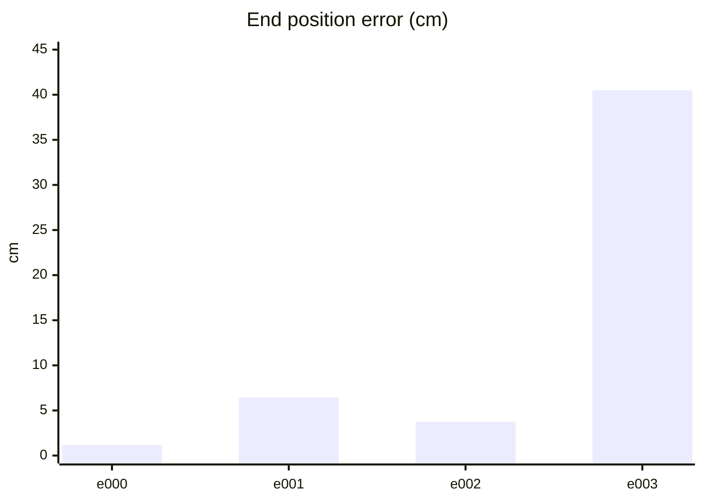
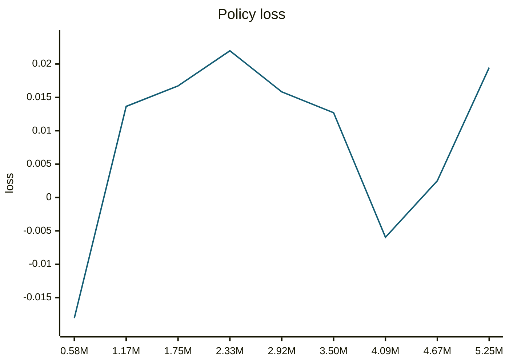
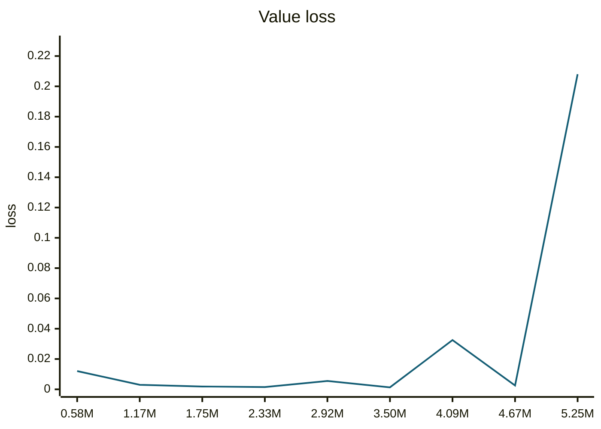
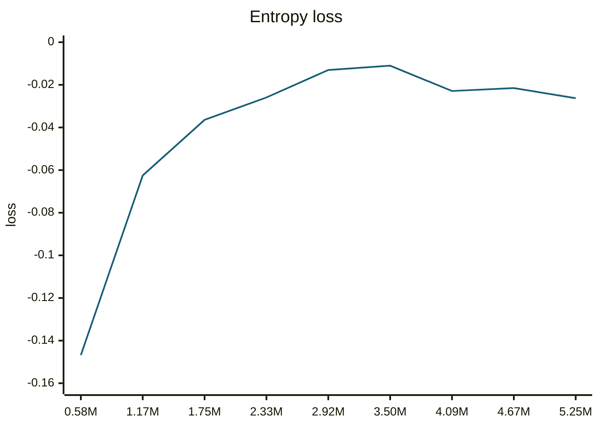
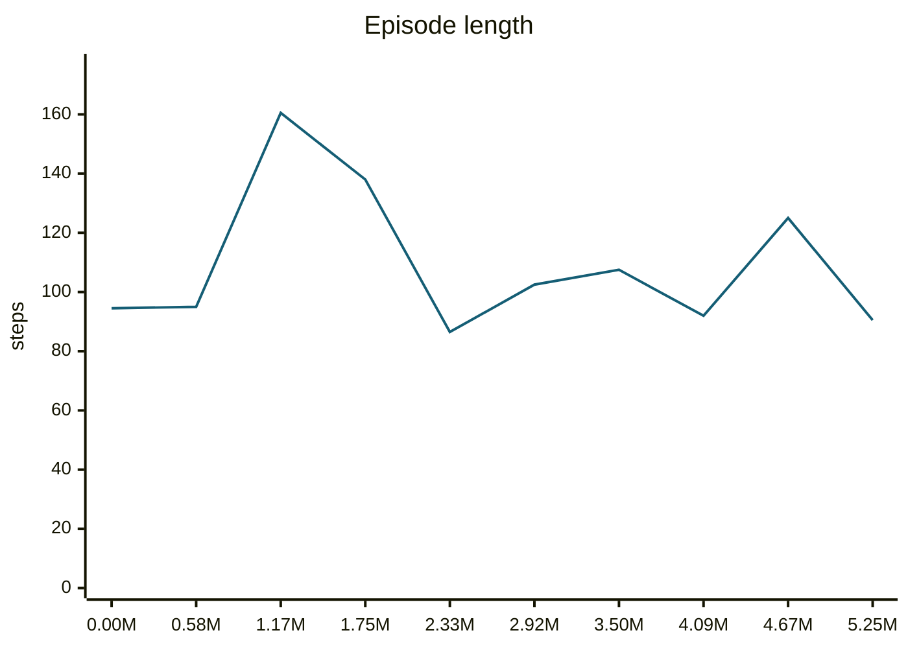
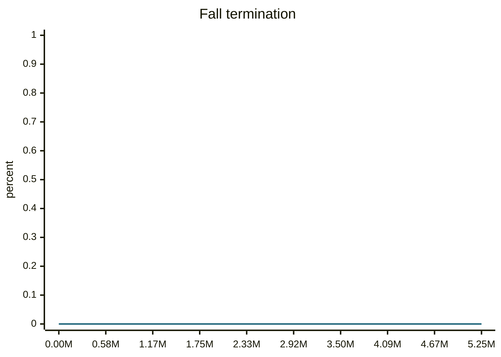
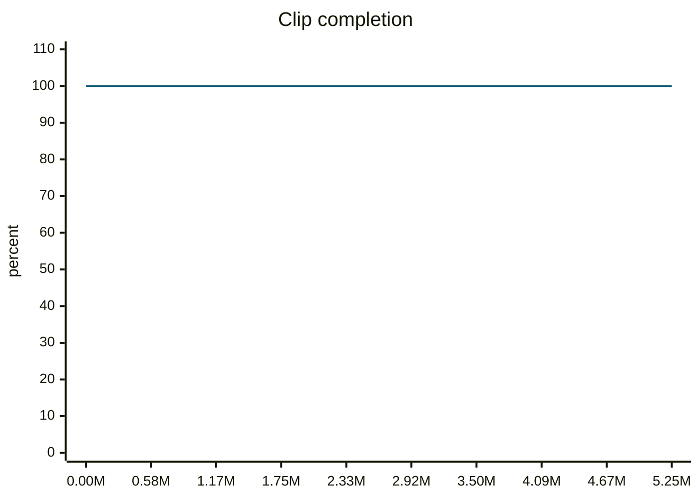

### trotRightSlow__r00 학습·평가 완료
e000~e002로 학습하고 e003은 미학습 형상으로 평가했습니다.

| 형상 | 생존 | 관절 RMS (°) | 발 오차 (cm) | 자세 오차 (°) | 종료 위치 오차 (cm) | 접지 일치 | 종합 |
| --- | --- | ---: | ---: | ---: | ---: | ---: | --- |
| e000 | 예 | 2.56 | 1.45 | 1.71 | 1.18 | 95.8% | 통과 |
| e001 | 예 | 2.56 | 1.83 | 2.52 | 6.43 | 95.8% | 불합격 |
| e002 | 예 | 4.34 | 3.48 | 2.64 | 3.73 | 96.2% | 불합격 |
| e003 | 예 | 36.08 | 9.68 | 15.32 | 40.49 | 82.2% | 불합격 |

오차는 낮을수록, 접지 일치는 높을수록 좋습니다. e003은 학습에 사용하지 않은 형상입니다.

#### 형상별 평가 오차 (x축: 형상, y축: 오차)









#### PPO 학습 지표 (첫 기록 → 마지막 기록)
| 지표 | 변화 | 간단한 해석 |
| --- | ---: | --- |
| Policy Loss | -0.0181 → 0.0195 | 단독으로 좋고 나쁨을 판정하지 않습니다. NaN·급변 여부를 봅니다. |
| Value Loss | 0.012 → 0.208 | 지속적으로 폭증하지 않고 안정적이면 좋습니다. |
| Approximate KL | 0.142 → 1e+04 | 급증하면 정책 변화가 과격할 수 있습니다. 1 이상이면 점검이 필요합니다. |
| Clip Fraction | 미기록 | 과도한 clipping 여부를 볼 지표지만 현재 코드가 기록하지 않습니다. |
| Entropy 관련 손실 | -0.147 → -0.0263 | 원래 Entropy는 미기록입니다. 손실값만으로 성능을 판정하지 않습니다. |
| Gradient Norm | 미기록 | 실제 기울기 크기는 미기록입니다. |
| Explained Variance | 미기록 | 1에 가까울수록 예측력이 좋지만 현재 미기록입니다. |
| Episode Length | 94.5 → 90.5 | 길이만으로는 부족합니다. 클립 완료율과 함께 봅니다. |
| 조기 종료율 (낙상) | 0% → 0% | 낮을수록 좋습니다. 전체 조기 종료율은 미기록입니다. |
| 클립 완료율 | 100% → 100% | 높을수록 좋습니다. |

학습 손실보다 아래 평가 CSV의 생존·오차·`pass_all`과 영상을 우선 확인하세요.

#### PPO 지표 추이 (x축: 학습 스텝, y축: 지표 값)





```mermaid
---
config:
  theme: base
  themeVariables:
    xyChart:
      plotColorPalette: '#155e75'
  themeCSS: '.line-plot-0 path { stroke-width: 3.5px !important; }'
---
xychart-beta
    title "Approximate KL"
    x-axis ["0.58M", "1.17M", "1.75M", "2.33M", "2.92M", "3.50M", "4.09M", "4.67M", "5.25M"]
    y-axis "KL" 0 --> 1.1e+04
    line [0.1417, 0.1024, 0.1118, 0.1203, 0.1405, 3.117, 39.34, 0.1561, 1.001e+04]
```









#### motion_eval/summary.csv — `runs/pipeline_v1/experts/trotRightSlow__r00/wandb/offline-run-20261015_193914-n9e79hes/motion_eval/summary.csv`
```csv
design,motion,frames,evaluated_frames,survived,joint_rms_deg,foot_err_cm,orn_err_deg,end_pos_err_cm,end_pos_tol_cm,travel_m,contact_agree,ref_infeasible,pass_joint,pass_foot,pass_orn,pass_end_pos,pass_contact,pass_all
e000,trotRightSlow__r00,101,100,1,2.564643144607544,1.4541385173797607,1.7075614923597504,1.1845700442790985,5.0,0.40877848863601685,0.9575,0.1188118811881188,1,1,1,1,1,1
e001,trotRightSlow__r00,101,100,1,2.56060528755188,1.8282361030578613,2.524332755268661,6.433706730604172,5.0,0.48885589838027954,0.9575,0.13861386138613863,1,1,1,0,1,0
e002,trotRightSlow__r00,101,100,1,4.341126441955566,3.481994867324829,2.6407151601198473,3.734104335308075,5.000343322753906,0.5000343322753906,0.9625,0.12871287128712872,1,0,1,1,1,0
e003,trotRightSlow__r00,101,100,1,36.084007263183594,9.680434226989746,15.315998358971514,40.488401055336,5.0,0.33068394660949707,0.8225,0.1188118811881188,0,0,0,0,0,0
```
