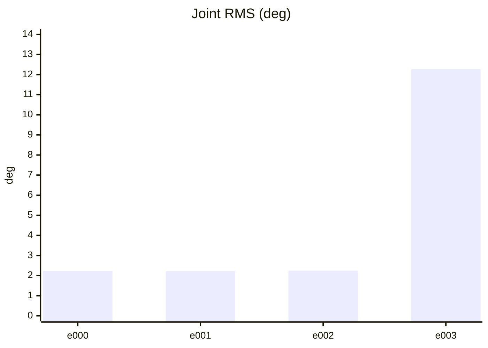
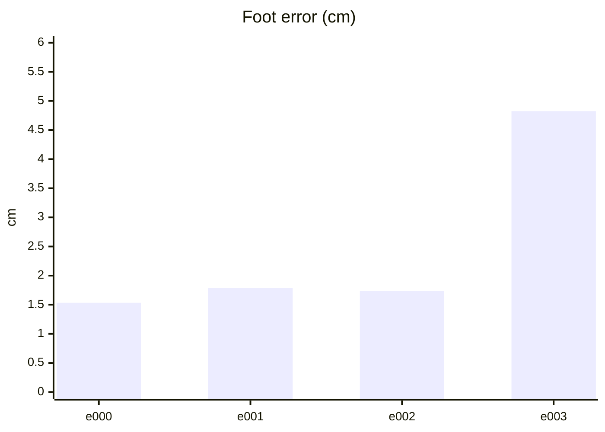
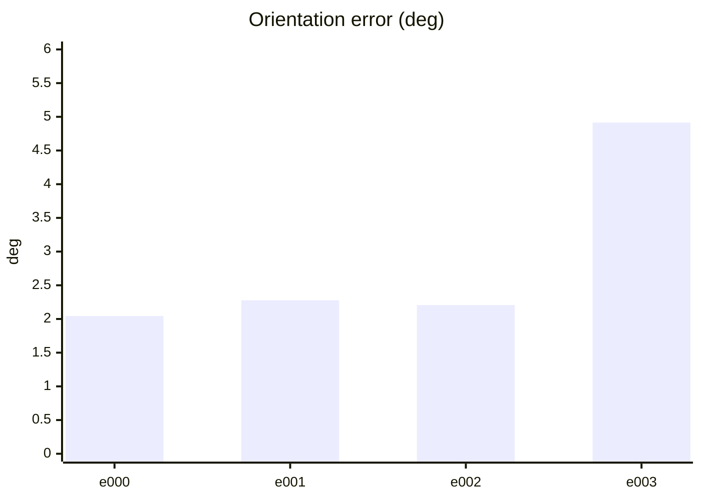
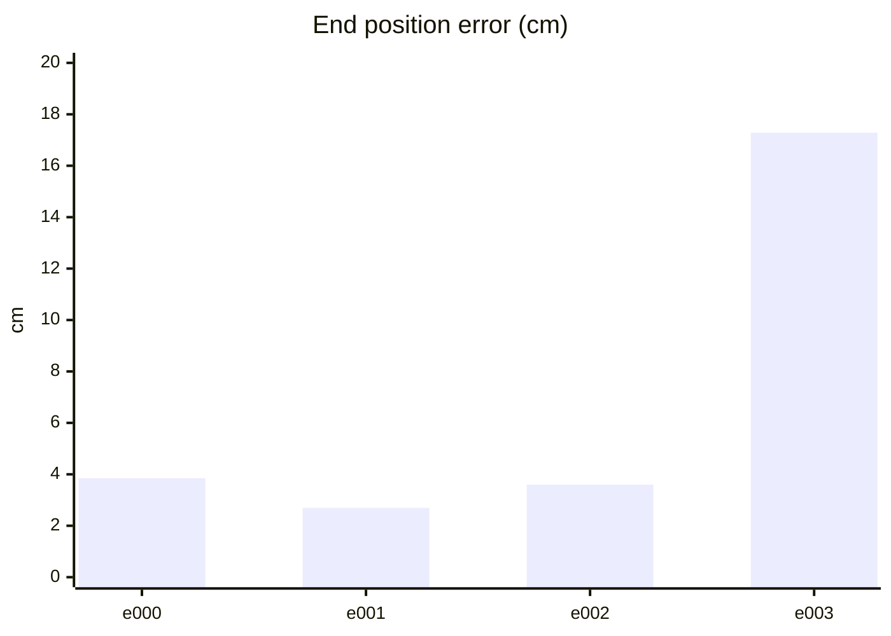
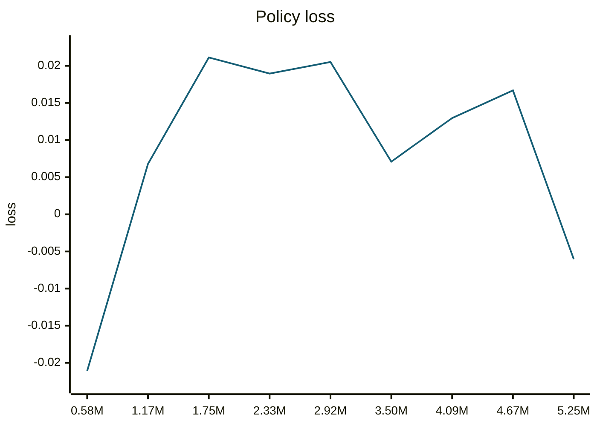
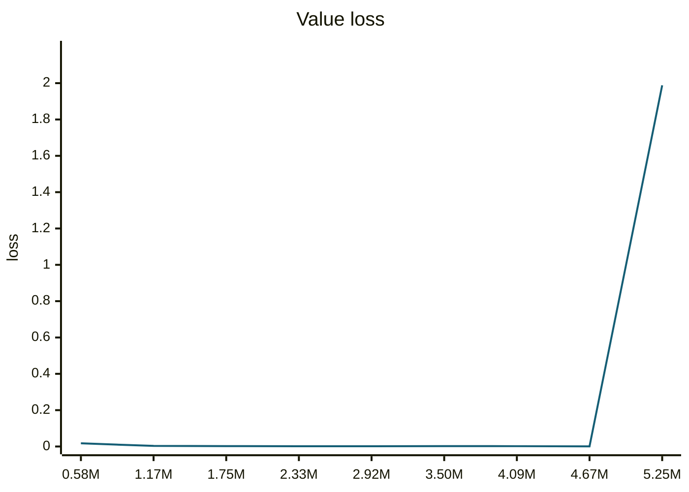
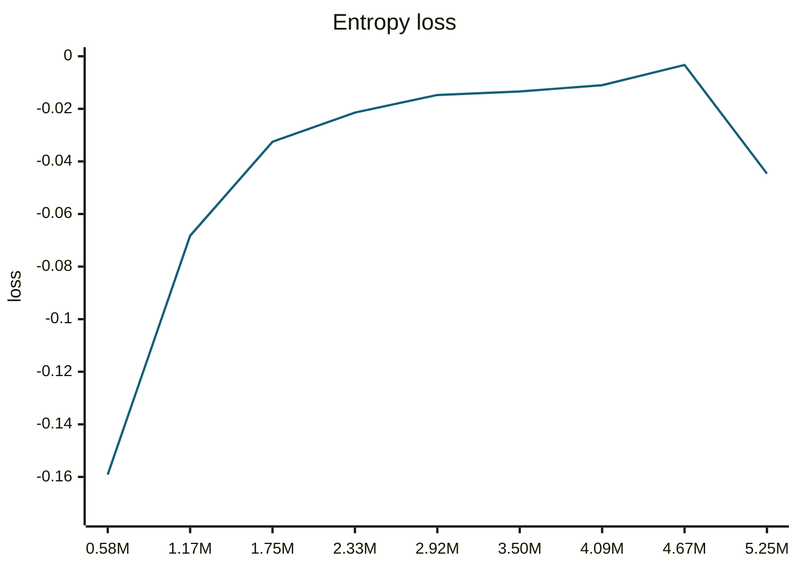
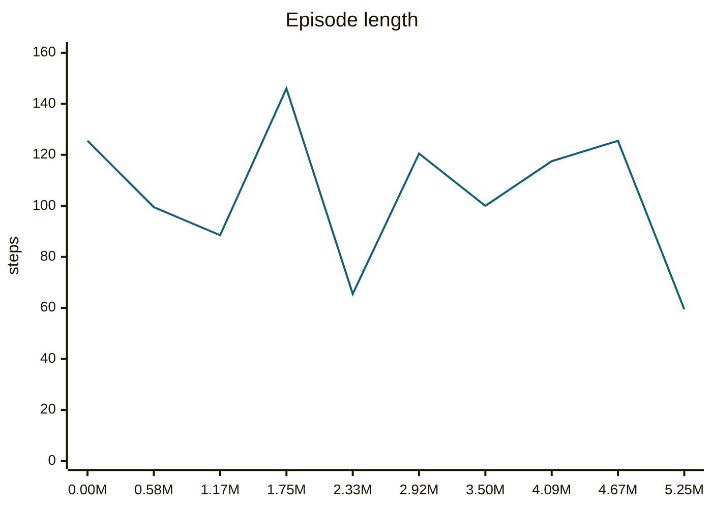
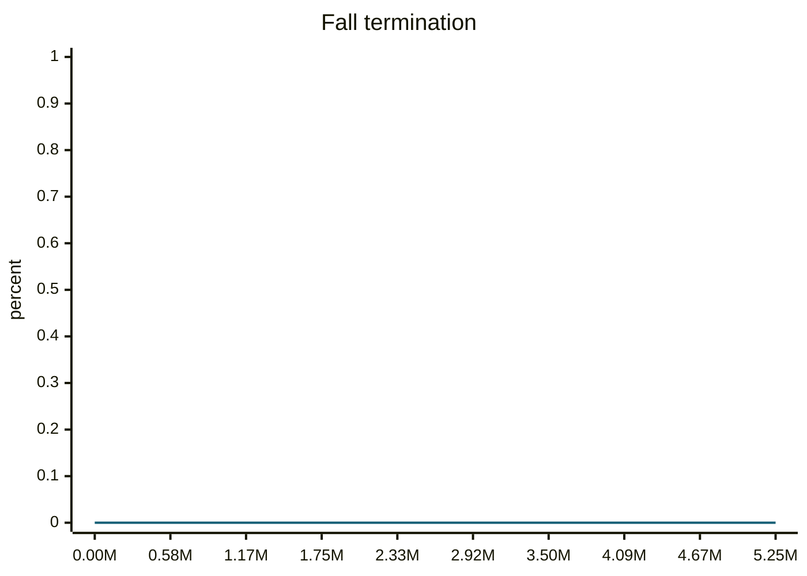
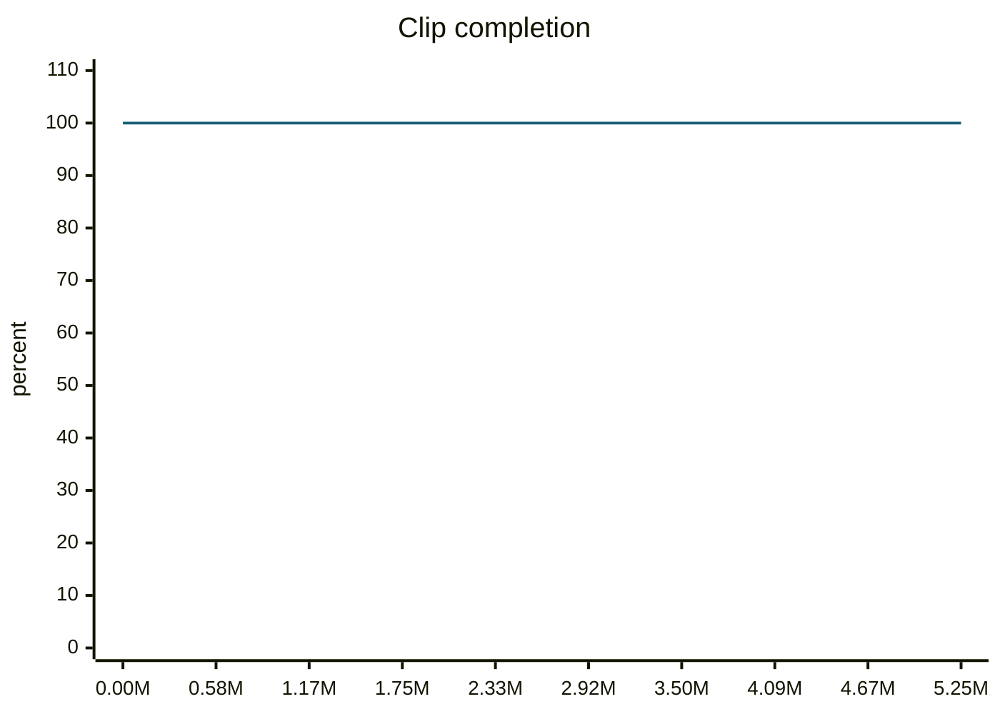

### walkBackwardFast__r00 학습·평가 완료
e000~e002로 학습하고 e003은 미학습 형상으로 평가했습니다.

| 형상 | 생존 | 관절 RMS (°) | 발 오차 (cm) | 자세 오차 (°) | 종료 위치 오차 (cm) | 접지 일치 | 종합 |
| --- | --- | ---: | ---: | ---: | ---: | ---: | --- |
| e000 | 예 | 2.23 | 1.53 | 2.04 | 3.85 | 97.9% | 통과 |
| e001 | 예 | 2.22 | 1.79 | 2.28 | 2.69 | 98.9% | 통과 |
| e002 | 예 | 2.25 | 1.74 | 2.21 | 3.60 | 97.9% | 통과 |
| e003 | 예 | 12.27 | 4.82 | 4.91 | 17.29 | 80.6% | 불합격 |

오차는 낮을수록, 접지 일치는 높을수록 좋습니다. e003은 학습에 사용하지 않은 형상입니다.

#### 형상별 평가 오차 (x축: 형상, y축: 오차)









#### PPO 학습 지표 (첫 기록 → 마지막 기록)
| 지표 | 변화 | 간단한 해석 |
| --- | ---: | --- |
| Policy Loss | -0.0211 → -0.00604 | 단독으로 좋고 나쁨을 판정하지 않습니다. NaN·급변 여부를 봅니다. |
| Value Loss | 0.0174 → 1.99 | 지속적으로 폭증하지 않고 안정적이면 좋습니다. |
| Approximate KL | 0.131 → 2.95e+03 | 급증하면 정책 변화가 과격할 수 있습니다. 1 이상이면 점검이 필요합니다. |
| Clip Fraction | 미기록 | 과도한 clipping 여부를 볼 지표지만 현재 코드가 기록하지 않습니다. |
| Entropy 관련 손실 | -0.159 → -0.0446 | 원래 Entropy는 미기록입니다. 손실값만으로 성능을 판정하지 않습니다. |
| Gradient Norm | 미기록 | 실제 기울기 크기는 미기록입니다. |
| Explained Variance | 미기록 | 1에 가까울수록 예측력이 좋지만 현재 미기록입니다. |
| Episode Length | 126 → 59.5 | 길이만으로는 부족합니다. 클립 완료율과 함께 봅니다. |
| 조기 종료율 (낙상) | 0% → 0% | 낮을수록 좋습니다. 전체 조기 종료율은 미기록입니다. |
| 클립 완료율 | 100% → 100% | 높을수록 좋습니다. |

학습 손실보다 아래 평가 CSV의 생존·오차·`pass_all`과 영상을 우선 확인하세요.

#### PPO 지표 추이 (x축: 학습 스텝, y축: 지표 값)





```mermaid
---
config:
  theme: base
  themeVariables:
    xyChart:
      plotColorPalette: '#155e75'
  themeCSS: '.line-plot-0 path { stroke-width: 3.5px !important; }'
---
xychart-beta
    title "Approximate KL"
    x-axis ["0.58M", "1.17M", "1.75M", "2.33M", "2.92M", "3.50M", "4.09M", "4.67M", "5.25M"]
    y-axis "KL" 0 --> 3.25e+03
    line [0.1315, 0.1007, 0.09901, 0.1032, 0.8745, 2.747, 17.95, 0.1338, 2950]
```









#### motion_eval/summary.csv — `runs/pipeline_v1/experts/walkBackwardFast__r00/wandb/offline-run-20261015_195731-yywb500w/motion_eval/summary.csv`
```csv
design,motion,frames,evaluated_frames,survived,joint_rms_deg,foot_err_cm,orn_err_deg,end_pos_err_cm,end_pos_tol_cm,travel_m,contact_agree,ref_infeasible,pass_joint,pass_foot,pass_orn,pass_end_pos,pass_contact,pass_all
e000,walkBackwardFast__r00,95,94,1,2.230130195617676,1.533847451210022,2.0443538335321954,3.84988896548748,15.782091617584229,1.5782091617584229,0.9787234042553191,0.031578947368421054,1,1,1,1,1,1
e001,walkBackwardFast__r00,95,94,1,2.2229697704315186,1.7902618646621704,2.2779165577352396,2.6941459625959396,18.88002038002014,1.8880020380020142,0.9893617021276596,0.10526315789473684,1,1,1,1,1,1
e002,walkBackwardFast__r00,95,94,1,2.2481727600097656,1.7357133626937866,2.2066255417722,3.597443923354149,19.30605173110962,1.930605173110962,0.9787234042553191,0.09473684210526316,1,1,1,1,1,1
e003,walkBackwardFast__r00,95,94,1,12.266582489013672,4.823586940765381,4.9136755232484814,17.285506427288055,12.742980718612671,1.274298071861267,0.8058510638297872,0.031578947368421054,0,0,1,0,0,0
```
