### walkCCWSlow__r00 학습·평가 완료
e000~e002로 학습하고 e003은 미학습 형상으로 평가했습니다.

| 형상 | 생존 | 관절 RMS (°) | 발 오차 (cm) | 자세 오차 (°) | 종료 위치 오차 (cm) | 접지 일치 | 종합 |
| --- | --- | ---: | ---: | ---: | ---: | ---: | --- |
| e000 | 예 | 2.59 | 1.54 | 2.17 | 1.13 | 93.6% | 통과 |
| e001 | 예 | 2.64 | 1.95 | 1.92 | 7.79 | 92.7% | 불합격 |
| e002 | 예 | 2.58 | 1.77 | 2.52 | 5.19 | 96.1% | 불합격 |
| e003 | 예 | 28.46 | 12.89 | 22.12 | 35.61 | 68.6% | 불합격 |

오차는 낮을수록, 접지 일치는 높을수록 좋습니다. e003은 학습에 사용하지 않은 형상입니다.

#### 형상별 평가 오차 (x축: 형상, y축: 오차)

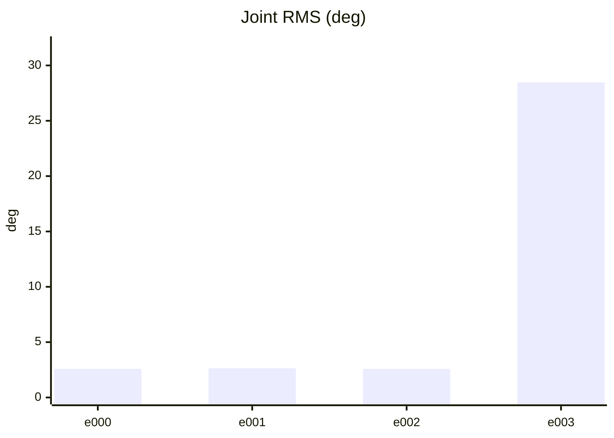

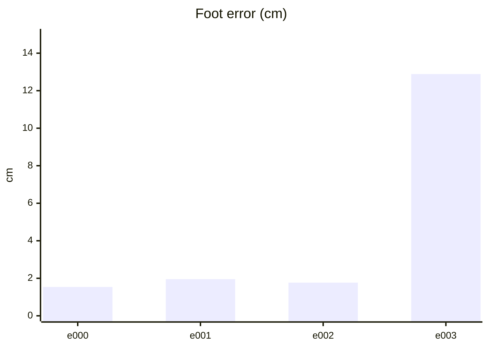

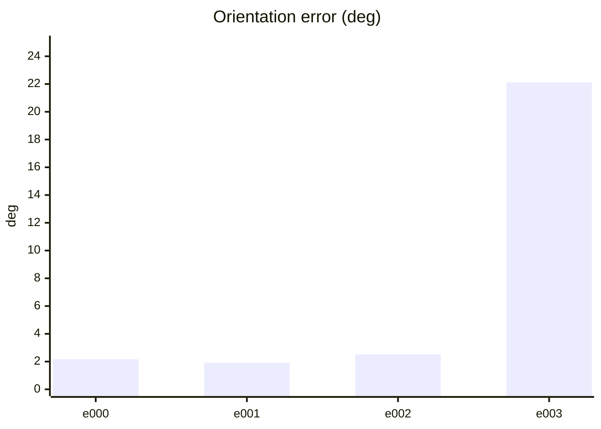

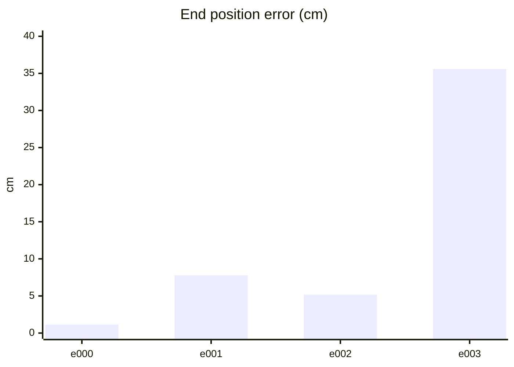

#### PPO 학습 지표 (첫 기록 → 마지막 기록)
| 지표 | 변화 | 간단한 해석 |
| --- | ---: | --- |
| Policy Loss | -0.0223 → -0.0241 | 단독으로 좋고 나쁨을 판정하지 않습니다. NaN·급변 여부를 봅니다. |
| Value Loss | 0.0254 → 0.0771 | 지속적으로 폭증하지 않고 안정적이면 좋습니다. |
| Approximate KL | 0.167 → 7.6 | 급증하면 정책 변화가 과격할 수 있습니다. 1 이상이면 점검이 필요합니다. |
| Clip Fraction | 미기록 | 과도한 clipping 여부를 볼 지표지만 현재 코드가 기록하지 않습니다. |
| Entropy 관련 손실 | -0.163 → -0.0784 | 원래 Entropy는 미기록입니다. 손실값만으로 성능을 판정하지 않습니다. |
| Gradient Norm | 미기록 | 실제 기울기 크기는 미기록입니다. |
| Explained Variance | 미기록 | 1에 가까울수록 예측력이 좋지만 현재 미기록입니다. |
| Episode Length | 268 → 120 | 길이만으로는 부족합니다. 클립 완료율과 함께 봅니다. |
| 조기 종료율 (낙상) | 0% → 0% | 낮을수록 좋습니다. 전체 조기 종료율은 미기록입니다. |
| 클립 완료율 | 100% → 100% | 높을수록 좋습니다. |

학습 손실보다 아래 평가 CSV의 생존·오차·`pass_all`과 영상을 우선 확인하세요.

#### PPO 지표 추이 (x축: 학습 스텝, y축: 지표 값)

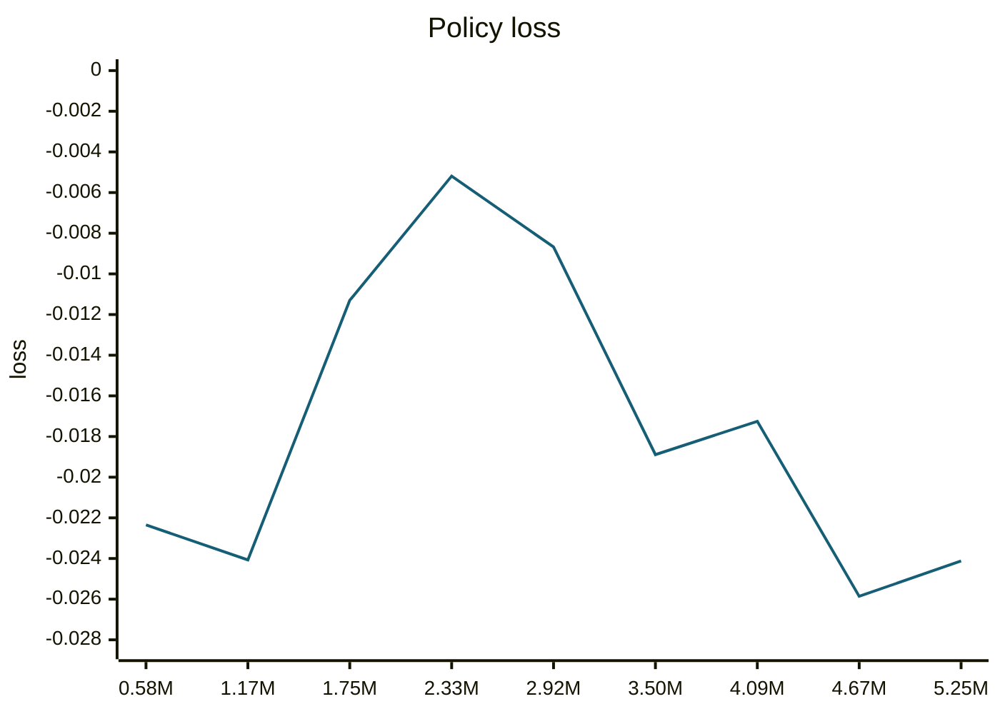

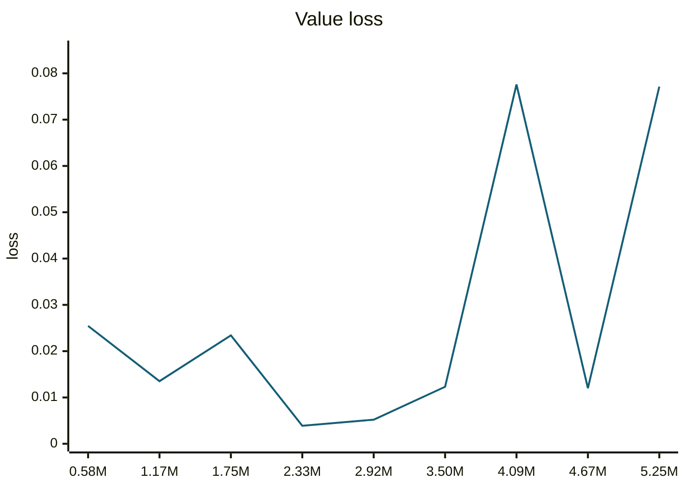

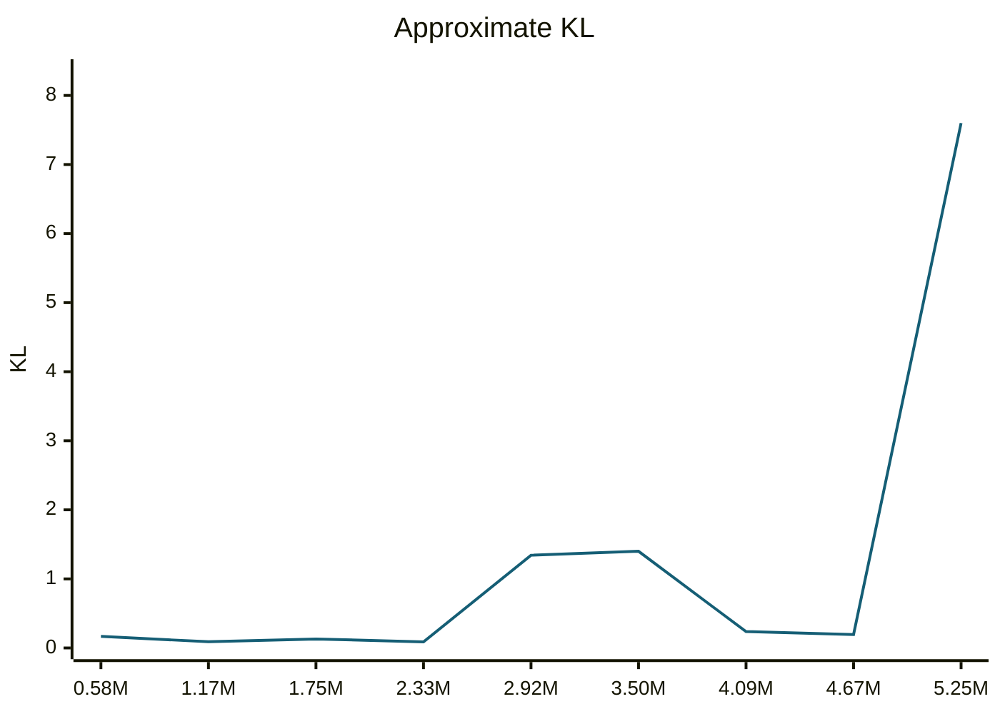

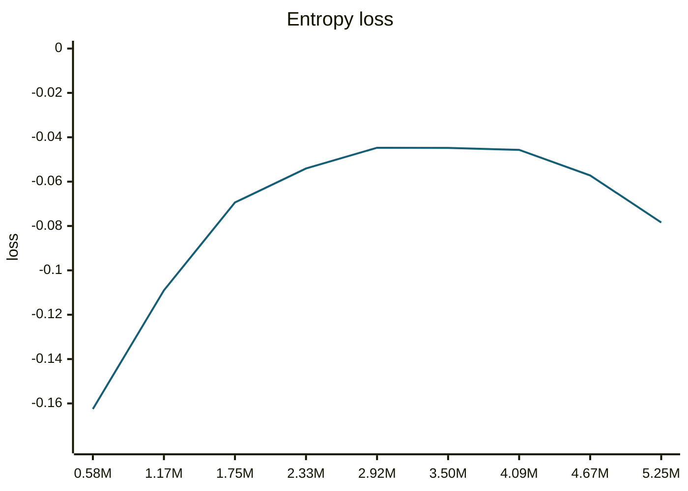

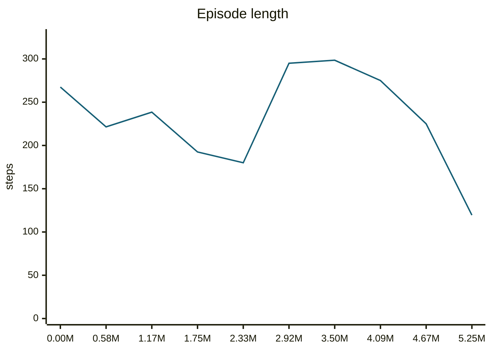

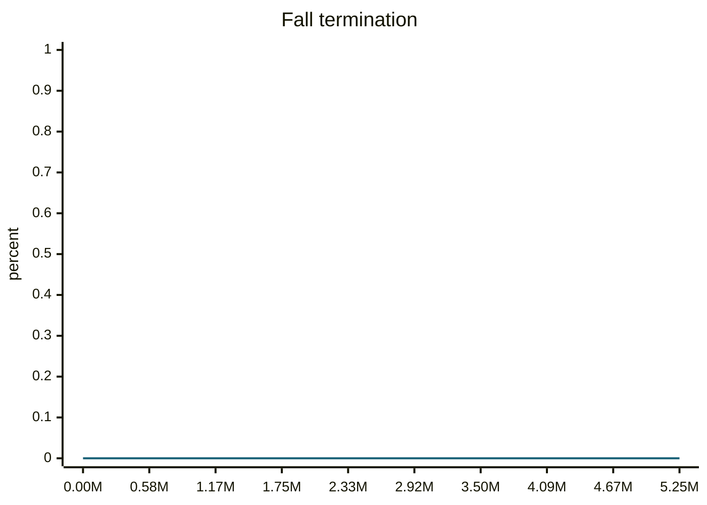

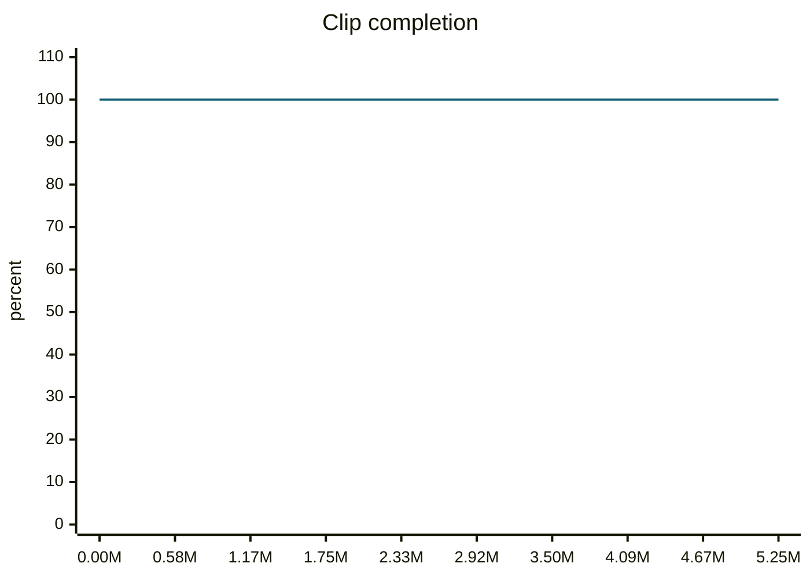

#### motion_eval/summary.csv — `runs/pipeline_v1/experts/walkCCWSlow__r00/wandb/offline-run-20261015_203423-ji8orv4i/motion_eval/summary.csv`
```csv
design,motion,frames,evaluated_frames,survived,joint_rms_deg,foot_err_cm,orn_err_deg,end_pos_err_cm,end_pos_tol_cm,travel_m,contact_agree,ref_infeasible,pass_joint,pass_foot,pass_orn,pass_end_pos,pass_contact,pass_all
e000,walkCCWSlow__r00,228,227,1,2.5850038528442383,1.5377967357635498,2.1675082784893065,1.1336764320731163,5.0,0.02787027880549431,0.9361233480176211,0.02631578947368421,1,1,1,1,1,1
e001,walkCCWSlow__r00,228,227,1,2.6447625160217285,1.954561471939087,1.9176935967912419,7.786162197589874,5.0,0.0333610475063324,0.9273127753303965,0.03508771929824561,1,1,1,0,1,0
e002,walkCCWSlow__r00,228,227,1,2.5795583724975586,1.7686711549758911,2.51791722947598,5.186184123158455,5.0,0.03409583121538162,0.961453744493392,0.03070175438596491,1,1,1,0,1,0
e003,walkCCWSlow__r00,228,227,1,28.46368408203125,12.886622428894043,22.11613582091647,35.606181621551514,5.0,0.02223028615117073,0.6861233480176211,0.043859649122807015,0,0,0,0,0,0
```
