### walkForwardFast__r00 학습·평가 완료
e000~e002로 학습하고 e003은 미학습 형상으로 평가했습니다.

| 형상 | 생존 | 관절 RMS (°) | 발 오차 (cm) | 자세 오차 (°) | 종료 위치 오차 (cm) | 접지 일치 | 종합 |
| --- | --- | ---: | ---: | ---: | ---: | ---: | --- |
| e000 | 예 | 1.96 | 1.23 | 1.30 | 2.66 | 99.2% | 통과 |
| e001 | 예 | 1.84 | 1.54 | 1.46 | 1.86 | 97.8% | 통과 |
| e002 | 예 | 1.93 | 1.51 | 1.73 | 0.75 | 97.3% | 통과 |
| e003 | 예 | 41.78 | 11.86 | 19.91 | 99.32 | 78.8% | 불합격 |

오차는 낮을수록, 접지 일치는 높을수록 좋습니다. e003은 학습에 사용하지 않은 형상입니다.

#### 형상별 평가 오차 (x축: 형상, y축: 오차)

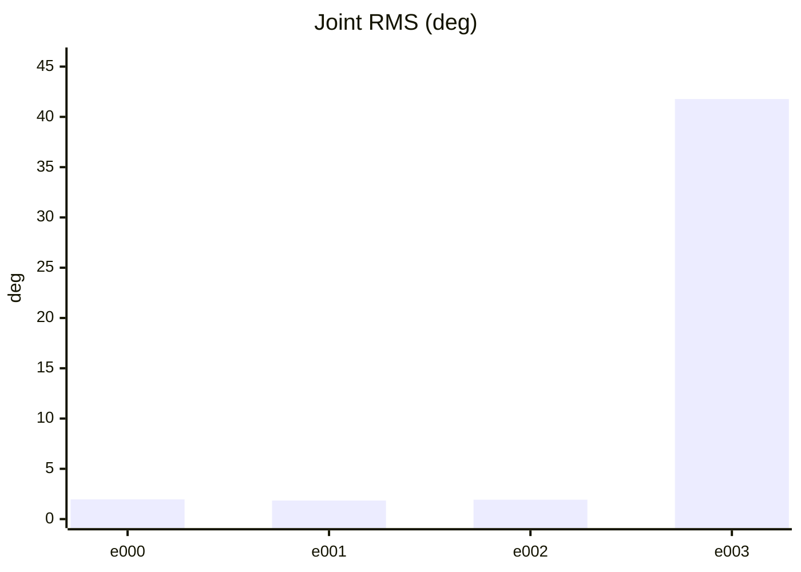

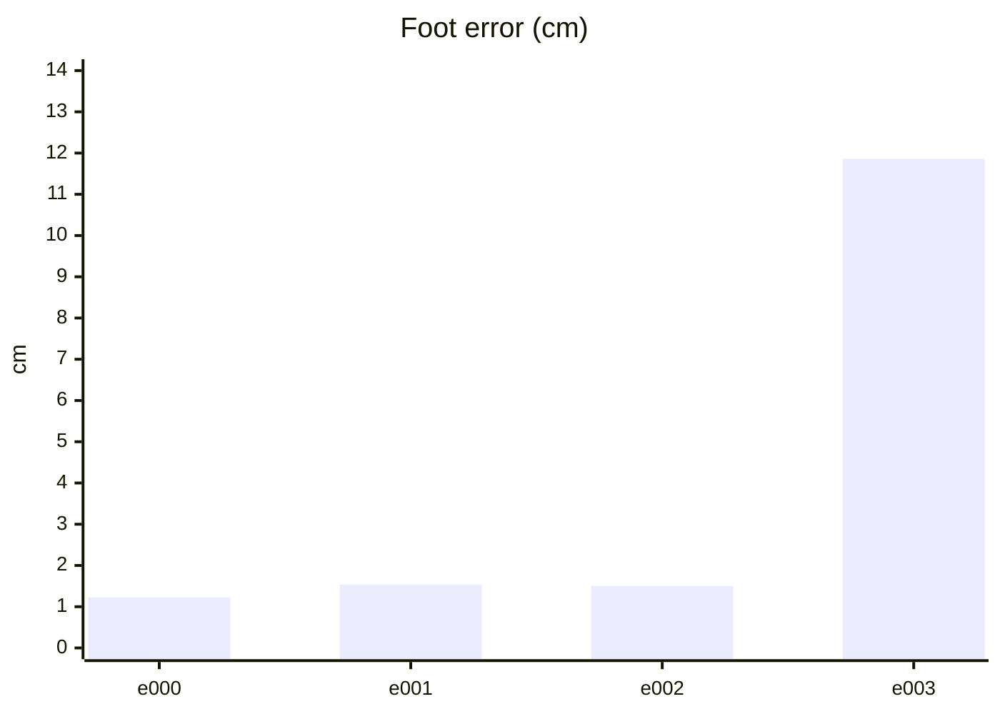

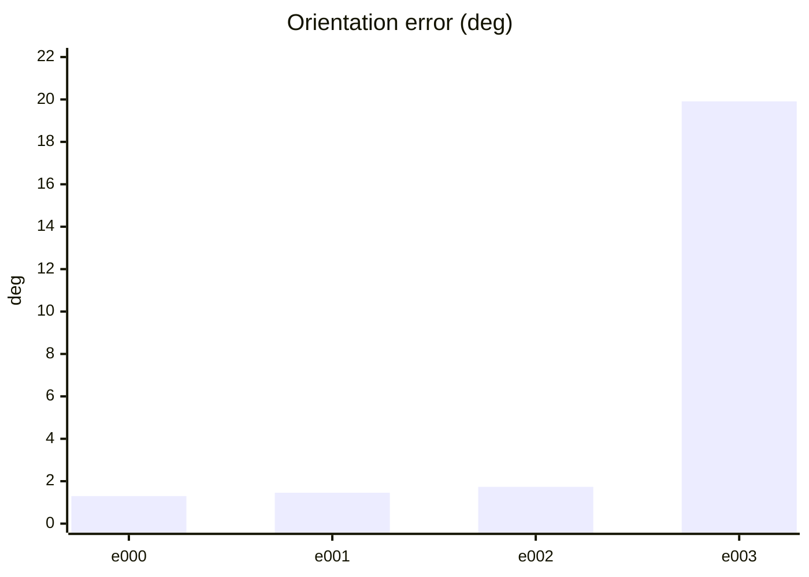

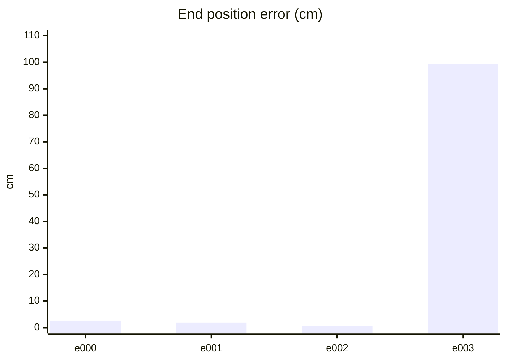

#### PPO 학습 지표 (첫 기록 → 마지막 기록)
| 지표 | 변화 | 간단한 해석 |
| --- | ---: | --- |
| Policy Loss | -0.0228 → -0.0148 | 단독으로 좋고 나쁨을 판정하지 않습니다. NaN·급변 여부를 봅니다. |
| Value Loss | 0.032 → 0.00864 | 지속적으로 폭증하지 않고 안정적이면 좋습니다. |
| Approximate KL | 0.156 → 111 | 급증하면 정책 변화가 과격할 수 있습니다. 1 이상이면 점검이 필요합니다. |
| Clip Fraction | 미기록 | 과도한 clipping 여부를 볼 지표지만 현재 코드가 기록하지 않습니다. |
| Entropy 관련 손실 | -0.175 → -0.0201 | 원래 Entropy는 미기록입니다. 손실값만으로 성능을 판정하지 않습니다. |
| Gradient Norm | 미기록 | 실제 기울기 크기는 미기록입니다. |
| Explained Variance | 미기록 | 1에 가까울수록 예측력이 좋지만 현재 미기록입니다. |
| Episode Length | 102 → 126 | 길이만으로는 부족합니다. 클립 완료율과 함께 봅니다. |
| 조기 종료율 (낙상) | 25% → 0% | 낮을수록 좋습니다. 전체 조기 종료율은 미기록입니다. |
| 클립 완료율 | 75% → 100% | 높을수록 좋습니다. |

학습 손실보다 아래 평가 CSV의 생존·오차·`pass_all`과 영상을 우선 확인하세요.

#### PPO 지표 추이 (x축: 학습 스텝, y축: 지표 값)

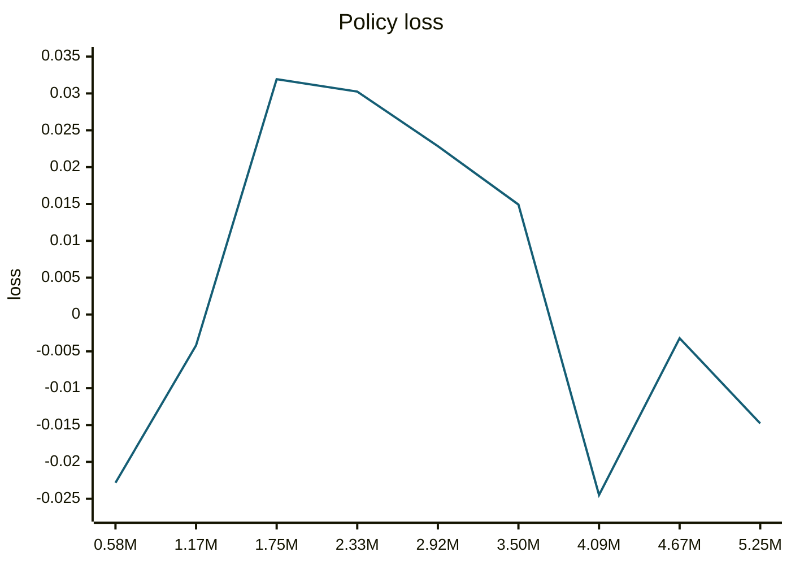

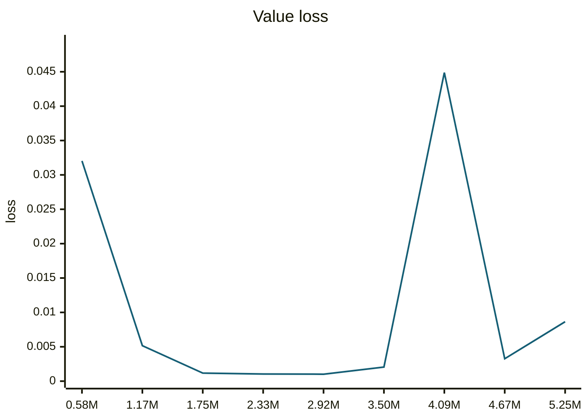

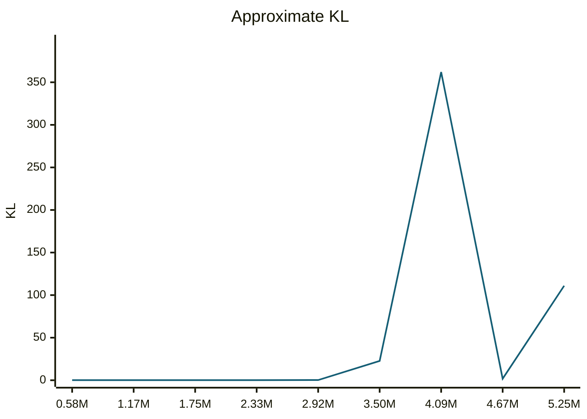

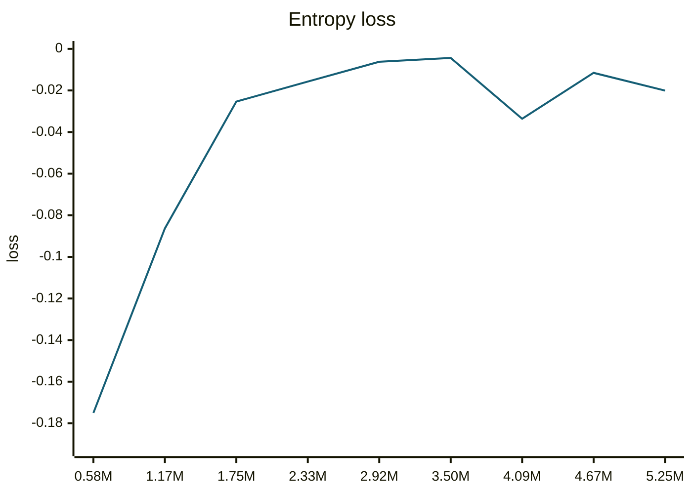

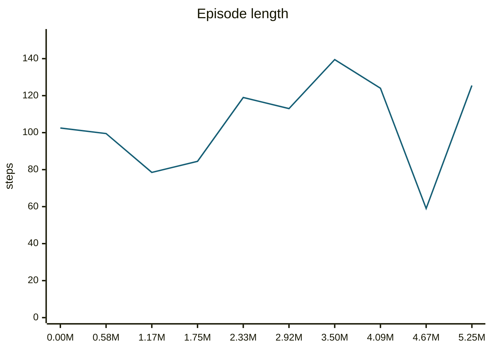

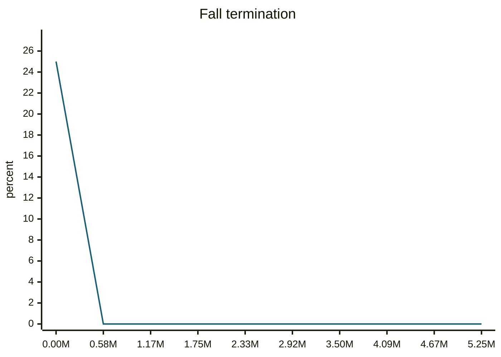

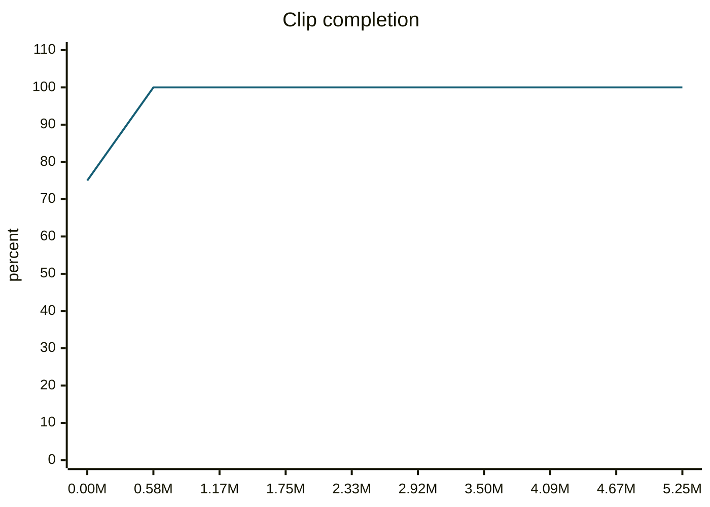

#### motion_eval/summary.csv — `runs/pipeline_v1/experts/walkForwardFast__r00/wandb/offline-run-20261015_205247-nuzwqro2/motion_eval/summary.csv`
```csv
design,motion,frames,evaluated_frames,survived,joint_rms_deg,foot_err_cm,orn_err_deg,end_pos_err_cm,end_pos_tol_cm,travel_m,contact_agree,ref_infeasible,pass_joint,pass_foot,pass_orn,pass_end_pos,pass_contact,pass_all
e000,walkForwardFast__r00,92,91,1,1.9589935541152954,1.2266391515731812,1.298803923124093,2.661726623773575,18.94993305206299,1.8949933052062988,0.9917582417582418,0.15217391304347827,1,1,1,1,1,1
e001,walkForwardFast__r00,92,91,1,1.8413915634155273,1.5389472246170044,1.4569066016738017,1.8585599958896637,22.667410373687748,2.2667410373687744,0.978021978021978,0.33695652173913043,1,1,1,1,1,1
e002,walkForwardFast__r00,92,91,1,1.9282431602478027,1.5061568021774292,1.734986098635791,0.7474975194782019,23.178691864013672,2.317869186401367,0.9725274725274725,0.32608695652173914,1,1,1,1,1,1
e003,walkForwardFast__r00,92,91,1,41.775577545166016,11.861296653747559,19.91078730694599,99.3204116821289,15.30434250831604,1.530434250831604,0.7884615384615384,0.10869565217391304,0,0,0,0,0,0
```
