### walkForwardSlow__r00 학습·평가 완료
e000~e002로 학습하고 e003은 미학습 형상으로 평가했습니다.

| 형상 | 생존 | 관절 RMS (°) | 발 오차 (cm) | 자세 오차 (°) | 종료 위치 오차 (cm) | 접지 일치 | 종합 |
| --- | --- | ---: | ---: | ---: | ---: | ---: | --- |
| e000 | 예 | 1.99 | 1.20 | 1.59 | 2.32 | 96.8% | 통과 |
| e001 | 예 | 2.05 | 1.51 | 1.21 | 1.72 | 97.0% | 통과 |
| e002 | 예 | 2.28 | 1.53 | 1.94 | 3.88 | 97.8% | 통과 |
| e003 | 예 | 12.56 | 4.81 | 4.48 | 11.00 | 90.3% | 불합격 |

오차는 낮을수록, 접지 일치는 높을수록 좋습니다. e003은 학습에 사용하지 않은 형상입니다.

#### 형상별 평가 오차 (x축: 형상, y축: 오차)

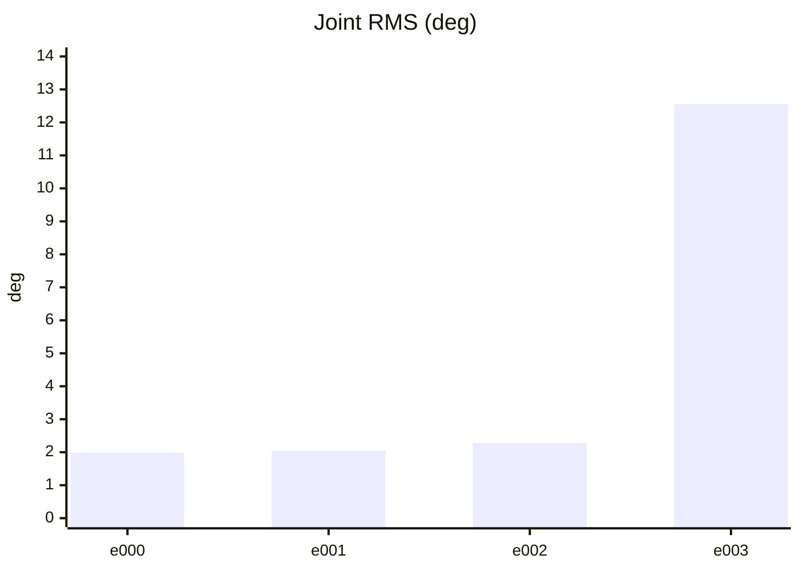

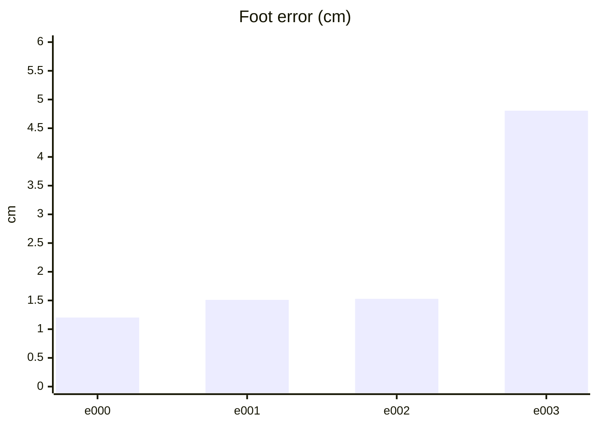

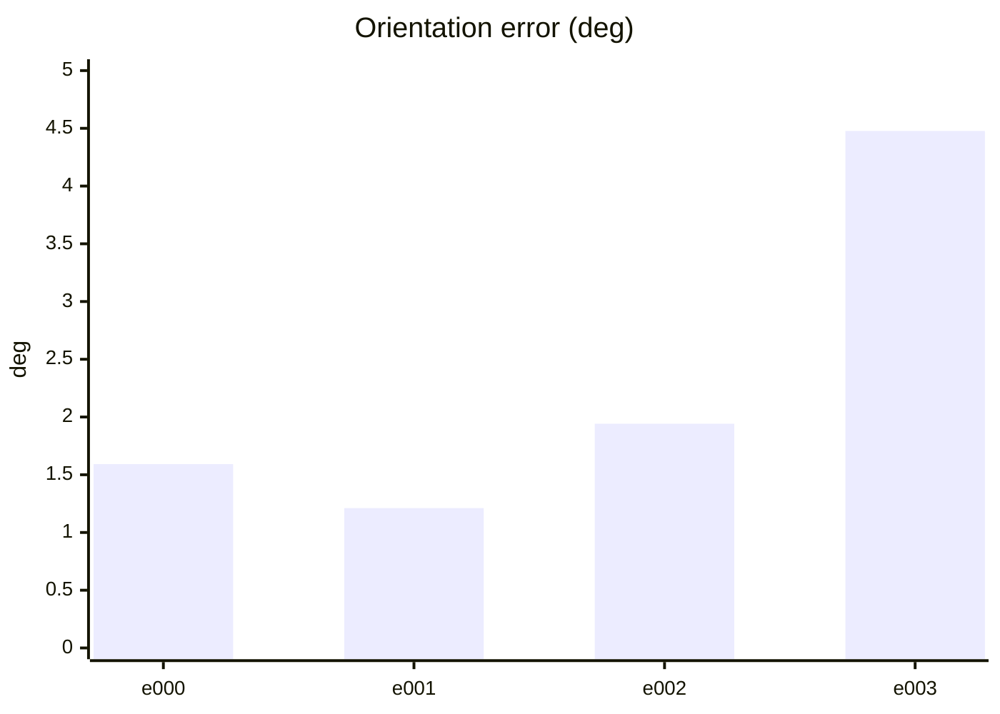

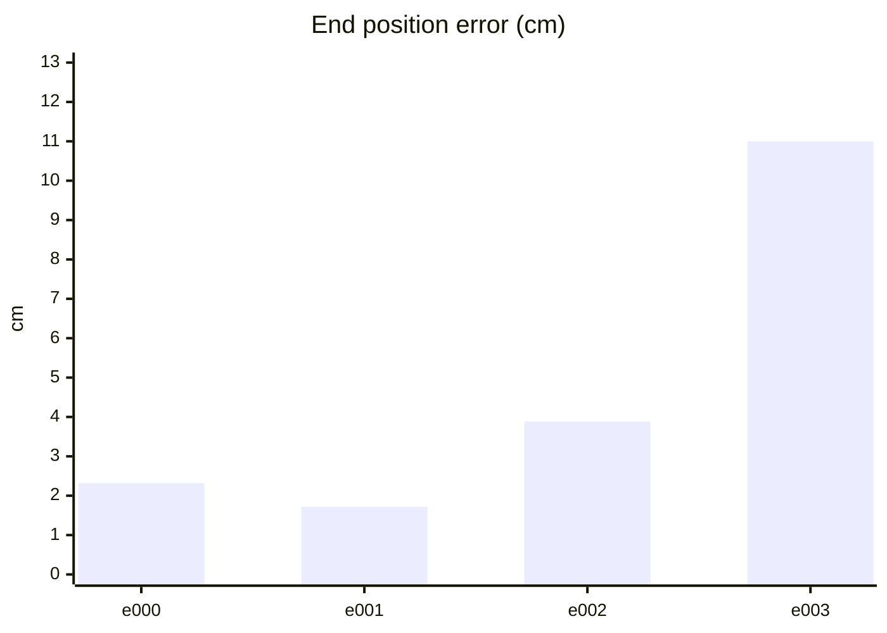

#### PPO 학습 지표 (첫 기록 → 마지막 기록)
| 지표 | 변화 | 간단한 해석 |
| --- | ---: | --- |
| Policy Loss | -0.029 → -0.0273 | 단독으로 좋고 나쁨을 판정하지 않습니다. NaN·급변 여부를 봅니다. |
| Value Loss | 0.026 → 0.0256 | 지속적으로 폭증하지 않고 안정적이면 좋습니다. |
| Approximate KL | 0.157 → 57.9 | 급증하면 정책 변화가 과격할 수 있습니다. 1 이상이면 점검이 필요합니다. |
| Clip Fraction | 미기록 | 과도한 clipping 여부를 볼 지표지만 현재 코드가 기록하지 않습니다. |
| Entropy 관련 손실 | -0.164 → -0.0538 | 원래 Entropy는 미기록입니다. 손실값만으로 성능을 판정하지 않습니다. |
| Gradient Norm | 미기록 | 실제 기울기 크기는 미기록입니다. |
| Explained Variance | 미기록 | 1에 가까울수록 예측력이 좋지만 현재 미기록입니다. |
| Episode Length | 102 → 282 | 길이만으로는 부족합니다. 클립 완료율과 함께 봅니다. |
| 조기 종료율 (낙상) | 0% → 0% | 낮을수록 좋습니다. 전체 조기 종료율은 미기록입니다. |
| 클립 완료율 | 100% → 100% | 높을수록 좋습니다. |

학습 손실보다 아래 평가 CSV의 생존·오차·`pass_all`과 영상을 우선 확인하세요.

#### PPO 지표 추이 (x축: 학습 스텝, y축: 지표 값)

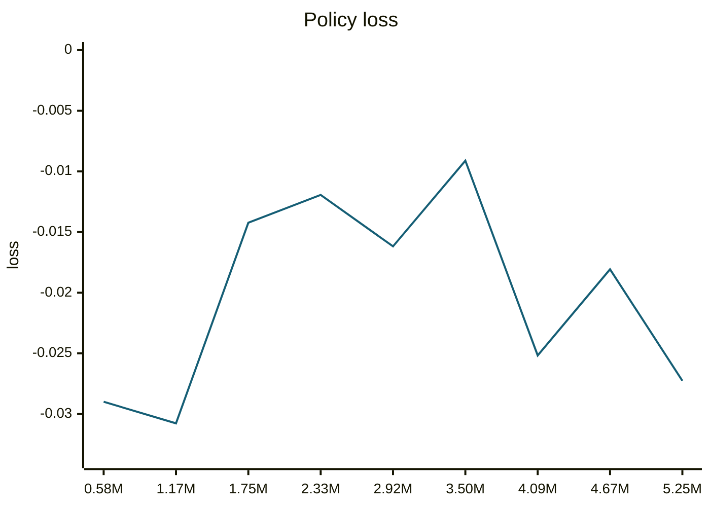

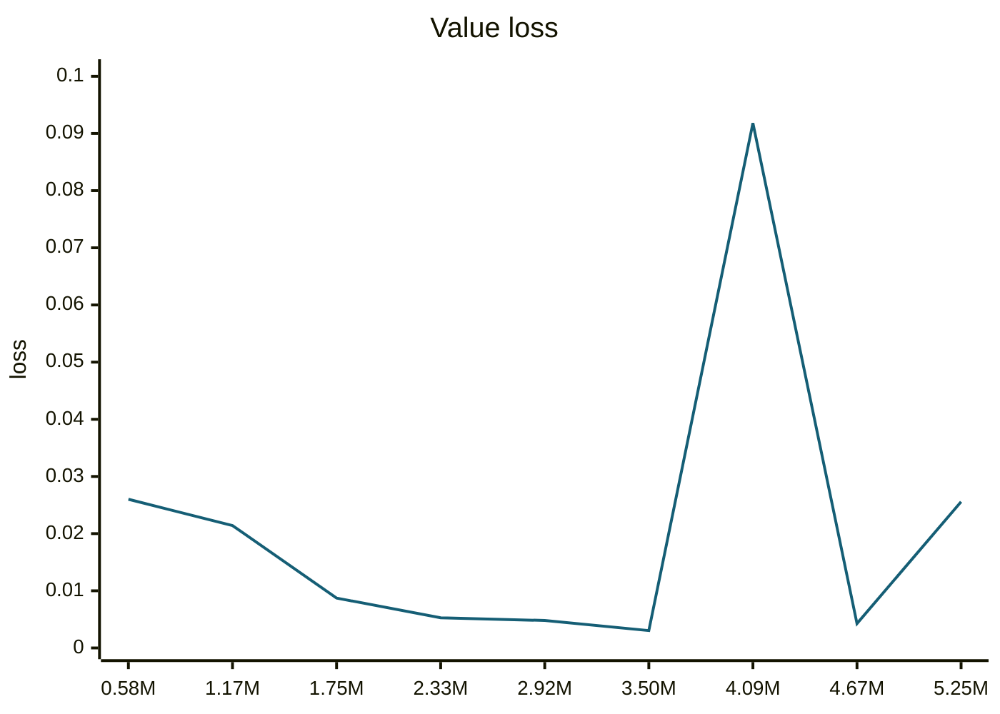

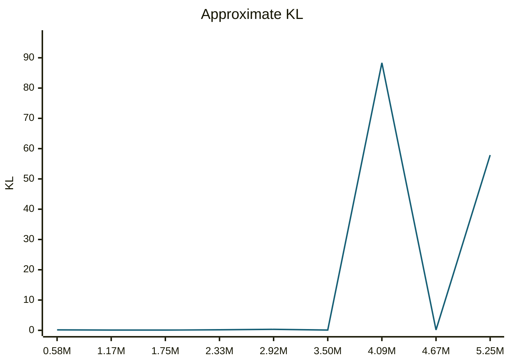

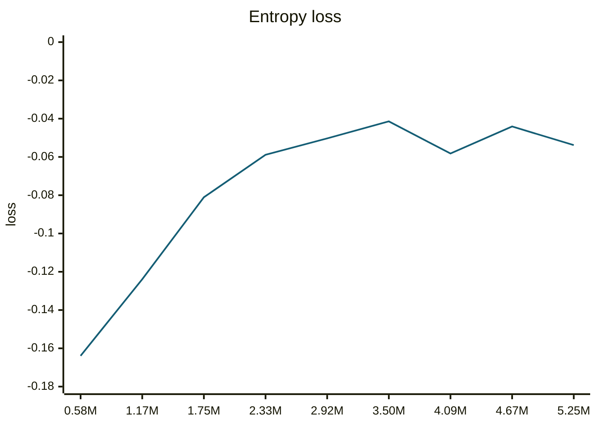

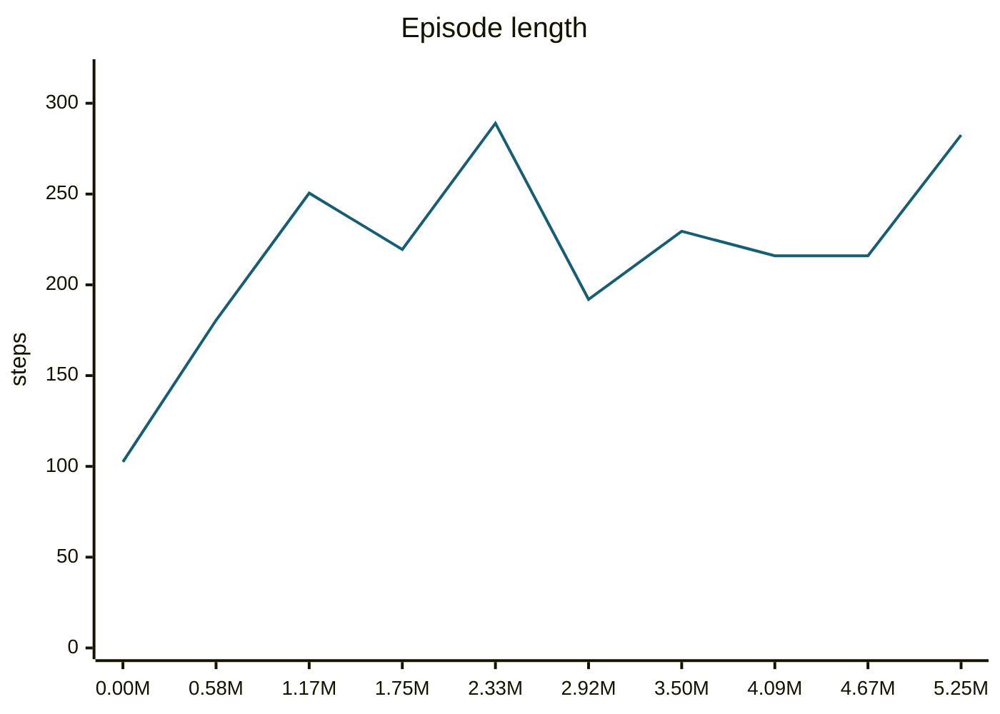

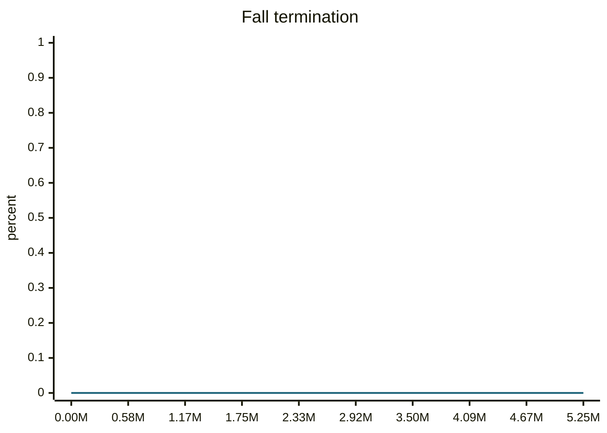

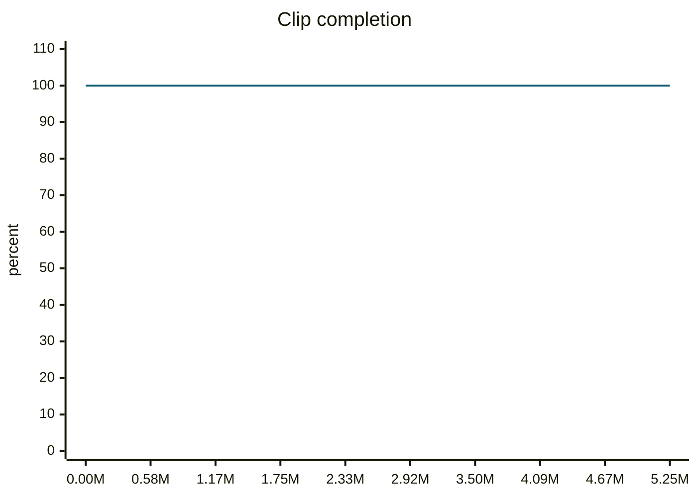

#### motion_eval/summary.csv — `runs/pipeline_v1/experts/walkForwardSlow__r00/wandb/offline-run-20261015_211059-3tzvu60k/motion_eval/summary.csv`
```csv
design,motion,frames,evaluated_frames,survived,joint_rms_deg,foot_err_cm,orn_err_deg,end_pos_err_cm,end_pos_tol_cm,travel_m,contact_agree,ref_infeasible,pass_joint,pass_foot,pass_orn,pass_end_pos,pass_contact,pass_all
e000,walkForwardSlow__r00,236,235,1,1.9887584447860718,1.2032443284988403,1.5923773795523375,2.3181715980172157,7.168099880218507,0.7168099880218506,0.9680851063829787,0.0,1,1,1,1,1,1
e001,walkForwardSlow__r00,236,235,1,2.0535888671875,1.511112928390503,1.2109399382471864,1.7213191837072372,8.57602834701538,0.8576028347015381,0.9702127659574468,0.012711864406779662,1,1,1,1,1,1
e002,walkForwardSlow__r00,236,235,1,2.2764639854431152,1.5292167663574219,1.9420104149937492,3.8806483149528503,8.76904010772705,0.8769040107727051,0.9776595744680852,0.0,1,1,1,1,1,1
e003,walkForwardSlow__r00,236,235,1,12.555456161499023,4.806186676025391,4.476510151211974,11.000048369169235,5.786723494529725,0.5786723494529724,0.9031914893617021,0.00847457627118644,0,0,1,0,1,0
```
