### walkLeftSlow__r00 학습·평가 완료
e000~e002로 학습하고 e003은 미학습 형상으로 평가했습니다.

| 형상 | 생존 | 관절 RMS (°) | 발 오차 (cm) | 자세 오차 (°) | 종료 위치 오차 (cm) | 접지 일치 | 종합 |
| --- | --- | ---: | ---: | ---: | ---: | ---: | --- |
| e000 | 예 | 2.53 | 1.57 | 1.91 | 7.20 | 94.5% | 통과 |
| e001 | 예 | 2.20 | 1.60 | 1.53 | 8.61 | 93.8% | 통과 |
| e002 | 예 | 2.44 | 1.84 | 2.19 | 8.64 | 96.1% | 통과 |
| e003 | 아니요 | 15.65 | 6.43 | 9.45 | 31.23 | 80.2% | 불합격 |

오차는 낮을수록, 접지 일치는 높을수록 좋습니다. e003은 학습에 사용하지 않은 형상입니다.

#### 형상별 평가 오차 (x축: 형상, y축: 오차)

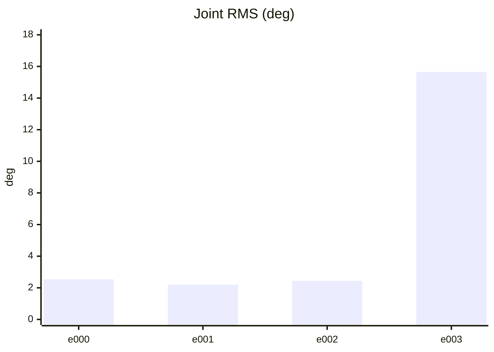

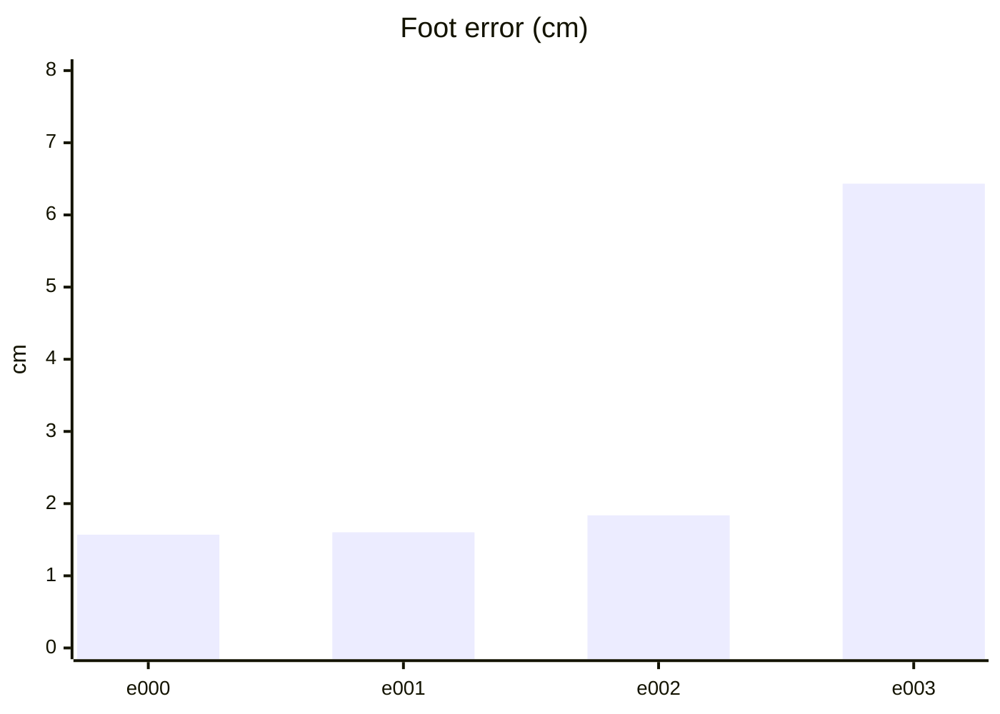

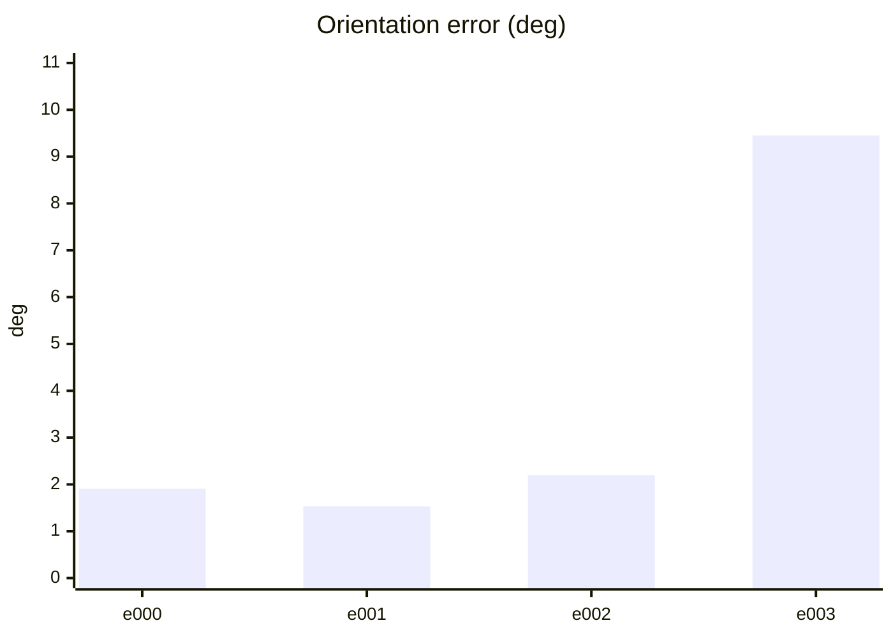

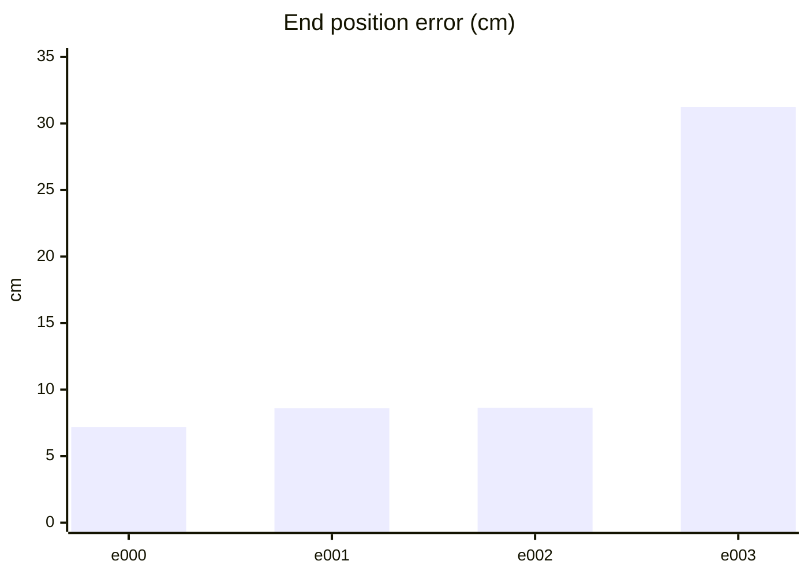

#### PPO 학습 지표 (첫 기록 → 마지막 기록)
| 지표 | 변화 | 간단한 해석 |
| --- | ---: | --- |
| Policy Loss | -0.0237 → -0.0381 | 단독으로 좋고 나쁨을 판정하지 않습니다. NaN·급변 여부를 봅니다. |
| Value Loss | 0.0216 → 0.0369 | 지속적으로 폭증하지 않고 안정적이면 좋습니다. |
| Approximate KL | 0.176 → 28.5 | 급증하면 정책 변화가 과격할 수 있습니다. 1 이상이면 점검이 필요합니다. |
| Clip Fraction | 미기록 | 과도한 clipping 여부를 볼 지표지만 현재 코드가 기록하지 않습니다. |
| Entropy 관련 손실 | -0.162 → -0.0807 | 원래 Entropy는 미기록입니다. 손실값만으로 성능을 판정하지 않습니다. |
| Gradient Norm | 미기록 | 실제 기울기 크기는 미기록입니다. |
| Explained Variance | 미기록 | 1에 가까울수록 예측력이 좋지만 현재 미기록입니다. |
| Episode Length | 178 → 206 | 길이만으로는 부족합니다. 클립 완료율과 함께 봅니다. |
| 조기 종료율 (낙상) | 0% → 0% | 낮을수록 좋습니다. 전체 조기 종료율은 미기록입니다. |
| 클립 완료율 | 100% → 100% | 높을수록 좋습니다. |

학습 손실보다 아래 평가 CSV의 생존·오차·`pass_all`과 영상을 우선 확인하세요.

#### PPO 지표 추이 (x축: 학습 스텝, y축: 지표 값)

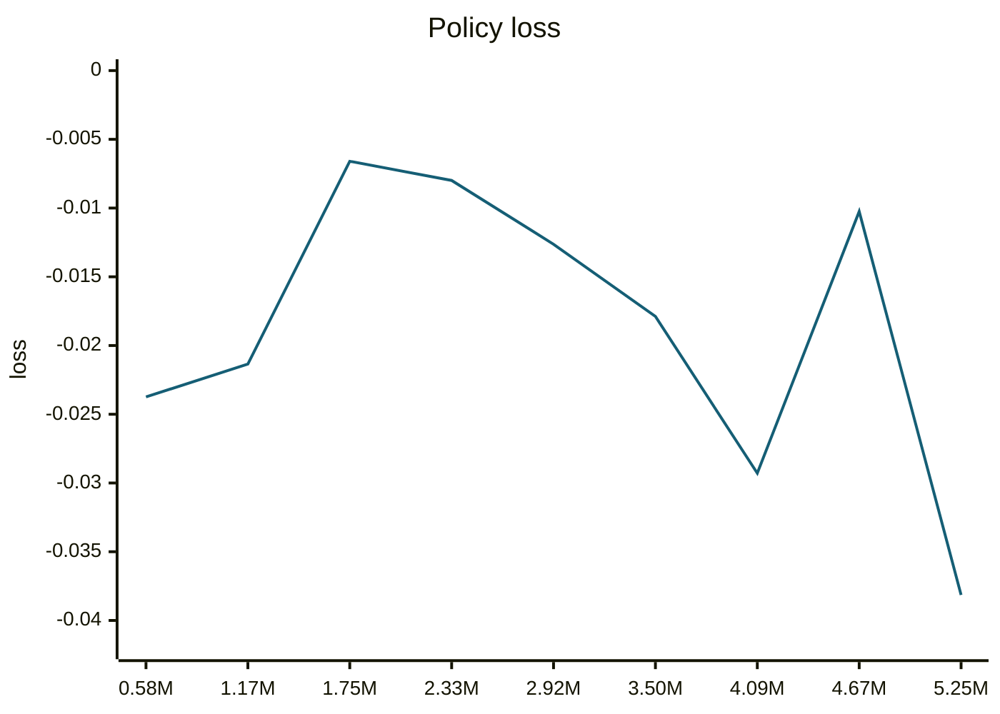

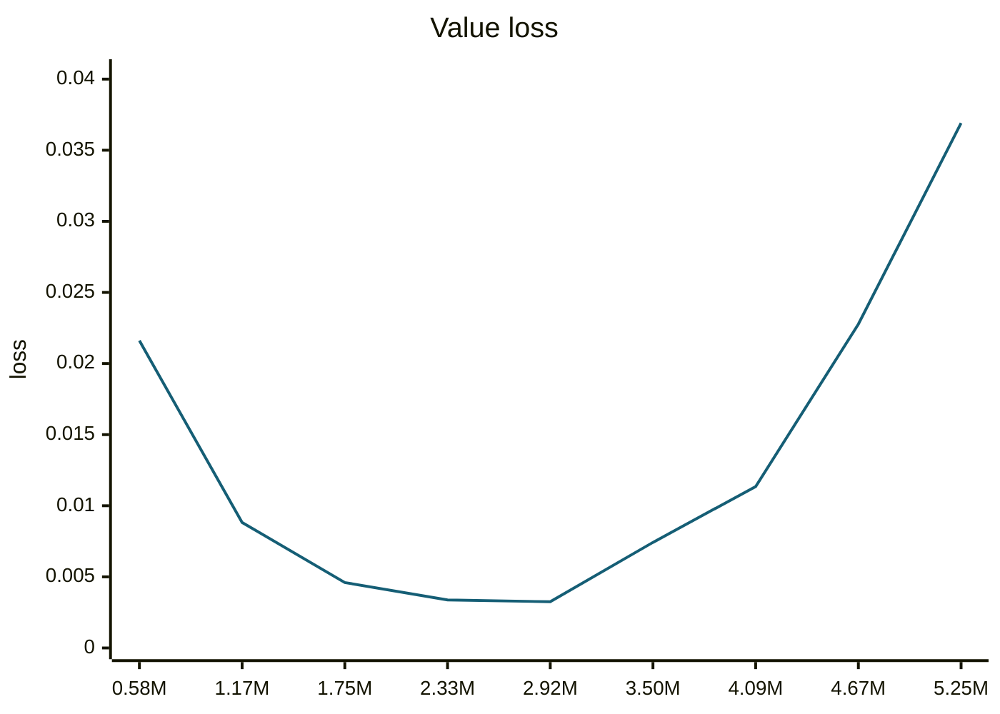

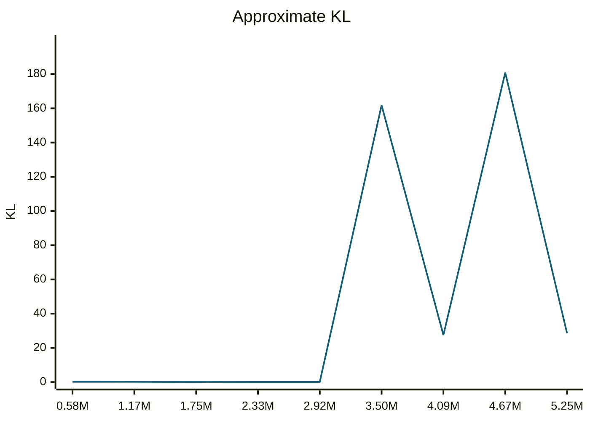

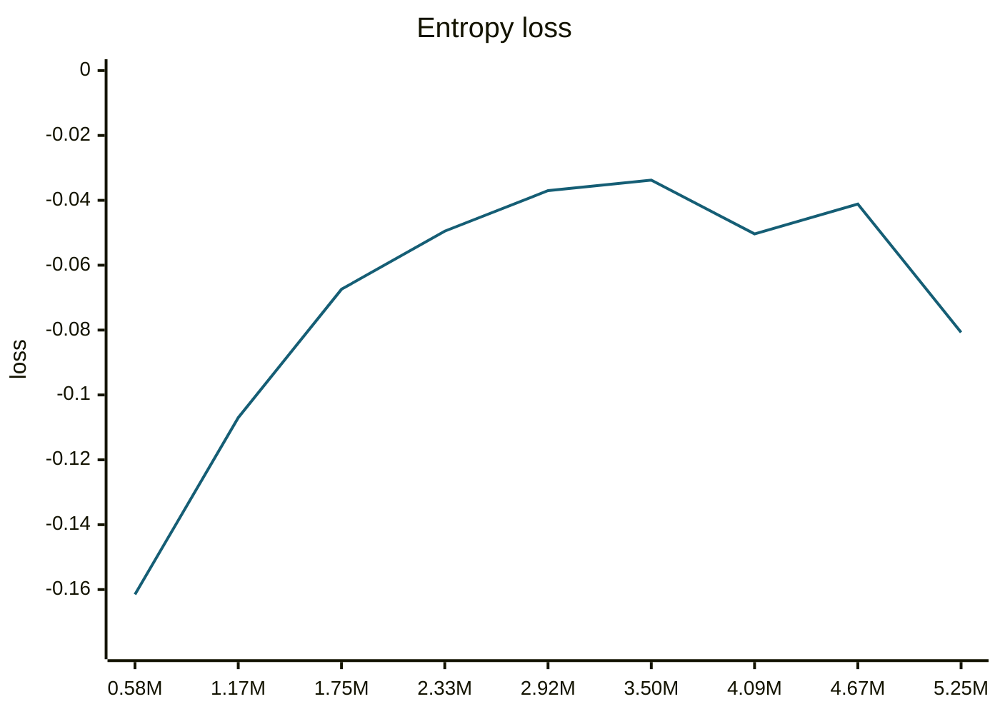

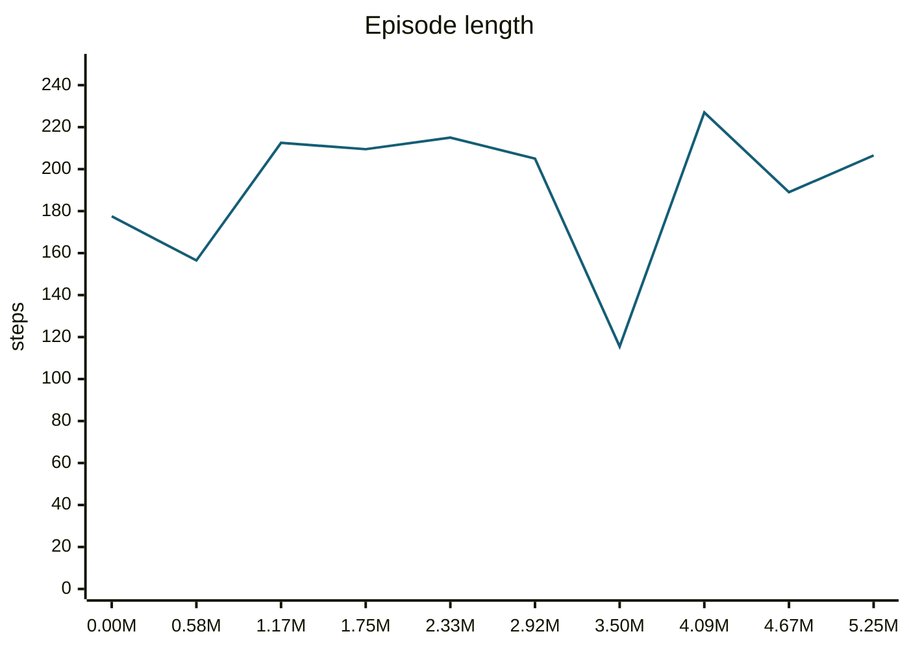

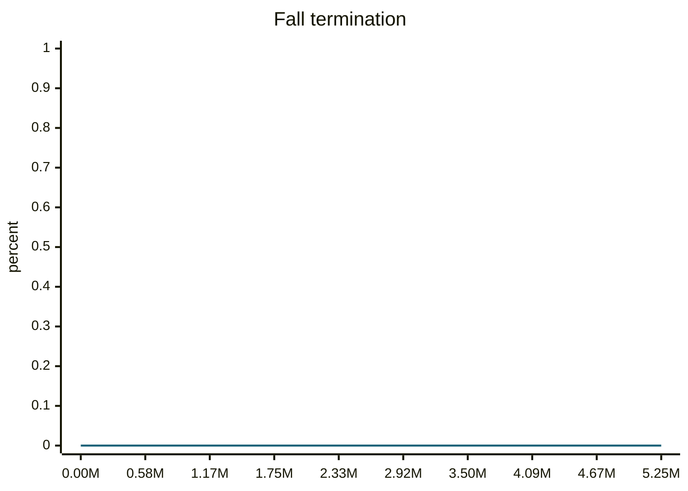

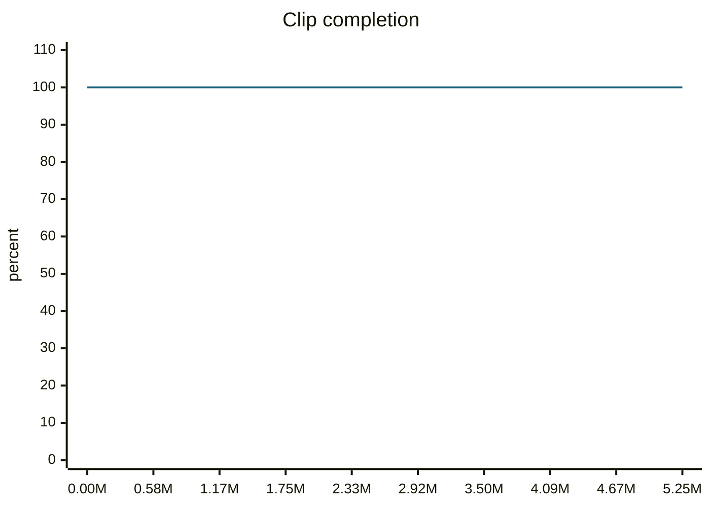

#### motion_eval/summary.csv — `runs/pipeline_v1/experts/walkLeftSlow__r00/wandb/offline-run-20261015_212924-yph5o0iy/motion_eval/summary.csv`
```csv
design,motion,frames,evaluated_frames,survived,joint_rms_deg,foot_err_cm,orn_err_deg,end_pos_err_cm,end_pos_tol_cm,travel_m,contact_agree,ref_infeasible,pass_joint,pass_foot,pass_orn,pass_end_pos,pass_contact,pass_all
e000,walkLeftSlow__r00,182,181,1,2.5348777770996094,1.5700217485427856,1.9110501307545416,7.197452336549759,10.618107318878174,1.0618107318878174,0.9447513812154696,0.06593406593406594,1,1,1,1,1,1
e001,walkLeftSlow__r00,182,181,1,2.196504831314087,1.6031460762023926,1.5326958450929427,8.610141277313232,12.703440189361572,1.2703440189361572,0.9378453038674033,0.06593406593406594,1,1,1,1,1,1
e002,walkLeftSlow__r00,182,181,1,2.441056251525879,1.8382281064987183,2.1945550724842144,8.64301472902298,12.989046573638916,1.2989046573638916,0.9613259668508287,0.06043956043956044,1,1,1,1,1,1
e003,walkLeftSlow__r00,182,106,0,15.649779319763184,6.433274745941162,9.453502806025698,31.226053833961487,8.568052053451538,0.8568052053451538,0.8018867924528302,0.04395604395604396,0,0,0,0,0,0
```
