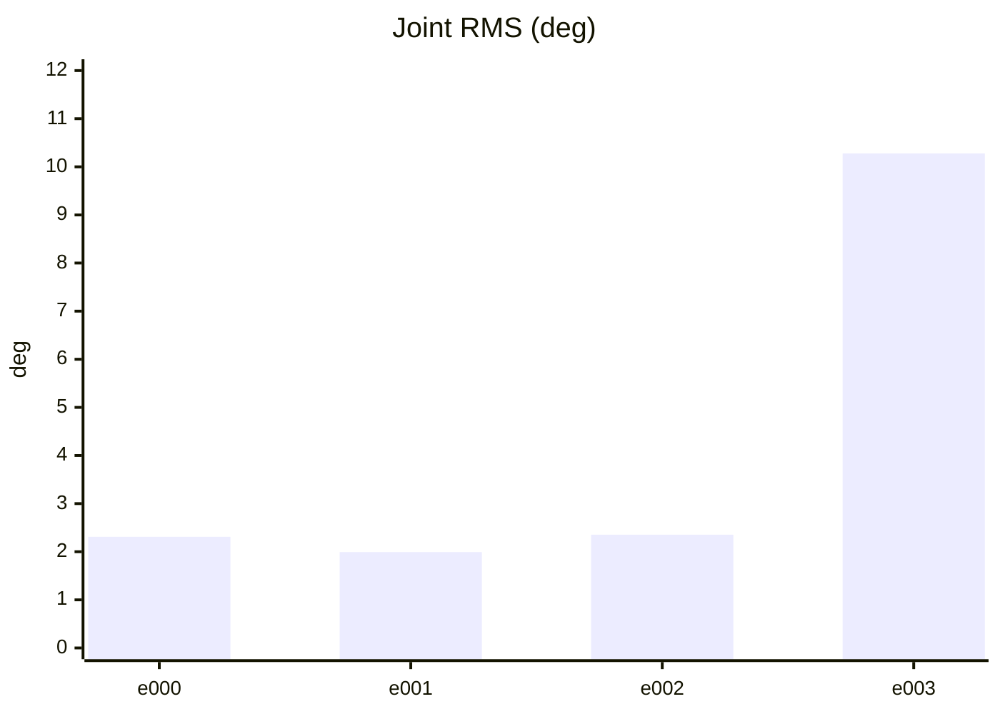
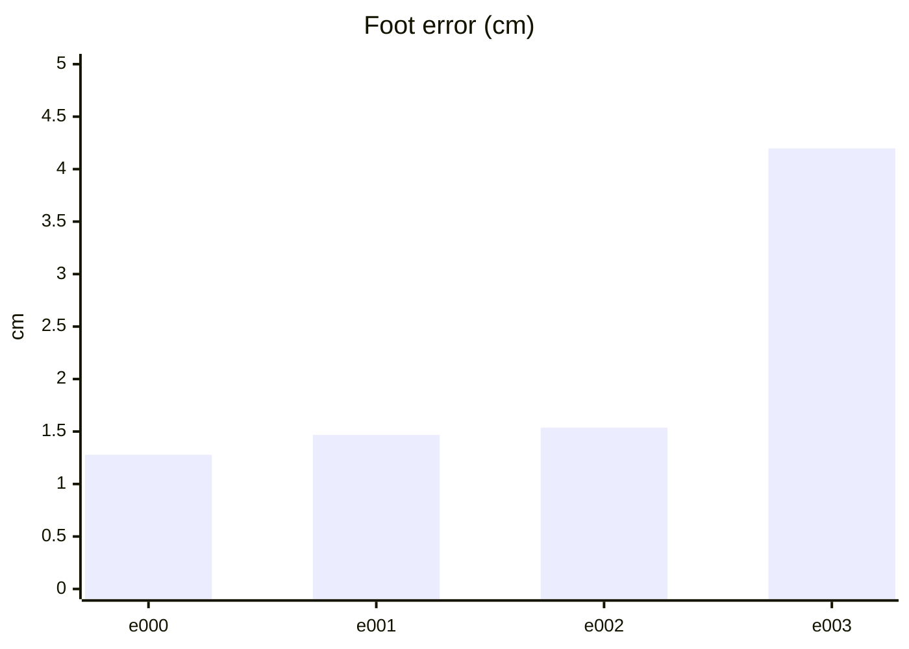
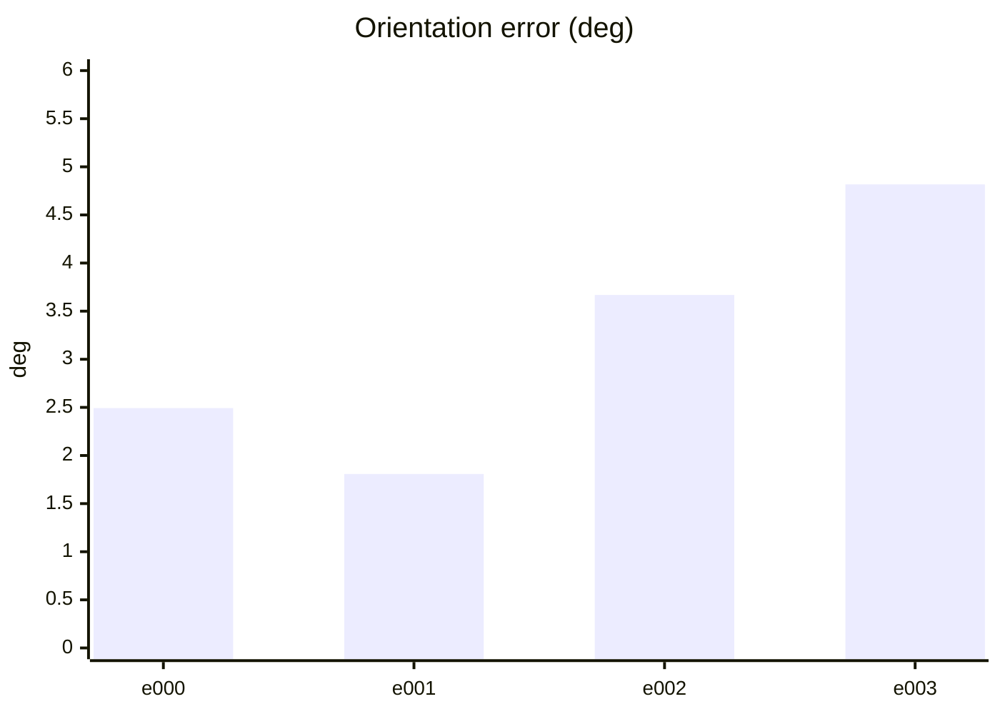
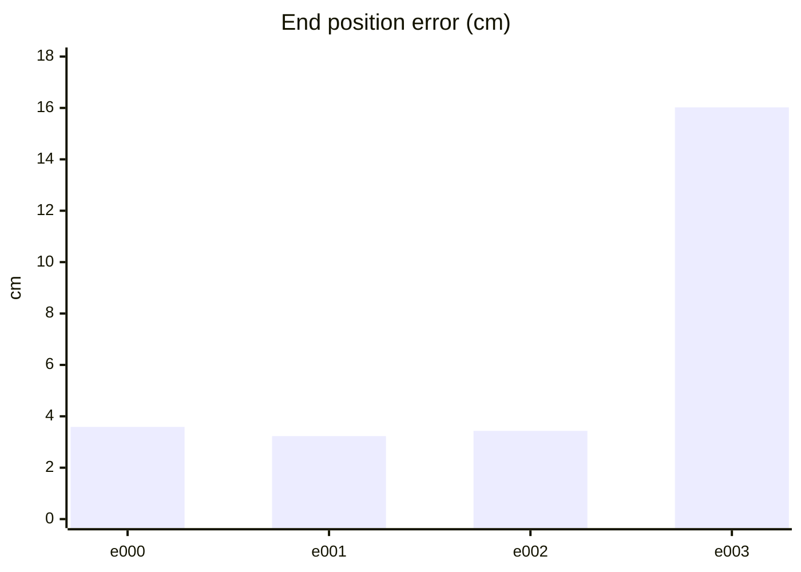
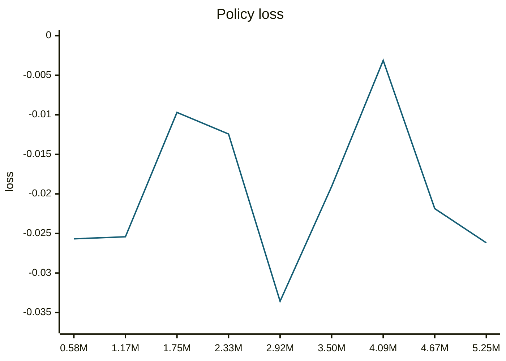
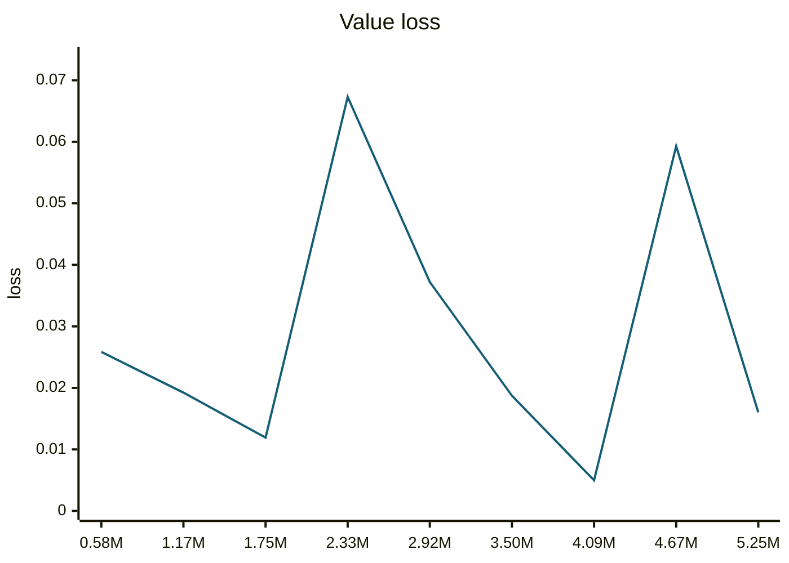
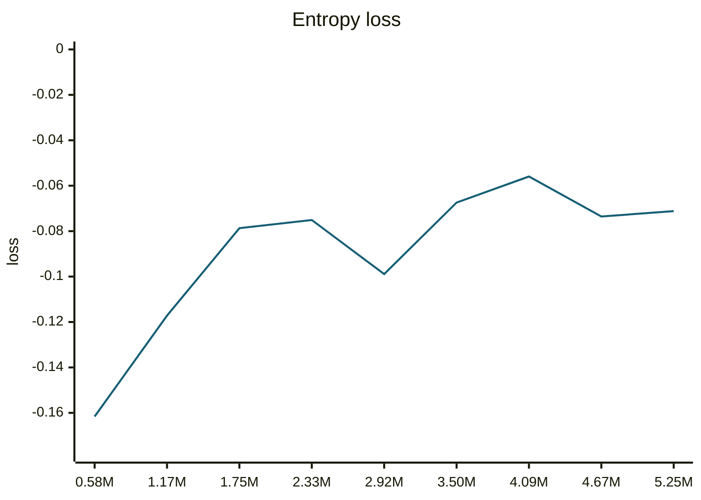
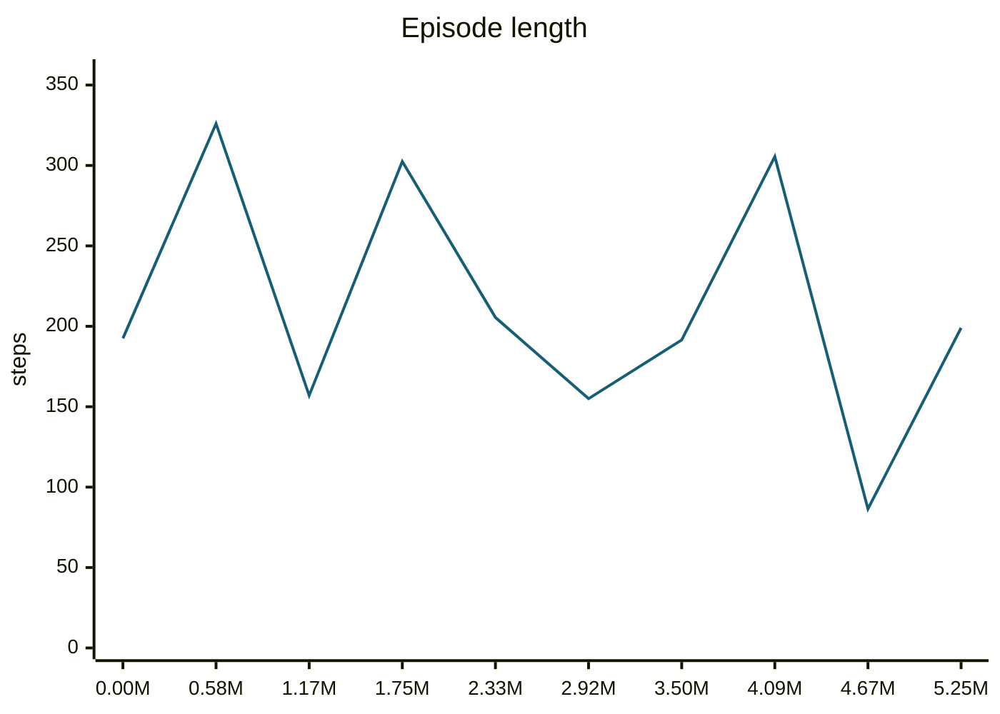
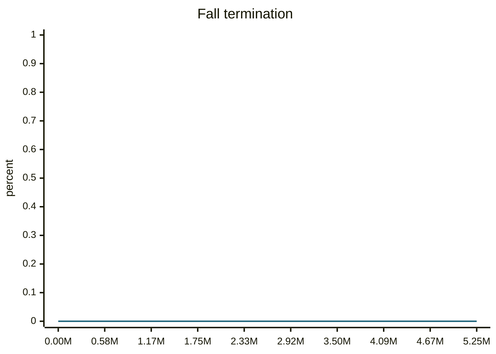
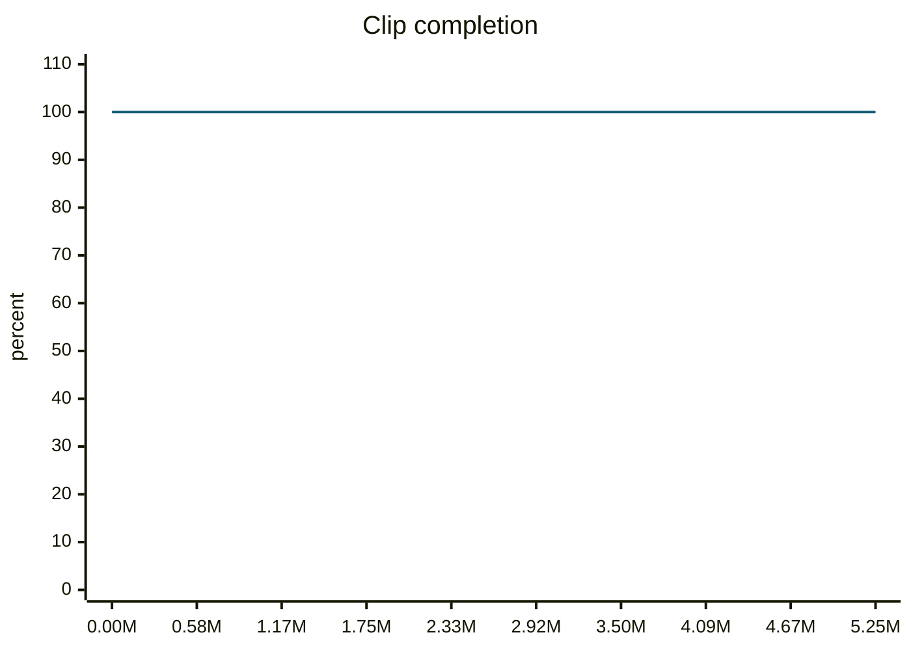

### walkRightSlow__r00 학습·평가 완료
e000~e002로 학습하고 e003은 미학습 형상으로 평가했습니다.

| 형상 | 생존 | 관절 RMS (°) | 발 오차 (cm) | 자세 오차 (°) | 종료 위치 오차 (cm) | 접지 일치 | 종합 |
| --- | --- | ---: | ---: | ---: | ---: | ---: | --- |
| e000 | 예 | 2.31 | 1.28 | 2.49 | 3.59 | 96.2% | 통과 |
| e001 | 예 | 1.99 | 1.47 | 1.81 | 3.23 | 96.3% | 통과 |
| e002 | 예 | 2.35 | 1.54 | 3.67 | 3.43 | 97.5% | 통과 |
| e003 | 예 | 10.28 | 4.20 | 4.82 | 16.02 | 84.3% | 불합격 |

오차는 낮을수록, 접지 일치는 높을수록 좋습니다. e003은 학습에 사용하지 않은 형상입니다.

#### 형상별 평가 오차 (x축: 형상, y축: 오차)









#### PPO 학습 지표 (첫 기록 → 마지막 기록)
| 지표 | 변화 | 간단한 해석 |
| --- | ---: | --- |
| Policy Loss | -0.0257 → -0.0262 | 단독으로 좋고 나쁨을 판정하지 않습니다. NaN·급변 여부를 봅니다. |
| Value Loss | 0.0258 → 0.016 | 지속적으로 폭증하지 않고 안정적이면 좋습니다. |
| Approximate KL | 0.168 → 489 | 급증하면 정책 변화가 과격할 수 있습니다. 1 이상이면 점검이 필요합니다. |
| Clip Fraction | 미기록 | 과도한 clipping 여부를 볼 지표지만 현재 코드가 기록하지 않습니다. |
| Entropy 관련 손실 | -0.162 → -0.0712 | 원래 Entropy는 미기록입니다. 손실값만으로 성능을 판정하지 않습니다. |
| Gradient Norm | 미기록 | 실제 기울기 크기는 미기록입니다. |
| Explained Variance | 미기록 | 1에 가까울수록 예측력이 좋지만 현재 미기록입니다. |
| Episode Length | 192 → 199 | 길이만으로는 부족합니다. 클립 완료율과 함께 봅니다. |
| 조기 종료율 (낙상) | 0% → 0% | 낮을수록 좋습니다. 전체 조기 종료율은 미기록입니다. |
| 클립 완료율 | 100% → 100% | 높을수록 좋습니다. |

학습 손실보다 아래 평가 CSV의 생존·오차·`pass_all`과 영상을 우선 확인하세요.

#### PPO 지표 추이 (x축: 학습 스텝, y축: 지표 값)





```mermaid
---
config:
  theme: base
  themeVariables:
    xyChart:
      plotColorPalette: '#155e75'
  themeCSS: '.line-plot-0 path { stroke-width: 3.5px !important; }'
---
xychart-beta
    title "Approximate KL"
    x-axis ["0.58M", "1.17M", "1.75M", "2.33M", "2.92M", "3.50M", "4.09M", "4.67M", "5.25M"]
    y-axis "KL" 0 --> 1.41e+03
    line [0.1679, 0.1162, 0.7092, 934.5, 103.2, 1.619, 0.2079, 1282, 489.1]
```









#### motion_eval/summary.csv — `runs/pipeline_v1/experts/walkRightSlow__r00/wandb/offline-run-20261015_214747-ni5wybgz/motion_eval/summary.csv`
```csv
design,motion,frames,evaluated_frames,survived,joint_rms_deg,foot_err_cm,orn_err_deg,end_pos_err_cm,end_pos_tol_cm,travel_m,contact_agree,ref_infeasible,pass_joint,pass_foot,pass_orn,pass_end_pos,pass_contact,pass_all
e000,walkRightSlow__r00,227,226,1,2.309619903564453,1.278996229171753,2.4931794696116807,3.5868946462869644,7.027531862258911,0.7027531862258911,0.9623893805309734,0.00881057268722467,1,1,1,1,1,1
e001,walkRightSlow__r00,227,226,1,1.9916448593139648,1.4677374362945557,1.8078890248422192,3.228958696126938,8.407078981399536,0.8407078981399536,0.963495575221239,0.01762114537444934,1,1,1,1,1,1
e002,walkRightSlow__r00,227,226,1,2.354100227355957,1.5366913080215454,3.6682607982688733,3.4339506179094315,8.596565127372742,0.8596565127372742,0.9745575221238938,0.0,1,1,1,1,1,1
e003,walkRightSlow__r00,227,226,1,10.280415534973145,4.198131561279297,4.817263939802497,16.023117303848267,5.6730735301971436,0.5673073530197144,0.8429203539823009,0.01762114537444934,0,0,1,0,0,0
```
